# Learn Ollama 🦙

<div align="center">

[](https://opensource.org/licenses/MIT)
[](https://ollama.com)
[](https://github.com/TheLearningHubOrg/learn-ollama/actions/workflows/ci.yml)
[](https://github.com/TheLearningHubOrg/learn-ollama/releases)
[](https://go.dev)
[](https://github.com/ollama/ollama/tree/main/docs)

**From your first `ollama run` to running private, quantized LLMs in production as a staff-level platform engineer.**  
Server and runner internals, Modelfiles and chat templates, GGUF and quantization maths, the REST and OpenAI-compatible APIs, tool calling, structured outputs, local RAG, GPU sizing and production deployment.

[Getting Started](#1-stage-1-ollama-fundamentals-architecture--first-inference) • [Modelfiles](#2-stage-2-modelfiles-prompt-templates--sampling) • [Quantization](#3-stage-3-gguf-quantization--model-import) • [REST API](#4-stage-4-rest-api-streaming-tool-calling--structured-outputs) • [Clients & RAG](#5-stage-5-client-libraries-embeddings--local-rag) • [Production](#6-stage-6-production-deployment-scaling--observability) • [Interview Prep](#7-stage-7-staff-ollama-platform-engineer-interview-handbook--cheatsheet)

<br/>

<a href="https://www.buymeacoffee.com/manthanank">
  
</a>

</div>

---

## 🗺️ 7-Stage Pedagogical Roadmap

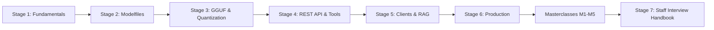

| Stage | Focus Domain | Core Concepts & Engineering Outcomes |
| :--- | :--- | :--- |
| **Stage 1** | **Fundamentals, Architecture & First Inference** | Install on Linux, macOS, Windows and Docker; `ollama pull`, `run`, `ps`, `stop`; `GET /api/version`, `POST /api/chat`; the server/runner split; mmap, GPU layer offload, prefill vs decode; manifests and blobs under `OLLAMA_MODELS`. Outcome: run the Go gateway in this repo against a local model and read its timing numbers. |
| **Stage 2** | **Modelfiles, Prompt Templates & Sampling** | `FROM`, `PARAMETER`, `SYSTEM`, `TEMPLATE`, `MESSAGE`, `ADAPTER`, `LICENSE`; `ollama create`, `show --modelfile`, `cp`, `push`; temperature, `top_k`, `top_p`, `min_p`, `repeat_penalty`; Go `text/template` with `.Messages`; `num_ctx` and KV-cache maths. Outcome: build, lint and publish a custom model. |
| **Stage 3** | **GGUF, Quantization & Model Import** | GGUF header, metadata keys and tensor directory (parsed by `internal/gguf`); Q8_0, Q4_0 and K-quant block maths; choosing Q4_K_M vs Q5_K_M vs Q8_0; `FROM ./model.gguf`, `ollama create --quantize`, llama.cpp `convert_hf_to_gguf.py` and `llama-quantize`; LoRA adapters. Outcome: import and size any open-weight model. |
| **Stage 4** | **REST API, Streaming, Tool Calling & Structured Outputs** | `/api/chat`, `/api/generate`, `/api/embed`, `/api/tags`, `/api/show`, NDJSON streaming, `/v1/chat/completions`, `tools` and `role: "tool"`, `format` with a JSON schema, `images` for vision models. Outcome: integrate Ollama into any HTTP stack. |
| **Stage 5** | **Client Libraries, Embeddings & Local RAG** | Official Python, JavaScript and Go clients; async streaming; schema-validated output; embedding models and task prefixes; an offline RAG pipeline. Outcome: ship a retrieval-augmented assistant with zero external calls. |
| **Stage 6** | **Production Deployment, Scaling & Observability** | `OLLAMA_NUM_PARALLEL`, `OLLAMA_MAX_LOADED_MODELS`, `OLLAMA_KEEP_ALIVE`, `OLLAMA_FLASH_ATTENTION`, `OLLAMA_KV_CACHE_TYPE`; Docker with the NVIDIA Container Toolkit; NGINX streaming proxy; Kubernetes GPU scheduling; health probes and alerts. Outcome: a multi-node, observable inference tier. |
| **Masterclasses** | **Scheduler internals, constrained decoding, agent loops, security, flagship platform** | How models are loaded, evicted and placed on GPUs; how JSON schemas become token masks; multi-step tool loops with thinking models; auth gateways and model supply chain; an air-gapped assistant platform end to end. |
| **Stage 7** | **Staff Interview Handbook** | 50 interview Q&As across core concepts, internals, architecture and production scenarios, plus a one-page cheatsheet. |

---

## 🆕 Ollama Versions, What's New & Migration

Ollama ships often (several releases a month) and uses `0.x` version numbers, so a minor bump can change defaults. This guide targets **0.12 or newer**; anything that depends on a later release says "current stable". Check yours with `ollama --version` (CLI) or `curl -s localhost:11434/api/version` (server). The two can differ when an old daemon is still running after an upgrade.

### V.1 Release Timeline

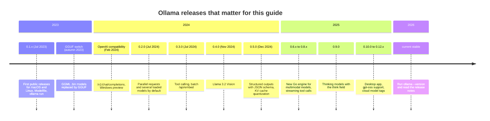

### V.2 Compatibility Matrix

| Platform | Requirement (current stable) | GPU acceleration | Notes |
| --- | --- | --- | --- |
| Linux x86-64 / arm64 | glibc distro, systemd for the service install | NVIDIA CUDA (compute capability 5.0+, recent driver), AMD ROCm on supported cards | `install.sh` creates the `ollama` user and service. Vulkan support is experimental in recent releases. |
| macOS | Apple Silicon or Intel; current builds need a recent macOS (14 Sonoma or newer) | Metal on Apple Silicon | Unified memory lets the GPU use most of system RAM. Intel Macs run on the CPU. |
| Windows 10/11 | 64-bit, 22H2 or newer | NVIDIA CUDA, AMD on supported Radeon cards | Native app; WSL2 also works with the Linux build. |
| Docker | `ollama/ollama` image | `--gpus=all` with the NVIDIA Container Toolkit; `ollama/ollama:rocm` for AMD | No GPU passthrough on Docker Desktop for macOS, so a Mac container is CPU only. |
| Kubernetes | Any conformant cluster | NVIDIA device plugin or GPU operator exposing `nvidia.com/gpu` | Run one Ollama per GPU node; see Stage 6. |

| Ollama feature | First release with it | API surface |
| --- | --- | --- |
| Concurrency (`OLLAMA_NUM_PARALLEL`, `OLLAMA_MAX_LOADED_MODELS`) | 0.1.33, on by default from 0.2.0 | Environment variables |
| Tool calling | 0.3.0 | `tools` in `/api/chat`, `message.tool_calls` |
| Batch embeddings | 0.3.0 | `POST /api/embed` with `input: []` |
| Structured outputs | 0.5.0 | `format: { JSON schema }` |
| KV cache quantization | 0.5.x | `OLLAMA_KV_CACHE_TYPE=q8_0` (needs flash attention) |
| Thinking | 0.9.0 | `think: true` in the request, `message.thinking` in the reply |

### V.3 What's New in Current Stable

#### Structured outputs replace "please answer in JSON"

`format: "json"` only promises syntactically valid JSON. Passing a JSON schema constrains decoding to that shape, so required fields and enum values are enforced while tokens are sampled.

Before:

```bash
curl -s localhost:11434/api/chat -d '{
  "model": "llama3.2:3b", "stream": false, "format": "json",
  "messages": [{"role": "user", "content": "Extract the city and temperature: Pune is 31C today. Reply as JSON."}]
}'
```

After:

```bash
curl -s localhost:11434/api/chat -d '{
  "model": "llama3.2:3b", "stream": false,
  "format": {
    "type": "object",
    "properties": {"city": {"type": "string"}, "celsius": {"type": "number"}},
    "required": ["city", "celsius"]
  },
  "messages": [{"role": "user", "content": "Pune is 31C today."}]
}'
```

#### Thinking is a separate field, not text you strip out

Reasoning models (DeepSeek-R1, Qwen3, gpt-oss and others) used to emit `<think>...</think>` inside `content`, and every client had to cut it out with a regex. With `think` the server separates the two.

Before:

```go
answer := resp.Message.Content
if i := strings.Index(answer, "</think>"); i >= 0 {
	answer = strings.TrimSpace(answer[i+len("</think>"):])
}
```

After:

```bash
curl -s localhost:11434/api/chat -d '{
  "model": "qwen3:8b", "stream": false, "think": true,
  "messages": [{"role": "user", "content": "Is 221 prime?"}]
}' | jq '{thinking: .message.thinking, answer: .message.content}'
```

The starter's `ollama.Message` type already carries a `Thinking` field for this. gpt-oss takes `"low"`, `"medium"` or `"high"` instead of `true`. On the CLI, `ollama run qwen3:8b --think=false` turns it off.

#### Server-wide default context length

The default `num_ctx` used to be 2048 tokens, which silently truncated RAG prompts. It is now larger (4096 since early 2025, and recent releases can choose a bigger default from available VRAM). You can set it once for the whole server instead of in every request or Modelfile.

Before:

```bash
curl -s localhost:11434/api/chat -d '{"model":"llama3.2:3b","options":{"num_ctx":8192},"messages":[...]}'
```

After:

```bash
OLLAMA_CONTEXT_LENGTH=8192 ollama serve
```

`ollama ps` shows the context each loaded model actually got, so you can confirm the setting took effect.

#### Quantized KV cache

The KV cache can be stored as `q8_0` (about half the memory of `f16`) or `q4_0` (about a quarter). It requires flash attention.

Before (8B model, 32K context, f16 cache): about 4 GiB of VRAM for the cache alone.

After:

```bash
OLLAMA_FLASH_ATTENTION=1 OLLAMA_KV_CACHE_TYPE=q8_0 ollama serve
```

Run `go run ./cmd/ggufinfo -ctx 32768 -kv q8_0 model.gguf` from this repo to see the saving for a specific file.

### V.4 Migration Guide (older 0.x → current stable)

```bash
# 1. Upgrade the binary (pick your platform)
curl -fsSL https://ollama.com/install.sh | sh        # Linux: reinstalls and restarts the service
brew upgrade ollama                                   # macOS with Homebrew
winget upgrade Ollama.Ollama                          # Windows
docker pull ollama/ollama && docker compose up -d     # Docker

# 2. Confirm the running server, not only the CLI, is new
curl -s localhost:11434/api/version

# 3. Re-pull models whose templates changed (pull only downloads changed layers)
ollama list | awk 'NR>1 {print $1}' | xargs -n1 ollama pull

# 4. Find code that still calls the old embeddings endpoint
grep -rn "api/embeddings" --include=*.{go,py,ts,js} .

# 5. Find Modelfiles that still use the single-turn template variables
grep -rln "{{ .Prompt }}" --include=*Modelfile* .
```

Code changes, in the order you will hit them:

| Old | New | Why |
| --- | --- | --- |
| `POST /api/embeddings` with `prompt` → `embedding` | `POST /api/embed` with `input` (string or array) → `embeddings` | Batching and normalised vectors. |
| `format: "json"` plus "reply in JSON" in the prompt | `format: <JSON schema>` | Enforced shape, not only valid syntax. |
| Stripping `<think>` from `content` | `think: true`, read `message.thinking` | Server-side separation. |
| `context` array returned by `/api/generate` and sent back | `/api/chat` with a `messages` array | The `context` field is deprecated. |
| `TEMPLATE` built on `.Prompt` / `.Response` | `TEMPLATE` that ranges over `.Messages` (and `.Tools`) | Multi-turn and tool calls need the full list. |
| Hard-coded `num_ctx` in every request | `OLLAMA_CONTEXT_LENGTH` on the server, `num_ctx` only where a request needs more | One place to change it. |

### V.5 Deprecations & Breaking Changes

| Version | Deprecated / removed | Replacement | What breaks and how to fix it |
| --- | --- | --- | --- |
| autumn 2023 | GGML `.bin` model files | GGUF | Old files fail to load. Re-download a GGUF build or convert with llama.cpp (Stage 3). |
| 0.3.0 | `/api/embeddings` (still answers, no new features) | `/api/embed` | Response key changes from `embedding` to `embeddings` (a list). Update the parser. |
| 0.5.x | Implicit 2048-token default context | Larger default, `OLLAMA_CONTEXT_LENGTH` | Tests that relied on truncation now see longer prompts and more VRAM use. Pin `num_ctx` where it matters. |
| 0.9.0 | `<think>` blocks inside `content` for thinking models (when `think` is set) | `message.thinking` | Regex strippers become no-ops; switch to the field. |
| ongoing | `context` field of `/api/generate` | `/api/chat` messages | Still works, but new features land in chat first. |
| ongoing | GGML-format LoRA `.bin` adapters | GGUF or safetensors adapters | `ADAPTER ./x.bin` fails. Convert with `convert_lora_to_gguf.py` or point at the safetensors directory. |

---

## 📋 Table of Contents

- [1. Stage 1: Ollama Fundamentals, Architecture & First Inference](#1-stage-1-ollama-fundamentals-architecture--first-inference)
  - [1.1 What Ollama Is and the Problem It Solves](#11-what-ollama-is-and-the-problem-it-solves)
  - [1.2 Installing Ollama on Linux, macOS, Windows and Docker](#12-installing-ollama-on-linux-macos-windows-and-docker)
  - [1.3 First Inference: CLI, REST and the Go Client](#13-first-inference-cli-rest-and-the-go-client)
  - [1.4 Server and Runner Architecture](#14-server-and-runner-architecture)
  - [1.5 Memory: mmap, GPU Layer Offload and the Prefill/Decode Split](#15-memory-mmap-gpu-layer-offload-and-the-prefilldecode-split)
  - [1.6 Model Storage: Names, Manifests and Blobs](#16-model-storage-names-manifests-and-blobs)
  - [1.7 Configuring the Server with Environment Variables](#17-configuring-the-server-with-environment-variables)
  - [1.8 Line-by-Line Breakdown of the Starter Gateway](#18-line-by-line-breakdown-of-the-starter-gateway)
  - [1.9 Pitfalls](#19-pitfalls)
  - [1.10 Best Practices](#110-best-practices)
  - [1.11 Hands-on Exercise](#111-hands-on-exercise)
- [2. Stage 2: Modelfiles, Prompt Templates & Sampling](#2-stage-2-modelfiles-prompt-templates--sampling)
  - [2.1 The Modelfile Mental Model](#21-the-modelfile-mental-model)
  - [2.2 Instruction Reference](#22-instruction-reference)
  - [2.3 Runtime Parameters and Where They Are Set](#23-runtime-parameters-and-where-they-are-set)
  - [2.4 How Sampling Works: temperature, top_k, top_p, min_p and repeat_penalty](#24-how-sampling-works-temperature-top_k-top_p-min_p-and-repeat_penalty)
  - [2.5 Chat Templates: Go text/template and Special Tokens](#25-chat-templates-go-texttemplate-and-special-tokens)
  - [2.6 Context Window and KV-Cache Memory](#26-context-window-and-kv-cache-memory)
  - [2.7 Production Modelfiles](#27-production-modelfiles)
  - [2.8 Build, Inspect, Copy and Publish Models](#28-build-inspect-copy-and-publish-models)
  - [2.9 Linting Modelfiles with the Starter](#29-linting-modelfiles-with-the-starter)
  - [2.10 Pitfalls](#210-pitfalls)
  - [2.11 Best Practices](#211-best-practices)
  - [2.12 Hands-on Exercise](#212-hands-on-exercise)
- [3. Stage 3: GGUF, Quantization & Model Import](#3-stage-3-gguf-quantization--model-import)
  - [3.1 GGUF File Anatomy](#31-gguf-file-anatomy)
  - [3.2 How Block Quantization Works: Q8_0 and Q4_0](#32-how-block-quantization-works-q8_0-and-q4_0)
  - [3.3 K-Quants and Mixed Precision](#33-k-quants-and-mixed-precision)
  - [3.4 Choosing a Quantization: Size, Quality and Speed](#34-choosing-a-quantization-size-quality-and-speed)
  - [3.5 Importing a GGUF File](#35-importing-a-gguf-file)
  - [3.6 Importing Safetensors and Quantizing with ollama create](#36-importing-safetensors-and-quantizing-with-ollama-create)
  - [3.7 Converting with the llama.cpp Toolchain](#37-converting-with-the-llamacpp-toolchain)
  - [3.8 LoRA Adapters](#38-lora-adapters)
  - [3.9 Pitfalls](#39-pitfalls)
  - [3.10 Best Practices](#310-best-practices)
  - [3.11 Hands-on Exercise](#311-hands-on-exercise)
- [4. Stage 4: REST API, Streaming, Tool Calling & Structured Outputs](#4-stage-4-rest-api-streaming-tool-calling--structured-outputs)
  - [4.1 Native REST API Overview](#41-native-rest-api-overview)
  - [4.2 Chat Completion and Response Metrics](#42-chat-completion-and-response-metrics)
  - [4.3 Streaming NDJSON in Go](#43-streaming-ndjson-in-go)
  - [4.4 Vector Embeddings (`POST /api/embed`)](#44-vector-embeddings-post-apiembed)
  - [4.5 OpenAI-Compatible Endpoints (`/v1`)](#45-openai-compatible-endpoints-v1)
  - [4.6 Tool Calling](#46-tool-calling)
  - [4.7 Structured Outputs with JSON Schema](#47-structured-outputs-with-json-schema)
  - [4.8 Multimodal Vision Input](#48-multimodal-vision-input)
  - [4.9 Pitfalls](#49-pitfalls)
  - [4.10 Best Practices](#410-best-practices)
  - [4.11 Hands-on Exercise](#411-hands-on-exercise)
- [5. Stage 5: Client Libraries, Embeddings & Local RAG](#5-stage-5-client-libraries-embeddings--local-rag)
  - [5.1 Choosing a Client](#51-choosing-a-client)
  - [5.2 Python: Async Calls with Schema-Validated Output](#52-python-async-calls-with-schema-validated-output)
  - [5.3 JavaScript and Go: Streaming](#53-javascript-and-go-streaming)
  - [5.4 Embedding Models and Retrieval Quality](#54-embedding-models-and-retrieval-quality)
  - [5.5 An Air-Gapped Local RAG Pipeline](#55-an-air-gapped-local-rag-pipeline)
  - [5.6 Pitfalls](#56-pitfalls)
  - [5.7 Best Practices](#57-best-practices)
  - [5.8 Hands-on Exercise](#58-hands-on-exercise)
- [6. Stage 6: Production Deployment, Scaling & Observability](#6-stage-6-production-deployment-scaling--observability)
  - [6.1 Concurrency and Memory Settings](#61-concurrency-and-memory-settings)
  - [6.2 Docker with NVIDIA GPU Passthrough](#62-docker-with-nvidia-gpu-passthrough)
  - [6.3 Load Balancing with NGINX](#63-load-balancing-with-nginx)
  - [6.4 Health Checks and Observability](#64-health-checks-and-observability)
  - [6.5 Kubernetes Deployment](#65-kubernetes-deployment)
  - [6.6 Pitfalls](#66-pitfalls)
  - [6.7 Best Practices](#67-best-practices)
  - [6.8 Hands-on Exercise](#68-hands-on-exercise)
- [M1. Masterclass: Scheduler, Memory Budgeting & Model Residency](#m1-masterclass-scheduler-memory-budgeting--model-residency)
  - [M1.1 How the Scheduler Decides Where a Model Runs](#m11-how-the-scheduler-decides-where-a-model-runs)
  - [M1.2 Worked Example: Two Models on a 16 GiB GPU](#m12-worked-example-two-models-on-a-16-gib-gpu)
  - [M1.3 Trade-offs](#m13-trade-offs)
  - [M1.4 Production Checklist](#m14-production-checklist)
- [M2. Masterclass: Constrained Decoding & Structured Output Internals](#m2-masterclass-constrained-decoding--structured-output-internals)
  - [M2.1 How a JSON Schema Becomes a Token Mask](#m21-how-a-json-schema-becomes-a-token-mask)
  - [M2.2 Worked Example](#m22-worked-example)
  - [M2.3 Trade-offs](#m23-trade-offs)
  - [M2.4 Production Checklist](#m24-production-checklist)
- [M3. Masterclass: Agentic Tool-Calling Loops & Thinking Models](#m3-masterclass-agentic-tool-calling-loops--thinking-models)
  - [M3.1 How a Tool Loop Runs](#m31-how-a-tool-loop-runs)
  - [M3.2 Worked Example: The Loop in Go](#m32-worked-example-the-loop-in-go)
  - [M3.3 Trade-offs](#m33-trade-offs)
  - [M3.4 Production Checklist](#m34-production-checklist)
- [M4. Masterclass: Securing Ollama: Auth Gateways, Multi-Tenancy & Supply Chain](#m4-masterclass-securing-ollama-auth-gateways-multi-tenancy--supply-chain)
  - [M4.1 Where Security Has to Live](#m41-where-security-has-to-live)
  - [M4.2 Worked Example](#m42-worked-example)
  - [M4.3 Trade-offs](#m43-trade-offs)
  - [M4.4 Production Checklist](#m44-production-checklist)
- [M5. Masterclass: Flagship Blueprint: An Air-Gapped Private Assistant Platform](#m5-masterclass-flagship-blueprint-an-air-gapped-private-assistant-platform)
  - [M5.1 Architecture](#m51-architecture)
  - [M5.2 Build Steps](#m52-build-steps)
  - [M5.3 Trade-offs](#m53-trade-offs)
  - [M5.4 Production Checklist](#m54-production-checklist)
- [7. Stage 7: Staff Ollama Platform Engineer Interview Handbook & Cheatsheet](#7-stage-7-staff-ollama-platform-engineer-interview-handbook--cheatsheet)
  - [7.1 Core Concepts (Q1-Q10)](#71-core-concepts-q1-q10)
  - [7.2 Internals & Performance (Q11-Q20)](#72-internals--performance-q11-q20)
  - [7.3 Architecture & Design (Q21-Q30)](#73-architecture--design-q21-q30)
  - [7.4 Scenario & Debugging Questions (Q31-Q50)](#74-scenario--debugging-questions-q31-q50)
  - [7.5 Staff Cheatsheet](#75-staff-cheatsheet)
- [🧪 Example Projects](#-example-projects)
- [📝 Cheat Sheets](#-cheat-sheets)
- [📚 Resources](#-resources)
- [🤝 Contributing](#-contributing)
- [📄 License](#-license)
- [🙏 Acknowledgments](#-acknowledgments)
- [🌐 Connect with me](#-connect-with-me)
- [☕ Support](#-support)

---

## 1. Stage 1: Ollama Fundamentals, Architecture & First Inference

This stage installs Ollama, runs a model from the CLI and over HTTP, and explains what happens between the request and the first token: the server, the scheduler, the runner process, memory mapping and GPU offload. No prior LLM experience is needed, only a terminal and `curl`. By the end you can run the Go gateway in this repo against a local model and explain every number in its response.

The examples in this guide use Ollama's own interfaces first (CLI, REST, Modelfile), and **Go** for application code. Ollama itself is written in Go, its official Go client (`github.com/ollama/ollama/api`) lives in the main repo, and Go's standard library is enough to talk to the API with every byte visible. Stage 5 also shows the official Python and JavaScript clients side by side, because those are what most application teams reach for.

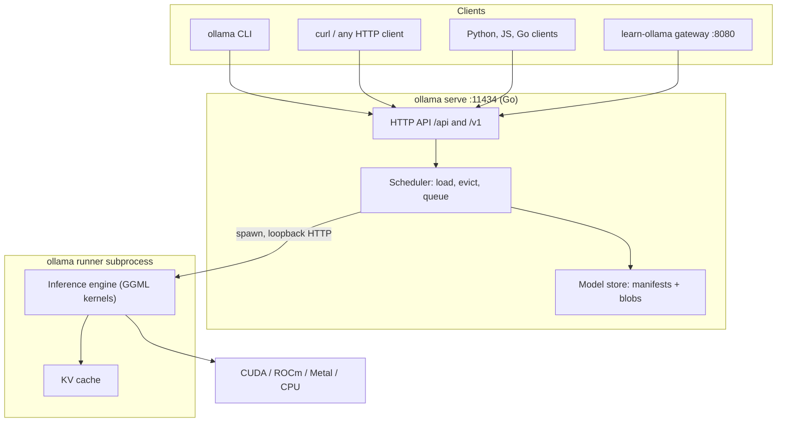

### 1.1 What Ollama Is and the Problem It Solves

Ollama is a single binary that downloads open-weight language models, stores them, loads them onto whatever accelerator the machine has, and serves them over a local HTTP API. It packages three things that used to be separate chores:

1. **A model registry client.** `ollama pull llama3.2:3b` fetches a manifest and content-addressed layers, much like `docker pull`.
2. **A runtime.** The server picks a GPU backend, decides how many transformer layers fit in VRAM, and starts an inference process with the GGML tensor library underneath (the same kernels llama.cpp uses).
3. **An API.** A native REST API on port 11434 plus an OpenAI-compatible `/v1` surface, so existing client code works by changing the base URL.

Teams pick it for data that cannot leave the building (health records, source code, legal documents), for offline or air-gapped sites, for predictable cost (hardware you already own instead of per-token billing), and for a fast inner loop on a laptop.

| Option | Best at | Weak at | Choose it when |
| --- | --- | --- | --- |
| **Ollama** | One-command setup, model management, Mac/Windows/Linux parity, OpenAI-compatible API | Very high concurrency on big GPU clusters | Developer machines, internal services, edge boxes, single-GPU servers |
| llama.cpp `llama-server` | Every low-level knob, newest quant types first | You manage GGUF files, templates and flags yourself | You need a flag Ollama does not expose |
| vLLM / SGLang / TGI | Throughput with continuous batching and paged attention on data-centre GPUs | Heavier install, mostly Linux + NVIDIA/AMD, safetensors weights | Hundreds of concurrent users per GPU |
| LM Studio | Desktop GUI for trying models | Headless servers and automation | Non-developers exploring models |
| Hosted APIs | Frontier-size models, zero ops | Data leaves your network, per-token cost | The task needs a model larger than you can host |

### 1.2 Installing Ollama on Linux, macOS, Windows and Docker

Linux installs a binary in `/usr/local/bin`, GPU libraries under `/usr/local/lib/ollama`, an `ollama` system user and a systemd unit:

```bash
curl -fsSL https://ollama.com/install.sh | sh
systemctl status ollama --no-pager
journalctl -u ollama -f          # live server log: GPU detection, model loads, errors
```

macOS and Windows use the desktop app, which starts the server in the background and adds the `ollama` CLI to your `PATH`:

```bash
# macOS: download the app from ollama.com, or
brew install ollama && ollama serve

# Windows (PowerShell)
winget install Ollama.Ollama
```

Docker keeps everything in one container and one named volume:

```bash
# CPU only
docker run -d --name ollama -p 11434:11434 -v ollama:/root/.ollama ollama/ollama

# NVIDIA GPU (needs the NVIDIA Container Toolkit on the host)
docker run -d --name ollama --gpus=all -p 11434:11434 -v ollama:/root/.ollama ollama/ollama

docker exec -it ollama ollama run llama3.2:3b
```

Server settings are environment variables. On Linux, put them in a systemd drop-in rather than editing the unit file, which the installer overwrites:

```bash
sudo systemctl edit ollama.service
```

```ini
[Service]
# Listen on every interface (only behind a firewall or reverse proxy, see Stage 6)
Environment="OLLAMA_HOST=0.0.0.0:11434"
# Allow browser apps from your internal domain, never "*" on a reachable host
Environment="OLLAMA_ORIGINS=https://*.internal.example"
Environment="OLLAMA_KEEP_ALIVE=30m"
Environment="OLLAMA_CONTEXT_LENGTH=8192"
```

```bash
sudo systemctl daemon-reload && sudo systemctl restart ollama
curl -s http://localhost:11434/api/version
# {"version":"..."}   the running server's version
curl -s http://localhost:11434/
# Ollama is running
```

On macOS the app reads variables set with `launchctl setenv OLLAMA_HOST 0.0.0.0:11434` (then restart the app). On Windows, set them as user environment variables and quit and reopen Ollama from the tray.

### 1.3 First Inference: CLI, REST and the Go Client

```bash
ollama pull llama3.2:3b                 # ~2 GB download, Q4_K_M by default
ollama run llama3.2:3b "Explain DNS in one sentence."
ollama run llama3.2:3b --verbose        # interactive, prints timings after each reply
```

`--verbose` prints the same counters the API returns. A typical run on a laptop GPU:

```text
total duration:       1.92s
load duration:        21ms
prompt eval count:    31 token(s)
prompt eval duration: 48ms
prompt eval rate:     645.83 tokens/s
eval count:           118 token(s)
eval duration:        1.83s
eval rate:            64.48 tokens/s
```

| Counter | Meaning | What a bad value tells you |
| --- | --- | --- |
| `load duration` | Time to get the model ready. Near zero when it is already resident. | Seconds on every call: the model is being evicted (raise `OLLAMA_KEEP_ALIVE`). |
| `prompt eval` | Prefill: the whole prompt processed in parallel. | Low rate on long prompts: CPU fallback or no flash attention. |
| `eval` | Decode: one token at a time. | Single-digit tokens/s on a GPU box: layers spilled to CPU (check `ollama ps`). |

Inside `ollama run`, slash commands change the session without restarting:

| Command | Effect |
| --- | --- |
| `/set parameter num_ctx 8192` | Change a runtime option for this session. |
| `/set system "Answer in French."` | Replace the system prompt. |
| `/show info` | Architecture, parameter count, context length, quantization. |
| `/save mymodel` | Save the current session settings as a new model. |
| `/clear` | Forget the conversation. |
| `/bye` | Exit (Ctrl+D also works). |

The same request over HTTP. `stream` defaults to `true`, which returns one JSON object per line (NDJSON):

```bash
curl -s http://localhost:11434/api/chat -d '{
  "model": "llama3.2:3b",
  "messages": [{"role": "user", "content": "Name three Linux init systems."}]
}'
```

```json
{"model":"llama3.2:3b","created_at":"...","message":{"role":"assistant","content":"Here"},"done":false}
{"model":"llama3.2:3b","created_at":"...","message":{"role":"assistant","content":" are"},"done":false}
{"model":"llama3.2:3b","created_at":"...","message":{"role":"assistant","content":""},"done":true,"done_reason":"stop","total_duration":812345678,"load_duration":20123456,"prompt_eval_count":32,"prompt_eval_duration":51234567,"eval_count":24,"eval_duration":701234567}
```

Only the last object has `done: true` and the timing fields. Durations are nanoseconds, so decode speed is `eval_count / eval_duration * 1e9`. The starter's client in Go:

```go
package main

import (
	"context"
	"fmt"
	"log"

	"github.com/TheLearningHubOrg/learn-ollama/internal/ollama"
)

func main() {
	c := ollama.New("") // defaults to http://127.0.0.1:11434
	resp, err := c.Chat(context.Background(), ollama.ChatRequest{
		Model:    "llama3.2:3b",
		Messages: []ollama.Message{{Role: "user", Content: "Name three Linux init systems."}},
	})
	if err != nil {
		log.Fatal(err)
	}
	fmt.Println(resp.Message.Content)
	fmt.Printf("%d tokens at %.1f tokens/s\n", resp.EvalCount, resp.TokensPerSecond())
}
```

### 1.4 Server and Runner Architecture

`ollama serve` is a long-lived Go process. It never runs the neural network itself. When a request names a model that is not loaded, the scheduler starts a **runner**: the same `ollama` binary launched as a child process (`ollama runner --model <blob> --port <n> ...`). The server then talks to it over HTTP on a loopback port and relays tokens back to the client.

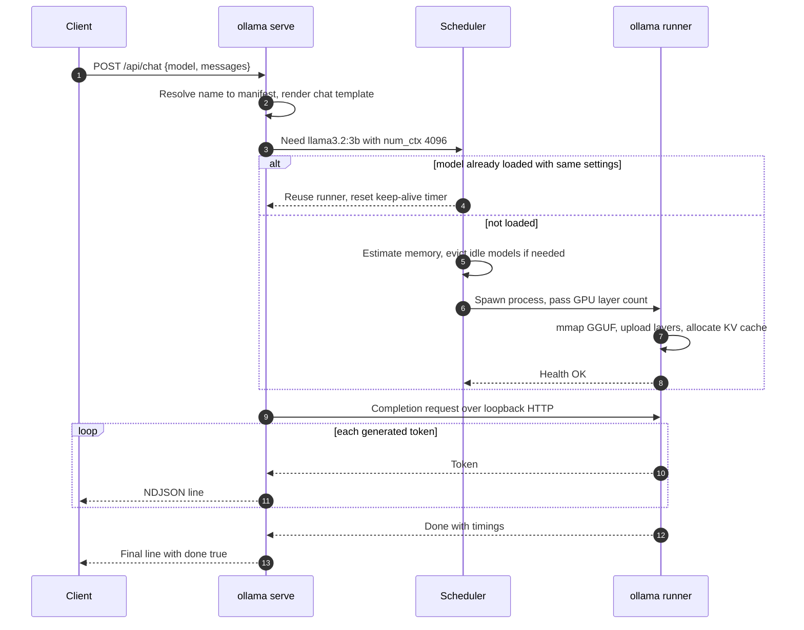

Why the split matters in practice:

| Design choice | Benefit | What you see when it matters |
| --- | --- | --- |
| Inference in a child process | A GPU driver fault or out-of-memory abort kills the runner, not the API server | Log line such as `llama runner process has terminated`; the next request starts a fresh runner |
| One runner per loaded model | Different models (or the same model with a different `num_ctx`) get separate memory budgets | Changing `num_ctx` in a request reloads the model, adding seconds of latency |
| Backend libraries chosen at load time | One install works on CUDA, ROCm, Metal or CPU | `OLLAMA_DEBUG=1` logs show which library was picked and why |
| Two engines | Newer model families run on Ollama's own Go engine built on GGML; others run through the llama.cpp-based path | Some models need a minimum Ollama version; the pull fails with a version error on older servers |

### 1.5 Memory: mmap, GPU Layer Offload and the Prefill/Decode Split

A transformer is a stack of identical blocks (28 for Llama 3.2 3B, 32 for Llama 3.1 8B, 80 for 70B). Before starting a runner, the scheduler estimates the memory each block needs (its weights plus its share of the KV cache) and puts as many blocks as fit on the GPU. The rest run on the CPU from system RAM.

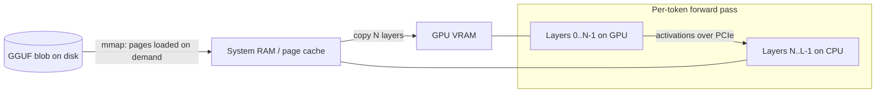

- **mmap** maps the file into the process's address space. The OS reads pages when they are first touched and can drop clean pages under memory pressure without writing anything back. A second load of the same model is fast because the pages are still in the page cache.
- **Full offload** (`100% GPU` in `ollama ps`) is the goal. **Partial offload** (`48%/52% CPU/GPU`) works but each token crosses the PCIe bus and the CPU layers run at system-RAM bandwidth, so speed drops sharply.
- **Prefill** processes every prompt token at once. It is compute-bound and fast (hundreds or thousands of tokens/s).
- **Decode** produces one token per forward pass, and every pass reads every weight once. It is bound by memory bandwidth, which gives a simple ceiling:

```text
max decode tokens/s  ≈  memory bandwidth (GB/s)  /  model size in memory (GB)
RTX 4090:  ~1008 GB/s / 4.9 GB (8B Q4_K_M)  ≈  205 tokens/s ceiling, ~110-150 in practice
Dual-channel DDR5 desktop CPU: ~80 GB/s / 4.9 GB  ≈  16 tokens/s ceiling
```

The starter encodes the same rule:

```go
// internal/sizing/sizing.go
func MaxDecodeTokensPerSecond(bandwidthGBps, modelGB float64) float64 {
	if modelGB <= 0 {
		return 0
	}
	return round2(bandwidthGBps / modelGB)
}
```

Check placement for every loaded model:

```bash
ollama ps
# NAME           ID            SIZE     PROCESSOR          CONTEXT  UNTIL
# llama3.1:8b    46e0c10c039e  6.9 GB   100% GPU           8192     29 minutes from now
# llama3.1:70b   711a9e8463af  47 GB    62%/38% CPU/GPU    4096     4 minutes from now
```

`SIZE` here is the loaded footprint (weights plus KV cache plus buffers), so it is larger than the download size in `ollama list`.

### 1.6 Model Storage: Names, Manifests and Blobs

A model name has up to four parts. Omitted parts take defaults:

```text
registry.ollama.ai / library / llama3.2 : 3b
└── host            └── namespace └── model └── tag (default "latest")
```

`llama3.2:3b` and `registry.ollama.ai/library/llama3.2:3b` are the same model. Your own uploads live under your namespace (`yourname/acme-coder:v1`).

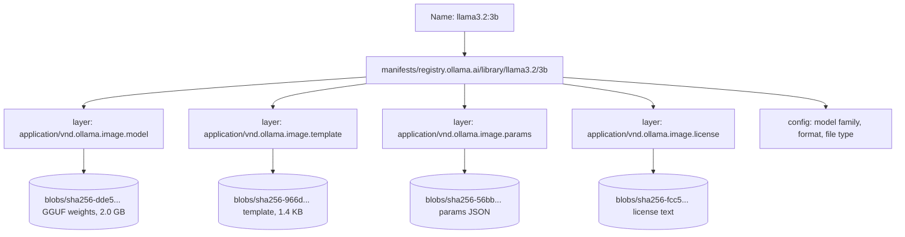

Default store locations (override with `OLLAMA_MODELS`):

| Install | Path |
| --- | --- |
| Linux service | `/usr/share/ollama/.ollama/models` |
| macOS | `~/.ollama/models` |
| Windows | `C:\Users\<you>\.ollama\models` |
| Docker image | `/root/.ollama/models` (mount a volume here) |

A manifest is a small JSON document in the Docker distribution format:

```json
{
  "schemaVersion": 2,
  "mediaType": "application/vnd.docker.distribution.manifest.v2+json",
  "config": {"mediaType": "application/vnd.docker.container.image.v1+json", "digest": "sha256:34bb...", "size": 561},
  "layers": [
    {"mediaType": "application/vnd.ollama.image.model", "digest": "sha256:dde5...", "size": 2019377376},
    {"mediaType": "application/vnd.ollama.image.template", "digest": "sha256:966d...", "size": 1429},
    {"mediaType": "application/vnd.ollama.image.params", "digest": "sha256:56bb...", "size": 96}
  ]
}
```

Because blobs are addressed by their SHA-256, a custom model built `FROM llama3.2:3b` with a new system prompt adds one tiny `system` layer and reuses the 2 GB weights blob. `ollama rm` deletes the manifest, and blobs no longer referenced by any manifest are pruned.

The `model` layer is a plain GGUF file, so any GGUF tool can read it in place:

```bash
BLOB=$(ollama show llama3.2:3b --modelfile | awk '/^FROM \//{print $2}')
go run ./cmd/ggufinfo "$BLOB"
```

### 1.7 Configuring the Server with Environment Variables

| Variable | Default | What it controls | Typical production value |
| --- | --- | --- | --- |
| `OLLAMA_HOST` | `127.0.0.1:11434` | Bind address for `serve`; also where the CLI connects | `0.0.0.0:11434` in containers |
| `OLLAMA_MODELS` | per-OS path above | Model store directory | A fast local NVMe path |
| `OLLAMA_KEEP_ALIVE` | `5m` | How long an idle model stays loaded (`-1` = forever, `0` = unload now) | `30m` to `24h` for latency-sensitive services |
| `OLLAMA_CONTEXT_LENGTH` | 4096 or VRAM-based (current stable) | Default `num_ctx` when a request does not set one | Size of your longest real prompt |
| `OLLAMA_NUM_PARALLEL` | auto | Requests one loaded model serves at once | 2-8, limited by KV-cache memory |
| `OLLAMA_MAX_LOADED_MODELS` | auto (about 3 per GPU) | Distinct models resident at once | 2 (chat + embedding) |
| `OLLAMA_MAX_QUEUE` | 512 | Requests waiting before the server answers 503 | Lower it so overload fails fast |
| `OLLAMA_ORIGINS` | localhost origins | Extra CORS origins for browser clients | Exact internal domains |
| `OLLAMA_FLASH_ATTENTION` | model-dependent | Flash attention kernels | `1` on modern GPUs |
| `OLLAMA_KV_CACHE_TYPE` | `f16` | KV cache precision: `f16`, `q8_0`, `q4_0` | `q8_0` when context is large |
| `OLLAMA_DEBUG` | off | Verbose logs: GPU discovery, memory estimates | `1` while diagnosing |

The CLI is a client of the server, and it reads the same `OLLAMA_HOST`. That makes remote use simple:

```bash
OLLAMA_HOST=gpu-box.internal:11434 ollama ps
OLLAMA_HOST=gpu-box.internal:11434 ollama run llama3.1:8b
```

### 1.8 Line-by-Line Breakdown of the Starter Gateway

The repo's starter is a small Go service that sits in front of Ollama. It shows the patterns you need when you put Ollama behind your own API: configuration from the environment, a typed client, validation, health checks and graceful shutdown. It uses only the standard library.

```text
cmd/server/main.go          entry point: env config, HTTP server, graceful shutdown
cmd/ggufinfo/main.go        CLI that prints a GGUF header and a memory estimate (Stage 3)
internal/ollama/client.go   typed client for /api/version, /api/tags, /api/chat (+ streaming)
internal/server/server.go   gateway routes: /health, /api/models, /api/ask, /api/modelfile/lint, /api/estimate
internal/modelfile/         Modelfile parser and linter (Stage 2)
internal/sizing/            weights + KV cache memory estimator (Stages 2 and 3)
internal/gguf/              GGUF header reader (Stage 3)
examples/                   sampling and template demos, example Modelfiles
```

The entry point:

```go
func main() {
	port := envOr("PORT", "8080")
	host := envOr("OLLAMA_HOST", ollama.DefaultHost)

	srv := &server.Server{
		Ollama:       ollama.New(host),
		DefaultModel: envOr("OLLAMA_MODEL", "llama3.2:3b"),
	}

	httpServer := &http.Server{
		Addr:              "0.0.0.0:" + port,
		Handler:           srv.Routes(),
		ReadHeaderTimeout: 10 * time.Second,
	}

	ctx, stop := signal.NotifyContext(context.Background(), os.Interrupt, syscall.SIGTERM)
	defer stop()

	go func() {
		if err := httpServer.ListenAndServe(); err != nil && !errors.Is(err, http.ErrServerClosed) {
			log.Fatal(err)
		}
	}()

	<-ctx.Done()
	shutdownCtx, cancel := context.WithTimeout(context.Background(), 10*time.Second)
	defer cancel()
	_ = httpServer.Shutdown(shutdownCtx)
}
```

| Line / API | Role | What happens at runtime |
| :--- | :--- | :--- |
| `envOr("OLLAMA_HOST", ollama.DefaultHost)` | Reuse Ollama's own variable | The same value the `ollama` CLI reads, so one setting points both at the server. `ollama.New` adds `http://` to a bare `host:port`. |
| `ollama.New(host)` | Build the client | Creates an `http.Client` with a 10-minute ceiling; per-request deadlines come from the request context. |
| `Addr: "0.0.0.0:" + port` | Bind all interfaces | Inside a container, `127.0.0.1` would be unreachable from the host. |
| `ReadHeaderTimeout` | Slowloris guard | A client that never finishes its headers is dropped after 10 s. |
| `signal.NotifyContext` | Graceful stop | `docker stop` sends SIGTERM; the context is cancelled and `Shutdown` lets in-flight requests finish. |
| `httpServer.Shutdown` | Drain | Stops accepting connections, waits up to 10 s for active handlers. |

The `/api/ask` handler shows what a thin gateway adds on top of `/api/chat`:

```go
func (s *Server) ask(w http.ResponseWriter, r *http.Request) {
	var in askRequest
	dec := json.NewDecoder(http.MaxBytesReader(w, r.Body, maxBody))
	dec.DisallowUnknownFields()
	if err := dec.Decode(&in); err != nil {
		writeError(w, http.StatusBadRequest, "invalid JSON body: "+err.Error())
		return
	}
	if strings.TrimSpace(in.Prompt) == "" {
		writeError(w, http.StatusBadRequest, "prompt is required")
		return
	}
	// ... build messages, call s.Ollama.Chat, map timings to the response
}
```

| Line / API | Role | What happens at runtime |
| :--- | :--- | :--- |
| `http.MaxBytesReader(..., 1 MiB)` | Bound input size | A 2 GB body is cut off instead of filling memory. |
| `DisallowUnknownFields()` | Strict contract | `{"temperature": 2}` is rejected with 400 instead of being silently ignored. |
| `s.Ollama.Chat(r.Context(), req)` | Upstream call | If the caller disconnects, the context is cancelled and the request to Ollama is aborted, which stops generation. |
| `writeUpstreamError` | Error mapping | Ollama's 404 ("model not found, try pulling it first") stays a 404; anything else becomes 502. |

Run it against a local Ollama:

```bash
go run ./cmd/server                                   # listens on :8080
curl -s localhost:8080/health                         # {"status":"ok"}
curl -s 'localhost:8080/health?deep=1'                # also calls Ollama's /api/version
curl -s localhost:8080/api/models
curl -s localhost:8080/api/ask -d '{"prompt":"Say hi in five words","system":"Be cheerful"}'
# {"model":"llama3.2:3b","answer":"Hi there, lovely friend!","prompt_tokens":24,
#  "completion_tokens":7,"tokens_per_second":71.3,"load_ms":18}
```

Or run both with Docker Compose (the gateway image is the multi-stage `Dockerfile` in the repo root):

```bash
docker compose up -d --build
docker compose exec ollama ollama pull llama3.2:3b
curl -s localhost:8080/api/ask -d '{"prompt":"Say hi in five words"}'
```

`/health` deliberately does not call Ollama. An orchestrator restarting the gateway because the model server is slow would make things worse; `?deep=1` exists for dashboards that want the dependency status.

### 1.9 Pitfalls

| Pitfall | Symptom | Fix |
| --- | --- | --- |
| CLI and server versions differ after an upgrade | New model fails with `pull model manifest: 412: The model you are attempting to pull requires a newer version of Ollama` even though `ollama --version` is new | Restart the server (`systemctl restart ollama`, quit the tray app) and check `curl localhost:11434/api/version`. |
| Port already in use | `Error: listen tcp 127.0.0.1:11434: bind: address already in use` when running `ollama serve` | The desktop app or service is already running. Use it, or stop it before starting a foreground server. |
| Server bound to localhost inside a container | Gateway logs `dial tcp 172.18.0.2:11434: connect: connection refused` | Set `OLLAMA_HOST=0.0.0.0:11434` in the Ollama container (the official image already does). |
| Env vars set in your shell, not for the service | `OLLAMA_HOST` change has no effect on the systemd service | Use `systemctl edit ollama.service`, `launchctl setenv` on macOS, or system env vars on Windows, then restart. |
| Model silently on CPU | `ollama ps` shows `100% CPU`; 3-8 tokens/s | Check `journalctl -u ollama` for GPU discovery errors (driver too old, missing `--gpus=all` in Docker). |
| Calling a model that is not pulled | HTTP 404 `{"error":"model \"llama3.2:3b\" not found, try pulling it first"}` | `ollama pull` first; the API does not auto-pull on `/api/chat`. |
| Reading timings from a streamed chunk | `eval_count` is zero or missing | Only the final object (`done: true`) carries timings. |
| Disk fills up | `pull` fails with `no space left on device` | Point `OLLAMA_MODELS` at a large volume; `ollama rm` unused tags. |

### 1.10 Best Practices

- **Check the server version, not just the CLI**: `GET /api/version` is the version that actually serves requests.
- **Pin model tags in code** (`llama3.1:8b-instruct-q4_K_M`, not `llama3.1`): `latest` can move to a different size or quantization on the next pull.
- **Keep the store on local NVMe**: load time is disk-read time on the first load; network filesystems turn a 3 s load into a minute.
- **Watch `ollama ps` before tuning anything**: the PROCESSOR and CONTEXT columns answer most "why is it slow" questions.
- **Keep Ollama on loopback unless something in front of it authenticates**: the API has no authentication of its own.
- **Set configuration in the service manager**: shell exports do not reach a daemon started by systemd, launchd or the Windows tray app.
- **Separate liveness from dependency health**: a gateway's `/health` should not fail just because the model is loading.

### 1.11 Hands-on Exercise

1. Install Ollama, pull `llama3.2:3b` and run one prompt with `--verbose`. Record the prompt eval rate and eval rate.
2. Call `/api/chat` with `"stream": false` and compute tokens/s from `eval_count` and `eval_duration`. It should match the CLI's eval rate within a few percent.
3. Start the starter gateway with `go run ./cmd/server` and call `POST /api/ask`. Confirm `tokens_per_second` matches your number from step 2.
4. Run `ollama ps` while the model is loaded and note the PROCESSOR and CONTEXT columns. Call `/api/ask` with `"num_ctx": 16384` and run `ollama ps` again: the model reloads with the larger context and a larger SIZE.

Expected: three matching speed measurements and a visible SIZE increase in step 4. The decode-speed formula is `TokensPerSecond` in `internal/ollama/client.go`; the gateway's response mapping is the `ask` handler in `internal/server/server.go`, and `TestAsk` in `internal/server/server_test.go` checks it against a fake Ollama.

[Back to top ⤴️](#-table-of-contents)

---

## 2. Stage 2: Modelfiles, Prompt Templates & Sampling

A Modelfile turns a base model into a product: a fixed persona, a context size, sampling settings and example turns, packaged under a new name. This stage covers every instruction, the maths behind the sampling parameters, how chat templates turn a message list into the exact token stream the model was trained on, and what a larger context costs in memory. It assumes Stage 1. Afterwards you can build, lint, inspect and publish your own models.

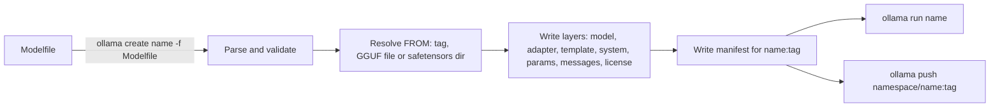

### 2.1 The Modelfile Mental Model

A Modelfile is to a model what a Dockerfile is to an image: a text recipe that `ollama create` turns into layers. The weights layer is almost always reused from the base model; every other instruction becomes a small layer of its own. Building a variant is therefore cheap (kilobytes on disk), and ten personas on one base model cost one copy of the weights.

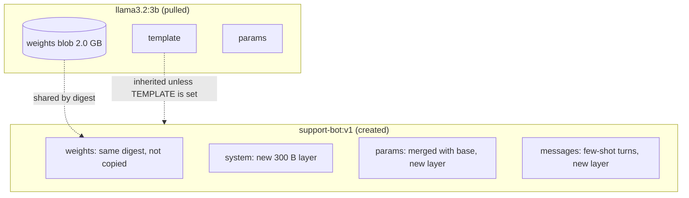

The smallest useful Modelfile is two lines:

```dockerfile
FROM llama3.2:3b
SYSTEM """You answer questions about our VPN. If unsure, say "Ask #it-help"."""
```

```bash
ollama create vpn-helper -f Modelfile
ollama run vpn-helper "How do I reset my token?"
```

Instructions you do not set are inherited from the base: a child of `llama3.2:3b` keeps its template, stop tokens and license.

### 2.2 Instruction Reference

| Instruction | Takes | Notes |
| :--- | :--- | :--- |
| `FROM` (required) | A model name (`llama3.2:3b`), a GGUF path (`./model.gguf`) or a safetensors directory (`./hf-model/`) | Relative paths resolve against the Modelfile's directory. |
| `PARAMETER` | `name value` | Default runtime options. Repeat `PARAMETER stop` for several stop strings; other names keep the last value. |
| `TEMPLATE` | A Go `text/template` string | The full prompt format. Usually inherited; write one only for imported weights or to change behaviour. |
| `SYSTEM` | Text | Default system prompt. A `system` message in a request replaces it for that request. |
| `ADAPTER` | Path to a LoRA adapter (GGUF or safetensors directory) | Must be trained against the exact base in `FROM`. |
| `MESSAGE` | `role text` with role `system`, `user` or `assistant` | Few-shot turns prepended to every conversation. |
| `LICENSE` | Text | Stored as a layer, shown by `ollama show --license`. |

Syntax rules that trip people up:

- Instruction names are case-insensitive; convention is upper case.
- Multi-line values use **triple double quotes** `"""`. Triple single quotes are not a delimiter and end up as literal characters in your prompt.
- `#` starts a comment only at the beginning of a line.
- A value with spaces on a single line should be quoted: `PARAMETER stop "### User:"`.

### 2.3 Runtime Parameters and Where They Are Set

| Parameter | Type | Default | What it does | Tuning guidance |
| :--- | :--- | :--- | :--- | :--- |
| `temperature` | float | 0.8 | Divides logits before softmax; lower is more deterministic | 0-0.3 for extraction, SQL and code; 0.7-1.0 for prose |
| `top_k` | int | 40 | Keep only the k most likely tokens | 20-50; lower trims nonsense on small models |
| `top_p` | float | 0.9 | Keep the smallest set whose probability reaches p | 0.8-0.95; tune either this or `top_k`, not both aggressively |
| `min_p` | float | 0.0 | Drop tokens below `min_p ×` the top token's probability | 0.05-0.1 keeps diversity at higher temperatures |
| `repeat_penalty` | float | 1.1 | Scales down logits of recently seen tokens | 1.0-1.2; too high damages code (variable names repeat legitimately) |
| `repeat_last_n` | int | 64 | How many recent tokens the penalty looks at (`-1` = whole context) | Leave alone unless loops persist |
| `num_ctx` | int | server default (4096 or VRAM-based) | Context window in tokens, prompt plus reply | Size to your longest real input; it drives KV-cache memory |
| `num_predict` | int | -1 (until stop) | Cap on generated tokens | Set it on every API path so a runaway answer cannot hold a slot |
| `stop` | string | from the model | Strings that end generation | Inherited from the base for chat models; add only extras |
| `seed` | int | random | RNG seed for sampling | Fix it for reproducible tests (see Q39 on GPU non-determinism) |
| `num_gpu` | int | auto | Layers to place on the GPU | Lower it to share a GPU; a large value such as 999 means "all" |
| `num_thread` | int | auto | CPU threads for CPU layers | Physical core count, not hyper-threads |

Settings stack from least to most specific. The request wins:

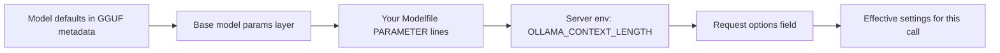

`OLLAMA_CONTEXT_LENGTH` only fills `num_ctx` when neither the Modelfile nor the request sets it. Per request:

```bash
curl -s localhost:11434/api/chat -d '{
  "model": "vpn-helper",
  "stream": false,
  "options": {"temperature": 0, "num_ctx": 8192, "num_predict": 256},
  "messages": [{"role": "user", "content": "Summarise the attached policy: ..."}]
}'
```

### 2.4 How Sampling Works: temperature, top_k, top_p, min_p and repeat_penalty

The model's output for each step is a vector of logits, one per vocabulary entry (128K for Llama 3). Sampling turns that vector into one token: penalties first, then filters and temperature, then a random draw. The exact order of the filter steps differs slightly between Ollama's two engines, but the effect of each step is the same:

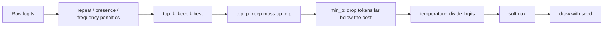

`examples/sampling/main.go` reproduces the effect on a five-token toy distribution for the prompt "The capital of France is":

```go
// softmax turns logits into probabilities. Dividing by the temperature first
// sharpens the distribution (t < 1) or flattens it (t > 1).
func softmax(cs []candidate, temperature float64) {
	maxLogit := math.Inf(-1)
	for _, c := range cs {
		maxLogit = math.Max(maxLogit, c.logit)
	}
	var sum float64
	for i := range cs {
		cs[i].prob = math.Exp((cs[i].logit - maxLogit) / temperature)
		sum += cs[i].prob
	}
	for i := range cs {
		cs[i].prob /= sum
	}
}

// topP keeps the smallest prefix whose probability mass reaches p.
func topP(cs []candidate, p float64) []candidate {
	var mass float64
	for i, c := range cs {
		mass += c.prob
		if mass >= p {
			return cs[:i+1]
		}
	}
	return cs
}
```

```bash
go run ./examples/sampling
```

```text
temperature 0.2        Paris=1.00 Lyon=0.00 France=0.00 the=0.00 banana=0.00
temperature 0.8        Paris=0.80 Lyon=0.12 France=0.07 the=0.01 banana=0.00
temperature 1.5        Paris=0.57 Lyon=0.21 France=0.15 the=0.06 banana=0.01
temp 0.8 + top_k 3     Paris=0.81 Lyon=0.12 France=0.07
temp 0.8 + top_p 0.9   Paris=0.87 Lyon=0.13
```

| Line / API | Role | What happens at runtime |
| :--- | :--- | :--- |
| `(logit - maxLogit)` | Numerical stability | Subtracting the max before `exp` prevents overflow; the result is unchanged. |
| `/ temperature` | Sharpen or flatten | At 0.2 the gap between Paris and Lyon is multiplied by 5, so Paris takes essentially all the mass. At 1.5 "banana" becomes possible. |
| `topK(cs, 3)` | Hard cut | Removes the long tail regardless of how flat the distribution is. |
| `topP(cs, 0.9)` | Adaptive cut | Paris and Lyon already hold 0.92 of the mass, so only 2 tokens survive. A confident model keeps 1; an uncertain one can keep dozens. |
| second `softmax` | Renormalise | Survivors are rescaled to sum to 1 before the draw. |

`temperature 0` is special-cased as greedy decoding: always the most likely token. `repeat_penalty` works on logits before any of this: a positive logit of a recently seen token is divided by the penalty, a negative one is multiplied, so both move toward "less likely".

### 2.5 Chat Templates: Go text/template and Special Tokens

A chat model was fine-tuned on text with specific markers between turns. The template's job is to rebuild that exact text from the message list. Ollama uses Go's `text/template`, and the data passed in looks like this:

| Variable | Type | Contains |
| --- | --- | --- |
| `.Messages` | list of `{Role, Content, ToolCalls}` | The whole conversation, including MESSAGE few-shot turns and tool results |
| `.System` | string | The system prompt (from the request or the `SYSTEM` instruction) |
| `.Tools` | list | Tool definitions from the request, for templates that support tools |
| `.Prompt`, `.Response` | string | Legacy single-turn fields, still used by `/api/generate` and old templates |

`examples/template/main.go` renders a ChatML template (the format used by Qwen and many fine-tunes) and prints what the model actually receives:

```go
const chatML = `{{- range .Messages }}<|im_start|>{{ .Role }}
{{ .Content }}<|im_end|>
{{ end }}<|im_start|>assistant
`

func main() {
	tmpl := template.Must(template.New("chatml").Parse(chatML))
	data := Data{Messages: []Message{
		{Role: "system", Content: "You are a terse assistant."},
		{Role: "user", Content: "What is 2+2?"},
		{Role: "assistant", Content: "4"},
		{Role: "user", Content: "And doubled?"},
	}}
	if err := tmpl.Execute(os.Stdout, data); err != nil {
		panic(err)
	}
}
```

```bash
go run ./examples/template
```

```text
<|im_start|>system
You are a terse assistant.<|im_end|>
<|im_start|>user
What is 2+2?<|im_end|>
<|im_start|>assistant
4<|im_end|>
<|im_start|>user
And doubled?<|im_end|>
<|im_start|>assistant
```

| Template element | Role | Effect |
| :--- | :--- | :--- |
| `{{- range .Messages }}` | Loop over turns | `-` trims whitespace before the action, so no stray newline starts the prompt. |
| `<|im_start|>{{ .Role }}` | Turn header | These are single special tokens in the vocabulary, not five characters. |
| `<|im_end|>` | Turn terminator | Also the stop token: the model emits it when its answer is complete. |
| trailing `<|im_start|>assistant` | Generation prompt | Leaves the model positioned to write the assistant turn. |

The Llama 3 family uses different markers. This is the shape of its template, written against `.Messages`:

```dockerfile
TEMPLATE """{{- if .System }}<|start_header_id|>system<|end_header_id|>

{{ .System }}<|eot_id|>{{ end }}
{{- range .Messages }}<|start_header_id|>{{ .Role }}<|end_header_id|>

{{ .Content }}<|eot_id|>{{ end }}<|start_header_id|>assistant<|end_header_id|>

"""
PARAMETER stop "<|eot_id|>"
```

Print any installed model's template with `ollama show --template llama3.2:3b`. For models from the Ollama library, never write your own: the published template also handles tool calls and edge cases you will not reproduce by hand.

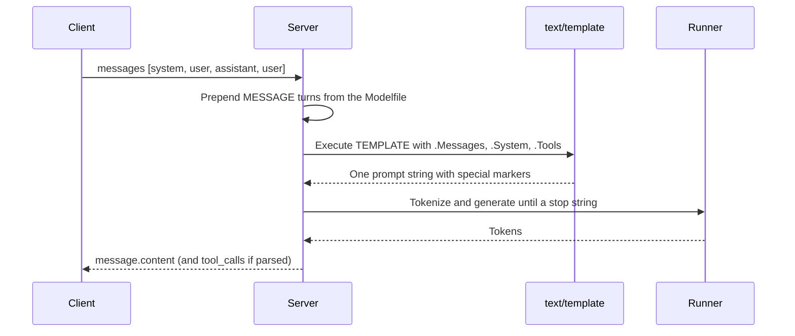

### 2.6 Context Window and KV-Cache Memory

Every token in the context keeps a key and a value vector in every layer, so the KV cache grows linearly with `num_ctx`:

```text
KV bytes = 2 (K and V) × layers × kv_heads × head_dim × num_ctx × parallel_slots × bytes_per_element
```

For Llama 3.1 8B (32 layers, 8 KV heads, head_dim 128) with an `f16` cache (2 bytes):

| `num_ctx` | KV cache, 1 slot | KV cache, 4 parallel slots |
| --- | --- | --- |
| 2,048 | 256 MiB | 1 GiB |
| 8,192 | 1 GiB | 4 GiB |
| 32,768 | 4 GiB | 16 GiB |
| 131,072 | 16 GiB | 64 GiB |

The weights of the same model at Q4_K_M are about 4.5 GiB, so at 32K context the cache is close to the weights, and at 128K it is several times larger. The starter's estimator implements the formula, and its test pins the 8K value at exactly 1 GiB:

```go
weights := r.Arch.ParamsBillion * 1e9 * bpw / 8
kv := 2 * float64(r.Arch.Layers) * float64(r.Arch.KVHeads) * float64(r.Arch.HeadDim) *
	float64(r.ContextLength) * float64(parallel) * kvBytes
```

```bash
curl -s 'localhost:8080/api/estimate?model=llama3.1:8b&quant=Q4_K_M&ctx=32768&parallel=1&vram=12'
# {"estimate":{"weights_gib":4.53,"kv_cache_gib":4,"overhead_gib":1,"total_gib":9.53},
#  "gpu_layers":32,"model":"llama3.1:8b","total_layers":32}
```

Three things follow:

- **Grouped-query attention helps.** Llama 3 has 32 query heads but only 8 KV heads, so its cache is a quarter of what full multi-head attention would need. `kv_heads` comes from the GGUF key `<arch>.attention.head_count_kv`.
- **Parallel slots multiply the cache.** `OLLAMA_NUM_PARALLEL=4` at 8K costs as much cache as one slot at 32K.
- **Overflow truncates, it does not fail.** When a conversation exceeds `num_ctx`, the oldest tokens are dropped (keeping `num_keep` tokens at the start, which by default covers the system prompt where possible). The model "forgets" without any error. Count tokens with `prompt_eval_count` and alert when it nears `num_ctx`.

### 2.7 Production Modelfiles

The repo ships three Modelfiles under `examples/modelfiles/`, each tested by `TestExampleModelfiles` to parse and lint clean.

A code reviewer (`code-reviewer.Modelfile`):

```dockerfile
FROM qwen2.5-coder:7b

# 8K tokens fits a few files plus the conversation.
PARAMETER num_ctx 8192
# Low temperature keeps reviews consistent between runs.
PARAMETER temperature 0.2
PARAMETER top_p 0.9
PARAMETER repeat_penalty 1.1

SYSTEM """
You are a senior Go reviewer.
Point out bugs first, then readability issues.
Quote the exact line you are talking about.
When you propose a change, show it as a unified diff.
If the code is fine, say so in one sentence.
"""

MESSAGE user "Review: if err != nil { log.Fatal(err) } inside an HTTP handler"
MESSAGE assistant "Bug: log.Fatal calls os.Exit, so one failed request stops the whole server. Return an HTTP 500 with http.Error and log the error instead."
```

A deterministic extractor (`json-extractor.Modelfile`). The prompt asks for JSON; the request's `format` field is what guarantees it (Stage 4):

```dockerfile
FROM llama3.2:3b

PARAMETER temperature 0
PARAMETER seed 42
PARAMETER num_ctx 4096
# Cap output so a runaway answer cannot fill the context window.
PARAMETER num_predict 512

SYSTEM """
You extract structured data from text.
Reply with one JSON object that matches the schema the caller supplies.
Use null for fields the text does not mention. Never invent values.
"""
```

A security-focused coding assistant, rebuilt from the earlier version of this guide on a current base model:

```dockerfile
FROM qwen2.5-coder:14b

PARAMETER num_ctx 8192
PARAMETER temperature 0.1
PARAMETER top_p 0.95
PARAMETER repeat_penalty 1.05

SYSTEM """
You are an application security reviewer for Python services.
Rules:
1. Produce type-annotated Python 3.12+ code.
2. Never suggest eval, pickle on untrusted data, string-built SQL or hard-coded secrets.
3. When you find a vulnerability, name the CWE and show the fixed code.
4. Include a pytest test for every fix.
"""

MESSAGE user "How do I run a SQL query with user input safely?"
MESSAGE assistant """Use bound parameters so the driver sends data separately from SQL:

    cur.execute("SELECT id, name FROM users WHERE email = %s", (email,))

Never format the value into the string; that is CWE-89 (SQL injection)."""
```

| Choice | Why |
| --- | --- |
| No `TEMPLATE` or `stop` | Inherited from the base; overriding them is the most common way to break a library model. |
| `repeat_penalty` near 1.0 for code | Code repeats identifiers legitimately; a high penalty renames variables mid-function. |
| `MESSAGE` examples | One good example teaches format better than a paragraph of rules. Each one costs context on every request, so keep them short. |
| `num_predict` on extractors | A broken input can make a small model loop; the cap bounds cost. |

### 2.8 Build, Inspect, Copy and Publish Models

```bash
# Build (re-running with the same name replaces the tag; unchanged layers are reused)
ollama create go-reviewer -f examples/modelfiles/code-reviewer.Modelfile

# Inspect
ollama show go-reviewer                  # architecture, parameters, context length, quantization
ollama show go-reviewer --modelfile      # the effective Modelfile, with FROM resolved to a blob path
ollama show go-reviewer --parameters
ollama show go-reviewer --template
ollama show go-reviewer --system

# Try it
ollama run go-reviewer "Review: for i := 0; i <= len(s); i++ { _ = s[i] }"

# Copy or rename a tag (there is no "ollama tag" command)
ollama cp go-reviewer go-reviewer:v1

# Publish to ollama.com: add your public key (~/.ollama/id_ed25519.pub) to your account first
ollama cp go-reviewer:v1 yourname/go-reviewer:v1
ollama push yourname/go-reviewer:v1
```

For private distribution, two approaches work without the public registry: run `ollama create` from the same Modelfile on every host (weights pulled from a mirror), or copy the `models` directory between machines (manifests plus blobs, see Q36). Pushing to self-hosted registries depends on the registry's compatibility with Ollama's manifest format; test before you rely on it.

The same operations over HTTP, for automation:

```bash
curl -s localhost:11434/api/show -d '{"model":"go-reviewer"}' | jq '.details, .model_info["general.architecture"]'
curl -s localhost:11434/api/copy -d '{"source":"go-reviewer","destination":"go-reviewer:backup"}'
curl -s -X DELETE localhost:11434/api/delete -d '{"model":"go-reviewer:backup"}'
```

### 2.9 Linting Modelfiles with the Starter

`ollama create` rejects syntax errors but accepts most semantic mistakes: a misspelt parameter, a temperature of 3, a `num_ctx` of 1024 that truncates every RAG prompt. The starter's `internal/modelfile` package parses Modelfiles the way Ollama does and lints them:

```go
var knownParameters = map[string]kind{
	"num_ctx": kindInt, "num_predict": kindInt, "top_k": kindInt, "seed": kindInt,
	"temperature": kindFloat, "top_p": kindFloat, "min_p": kindFloat,
	"repeat_penalty": kindFloat, "stop": kindString, // ...
}

func Lint(m *Modelfile) []Warning {
	// unknown names, wrong types, out-of-range values, duplicates,
	// num_ctx below 2048, and a TEMPLATE with no {{ }} actions
}
```

```bash
curl -s localhost:8080/api/modelfile/lint --data-binary @- <<'EOF'
FROM llama3.2:3b
PARAMETER temprature 0.2
PARAMETER num_ctx 1024
PARAMETER num_ctx 4096
EOF
```

```json
{"modelfile":{"from":"llama3.2:3b","parameters":[...]},
 "warnings":[
  {"line":2,"message":"unknown parameter \"temprature\""},
  {"line":3,"message":"num_ctx below 2048 truncates most chat histories and RAG prompts"},
  {"line":4,"message":"num_ctx is also set on line 3; the last value wins"}]}
```

| Line / API | Role | What happens at runtime |
| :--- | :--- | :--- |
| `readValue` with `"""` | Multi-line values | Reads following lines until the closing `"""`, and reports the opening line number if it never closes. |
| `strings.ToUpper(name)` | Case-insensitive instructions | `from` and `FROM` parse the same, like Ollama. |
| `seen[p.Name]` | Duplicate detection | `stop` is exempt because repeating it is how you add several stop strings. |
| `ParseError{Line: start}` | Precise errors | The gateway returns `400 modelfile: line 2: unknown instruction "RUN"`. |

Run it in CI over every Modelfile in your repo so a typo never reaches `ollama create`.

### 2.10 Pitfalls

| Pitfall | Symptom | Fix |
| --- | --- | --- |
| Triple single quotes around `SYSTEM` | The model sees `'''` in its prompt; persona is ignored or garbled | Use `"""`. |
| Overriding `TEMPLATE` on a library model | Model repeats the user's text, never stops, or answers as "user" | Delete the `TEMPLATE` line; inherit the base template. |
| Missing stop token on an imported model | Output runs on into a fake next turn (`<|im_start|>user ...`) | Add `PARAMETER stop "<|im_end|>"` (or the model's end-of-turn marker). |
| Misspelt parameter | Silently ignored; behaviour unchanged | Lint Modelfiles (section 2.9) and compare with `ollama show --parameters`. |
| Per-request `num_ctx` that differs between callers | Model reloads on alternate requests; `load_duration` of seconds | Set `num_ctx` in the Modelfile or server env, not per caller. |
| Context overflow | Model forgets instructions in long chats; no error | Track `prompt_eval_count`; summarise or trim history before it reaches `num_ctx`. |
| `temperature 0` expected to be bit-identical across machines | Different answers on two GPUs | Fix `seed`, pin model digest and hardware; accept small floating-point drift (Q39). |
| `ollama push` without a key or namespace | `you are not authorized to push to this namespace` | Add `~/.ollama/id_ed25519.pub` to your ollama.com account and `ollama cp` to `yourname/model`. |

### 2.11 Best Practices

- **Keep Modelfiles in git next to the code that calls them**: the model's behaviour is part of your application.
- **Version tags (`:v3`) instead of overwriting `latest`**: rollbacks become `ollama cp model:v2 model:latest`.
- **Inherit templates and stop tokens**: only imported weights need your own.
- **Put stable instructions in `SYSTEM`, per-call data in messages**: the system prompt is cached at the start of the context and benefits from prompt reuse.
- **Set `num_predict` everywhere**: unbounded generation is the cheapest denial of service there is.
- **Use few-shot `MESSAGE` turns for format, not for knowledge**: two short examples, not ten long ones.
- **Lint in CI and diff `ollama show --modelfile` in reviews**: the effective Modelfile reveals inherited settings you did not write.

### 2.12 Hands-on Exercise

Build a `release-notes` model that turns a list of commit subjects into grouped release notes.

1. Write `Modelfile.release-notes` with `FROM llama3.2:3b`, `temperature 0.3`, `num_ctx 8192`, `num_predict 600`, a `SYSTEM` prompt describing the output sections (Features, Fixes, Other) and one `MESSAGE user` / `MESSAGE assistant` example pair.
2. Lint it with `POST /api/modelfile/lint` and fix every warning.
3. `ollama create release-notes -f Modelfile.release-notes`, then run it on the output of `git log --oneline -20`.
4. Change `temperature` to 1.2, rebuild as `release-notes:hot`, and compare three runs of each.

Expected: zero lint warnings, consistent section headings at 0.3, and visibly different wording between runs at 1.2. Use `examples/modelfiles/code-reviewer.Modelfile` as the structural reference, and add your file to the list in `TestExampleModelfiles` (`internal/modelfile/modelfile_test.go`) so CI keeps it valid.

[Back to top ⤴️](#-table-of-contents)

---

## 3. Stage 3: GGUF, Quantization & Model Import

Open-weight models are published as 16-bit safetensors: about 2 bytes per parameter, so 16 GB for an 8B model and 140 GB for a 70B one. Ollama runs them as GGUF files quantized to 4-8 bits. This stage opens a GGUF file byte by byte, works through the quantization arithmetic, shows how to choose a quantization for a given GPU, and covers the three import paths: a ready GGUF, safetensors through `ollama create --quantize`, and the full llama.cpp toolchain. It builds on the memory model from Stages 1 and 2.

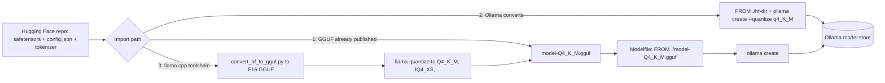

### 3.1 GGUF File Anatomy

GGUF (from the GGML project, the tensor library behind llama.cpp) is a single-file format that holds everything an inference engine needs: architecture hyperparameters, the tokenizer, the chat template and the weights. It replaced the older GGML `.bin` files in 2023 because it is self-describing: new architectures add metadata keys instead of breaking the format.

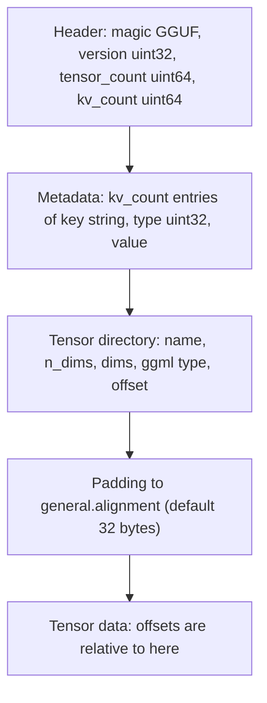

All integers are little-endian. A string is a `uint64` length followed by the bytes. An array is an element type, a `uint64` count and the elements. Typical keys:

| Key | Example value | Used for |
| --- | --- | --- |
| `general.architecture` | `llama`, `qwen2`, `gemma3` | Picks the compute graph; prefixes the keys below |
| `general.file_type` | `15` (= Q4_K_M) | The overall quantization label |
| `llama.block_count` | `32` | Number of transformer layers |
| `llama.context_length` | `131072` | Context the model was trained for (an upper bound for `num_ctx`) |
| `llama.embedding_length` | `4096` | Hidden size |
| `llama.attention.head_count` / `head_count_kv` | `32` / `8` | Query heads and KV heads (grouped-query attention) |
| `tokenizer.ggml.tokens` | array of 128,256 strings | Vocabulary |
| `tokenizer.chat_template` | Jinja template text | Ollama maps known templates to its own Go templates on import |

The repo's `internal/gguf` package reads exactly this layout and stops before the tensor data, so inspecting a 40 GB file reads only the header:

```go
func Read(r io.Reader) (*File, error) {
	d := &decoder{r: bufio.NewReaderSize(r, 1<<16)}

	var magic [4]byte
	if _, err := io.ReadFull(d.r, magic[:]); err != nil {
		return nil, fmt.Errorf("gguf: read magic: %w", err)
	}
	if string(magic[:]) != Magic {
		return nil, ErrNotGGUF
	}
	f := &File{Version: d.u32(), Metadata: map[string]any{}}
	if d.err == nil && (f.Version < 2 || f.Version > 3) {
		return nil, fmt.Errorf("gguf: unsupported version %d", f.Version)
	}
	tensorCount := d.count()
	kvCount := d.count()

	for i := uint64(0); i < kvCount && d.err == nil; i++ {
		key := d.str()
		f.Metadata[key] = d.value(ValueType(d.u32()))
	}
	for i := uint64(0); i < tensorCount && d.err == nil; i++ {
		t := TensorInfo{Name: d.str()}
		n := d.u32()
		// ... n dims, ggml type, offset
	}
	// ...
}
```

| Line / API | Role | What happens at runtime |
| :--- | :--- | :--- |
| `bufio.NewReaderSize(r, 1<<16)` | Fewer syscalls | The header is thousands of small reads (each token string is one); buffering makes them memory copies. |
| `string(magic[:]) != Magic` | Format check | A safetensors file or an HTML error page saved as `.gguf` fails here with `ErrNotGGUF`. |
| `d.u32()`, `d.count()` | Sticky-error decoder | The first short read records `io.ErrUnexpectedEOF`; later reads become no-ops, so the parsing code needs no `if err` after every field. |
| `d.count()` limit | Hostile-file guard | A count or string length above the limit fails instead of allocating terabytes. |
| `d.value(ValueType(...))` | Typed values | Arrays keep their full `Len` but only the first 8 values, so a 128K-entry vocabulary does not bloat memory. |

Run it on any model you have pulled:

```bash
BLOB=$(ollama show llama3.2:3b --modelfile | awk '/^FROM \//{print $2}')
go run ./cmd/ggufinfo -ctx 8192 "$BLOB"
```

```text
name           Llama 3.2 3B Instruct
architecture   llama
gguf version   3
file type      Q4_K_M
parameters     3.21B
layers         28
trained ctx    131072 tokens
heads          24 query, 8 kv, head_dim 128
tensor types
  F32    58 tensors
  Q4_K   168 tensors
  Q6_K   29 tensors
estimate       weights 1.81 GiB + KV 0.88 GiB + overhead 1.00 GiB = 3.69 GiB
```

The tensor counts show what "mixed" means in Q4_K_M: most tensors are Q4_K, a sensitive subset is Q6_K, and the small normalisation vectors stay F32. Exact counts vary by model.

### 3.2 How Block Quantization Works: Q8_0 and Q4_0

Quantization replaces each 16-bit weight with a small integer plus a scale shared by a block of weights. GGUF's simple types use blocks of 32.

**Q8_0**: find the largest magnitude in the block, `amax`. The scale is `d = amax / 127`. Each weight becomes `q = round(w / d)`, an int8. Decoding is `w ≈ d × q`. Storage is 32 bytes of int8 plus a 2-byte fp16 scale: 34 bytes per 32 weights, **8.5 bits per weight**.

**Q4_0**: find the weight with the largest magnitude, keeping its sign, call it `m`. The scale is `d = m / -8`. Each weight is stored as a 4-bit value `q = clamp(trunc(w/d + 8.5), 0, 15)` and decodes as `(q - 8) × d`. Storage is 16 bytes of nibbles plus the 2-byte scale: 18 bytes per 32 weights, **4.5 bits per weight**, 3.6× smaller than F16.

A hand-worked block of four (real blocks have 32) with weights `[0.12, -0.40, 0.33, 0.05]`:

| Step | 0.12 | -0.40 | 0.33 | 0.05 |
| --- | --- | --- | --- | --- |
| `m = -0.40`, `d = -0.40 / -8 = 0.05`, so `w/d + 8.5` | 10.9 | 0.5 | 15.1 | 9.5 |
| stored `q` (truncate, clamp to 15) | 10 | 0 | 15 | 9 |
| decoded `(q - 8) × 0.05` | 0.10 | -0.40 | 0.35 | 0.05 |
| error | -0.02 | 0 | +0.02 | 0 |

The extreme weight is exact and every other weight lands on a grid with spacing `d`. One outlier in a block widens `d` for all 31 neighbours, which is the main weakness of these simple types.

`examples/quantize/main.go` implements both schemes on a block of 32 normally distributed weights:

```go
func quantizeQ4(w []float32) (d float32, q []uint8) {
	var amax, signedMax float32
	for _, x := range w {
		if abs(x) > amax {
			amax, signedMax = abs(x), x
		}
	}
	d = signedMax / -8
	q = make([]uint8, len(w))
	if d == 0 {
		return d, q
	}
	inv := 1 / d
	for i, x := range w {
		q[i] = uint8(min(15, int(x*inv+8.5)))
	}
	return d, q
}
```

```bash
go run ./examples/quantize
```

```text
type      bytes    bits/weight         rmse
F16          64          16.00            0
Q8_0         34           8.50     0.000081
Q4_0         18           4.50     0.001173

first four weights: original -> Q8_0 -> Q4_0
  -0.00126 -> -0.00128 -> -0.00000
  +0.00068 -> +0.00064 -> -0.00000
  -0.00729 -> -0.00735 -> -0.00507
  -0.00614 -> -0.00607 -> -0.00507
```

Q8_0's error is about 14× smaller than Q4_0's. Q4_0 also collapses small weights to exactly zero and maps nearby weights to the same value, which is why plain Q4_0 loses noticeably more quality than the K-quants below at almost the same size.

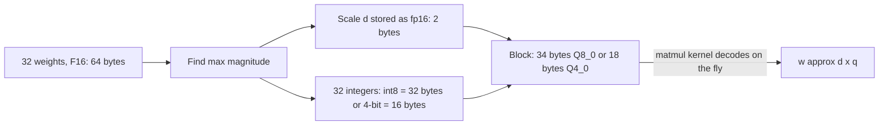

The decode happens inside the matrix-multiply kernel, in registers. Weights stay compressed in VRAM, which is the point: decode speed is bound by bytes read per token (Stage 1), so 4.5 bits per weight is roughly 3.5× faster than 16.

### 3.3 K-Quants and Mixed Precision

K-quants (`Q2_K` to `Q6_K`) improve on Q4_0 in two ways.

**Super-blocks with quantized scales.** Q4_K groups 256 weights into a super-block of eight 32-weight blocks. Each block gets its own 6-bit scale and 6-bit minimum (an offset, so asymmetric ranges are handled), and the super-block stores one fp16 scale for the scales and one for the minimums. A weight decodes as `d × scale_j × q - dmin × min_j`. Cost: 128 bytes of nibbles + 12 bytes of packed scales + 4 bytes of fp16 = 144 bytes per 256 weights, still 4.5 bits per weight, but with an offset and finer-grained scales.

| ggml type | Super-block layout | Bits per weight |
| --- | --- | --- |
| Q2_K | 16 blocks of 16, 4-bit scales and mins | 2.56 |
| Q3_K | 16 blocks of 16, 6-bit scales | 3.44 |
| Q4_K | 8 blocks of 32, 6-bit scales and mins | 4.5 |
| Q5_K | 8 blocks of 32, 6-bit scales and mins, 1 extra bit per weight | 5.5 |
| Q6_K | 16 blocks of 16, 8-bit scales | 6.56 |

**Different types for different tensors.** The names with a suffix (`Q4_K_S`, `Q4_K_M`, `Q5_K_M`) are recipes, not single types. Tensors are not equally sensitive: the attention value projection (`attn_v`), the feed-forward down projection (`ffn_down`) and the output head lose the most quality when squeezed. The `_M` (medium) recipes give those tensors more bits:

- **Q4_K_S**: Q4_K almost everywhere. About 4.6 effective bits per weight.
- **Q4_K_M**: Q4_K by default, with about half of the `attn_v` and `ffn_down` tensors (the most sensitive layers) and the output head upgraded to Q6_K. About 4.85 effective bits per weight.
- **Q5_K_M**: the same idea one step up, Q5_K with Q6_K for sensitive tensors. About 5.7 effective bits per weight.

Normalisation weights and other 1-D tensors stay F32 in every recipe; they are tiny.

**I-quants and importance matrices.** The `IQ` types (`IQ4_XS`, `IQ3_M`, `IQ2_M` and others) use non-uniform grids and lattice codebooks to fit more quality into fewer bits. They are usually built with an importance matrix (imatrix): llama.cpp runs calibration text through the F16 model, records which weights affect activations most, and the quantizer spends its error budget where it matters least. An imatrix also improves ordinary K-quants. The cost is that IQ types can be slower on CPU and need a recent runtime.

### 3.4 Choosing a Quantization: Size, Quality and Speed

Weights size ≈ parameters × effective bits per weight / 8. These are the values the starter's `internal/sizing` package uses:

| Quantization | Effective bits/weight | 8B weights | 70B weights | Quality loss vs F16 (typical) | Use it for |
| :--- | :--- | :--- | :--- | :--- | :--- |
| F16 / BF16 | 16 | ~16 GB | ~141 GB | none (reference) | Evaluation baselines, fine-tuning inputs, conversion source |
| Q8_0 | 8.5 | ~8.5 GB | ~75 GB | negligible | Maximum quality when memory allows; small models (≤ 3B) where every bit matters |
| Q6_K | 6.56 | ~6.6 GB | ~58 GB | very small | Reasoning, maths and code when Q8_0 does not fit |
| Q5_K_M | 5.7 | ~5.7 GB | ~50 GB | small | Quality-sensitive production |
| **Q4_K_M** | 4.85 | ~4.9 GB | ~43 GB | small but measurable | **The default for most library tags** |
| IQ4_XS | ~4.25 | ~4.3 GB | ~38 GB | similar to Q4_K_S with an imatrix | Squeezing a model into a card it almost fits |
| Q3_K_M | 3.9 | ~3.9 GB | ~34 GB | noticeable | Edge devices, or a large model on too little VRAM |
| Q2_K | ~3.0 | ~3.0 GB | ~26 GB | large: broken formatting, more hallucination | Experiments only |

"Quality loss" depends on the model and the task. Small models degrade faster than large ones, and maths and code degrade before chat. Measure on your own evaluation set, and use llama.cpp's `llama-perplexity` for a quick relative check between quantizations of the same model.

A rule that holds across most benchmarks: **a larger model at Q4_K_M usually beats a smaller model at Q8_0 of the same file size.** A 14B at Q4 (~9 GB) generally answers better than an 8B at Q8 (~8.5 GB).

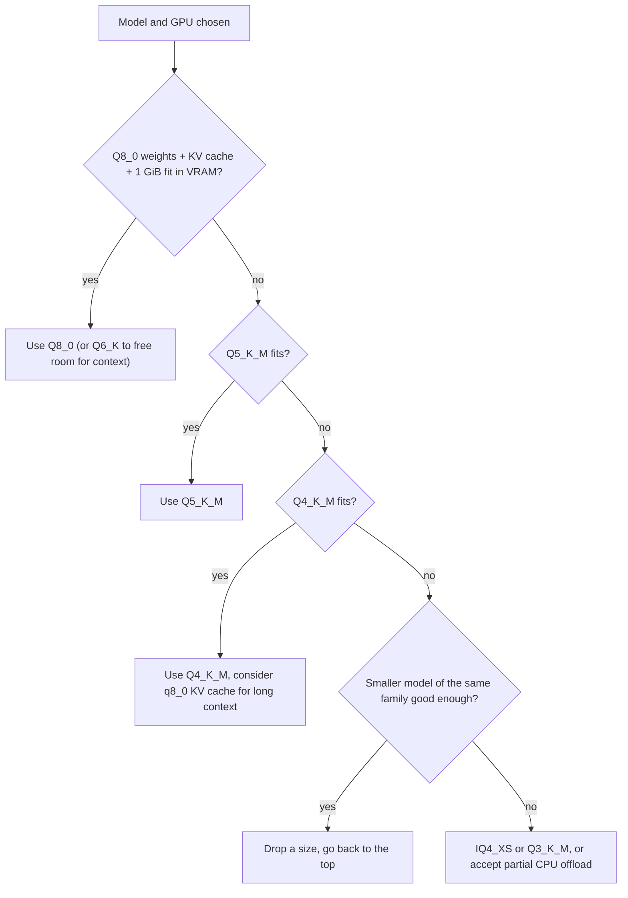

Ask the starter instead of doing the arithmetic by hand. `vram` is the card size in GiB; `gpu_layers` is how many layers would be placed on the GPU:

```bash
curl -s 'localhost:8080/api/estimate?model=llama3.1:70b&quant=Q4_K_M&ctx=8192&vram=24'
# {"estimate":{"weights_gib":39.86,"kv_cache_gib":2.5,"overhead_gib":1,"total_gib":43.36},
#  "gpu_layers":43,"model":"llama3.1:70b","total_layers":80}
```

43 of 80 layers on a 24 GiB card is a partial offload: expect single-digit tokens/s. The same request with `vram=48` places all 80 layers.

### 3.5 Importing a GGUF File

Many fine-tunes are published as ready GGUF files. Importing one is a Modelfile with a path:

```dockerfile
# examples/modelfiles/import-gguf.Modelfile
FROM ./my-model-Q4_K_M.gguf

PARAMETER num_ctx 8192
PARAMETER temperature 0.6
PARAMETER stop "<|im_end|>"

# ChatML-style template for models trained on <|im_start|> markers.
# Ollama copies the template from the GGUF metadata when it recognises it;
# write one only when the import produces garbled turns.
TEMPLATE """{{- range .Messages }}<|im_start|>{{ .Role }}
{{ .Content }}<|im_end|>
{{ end }}<|im_start|>assistant
"""
```

```bash
ollama create my-import -f examples/modelfiles/import-gguf.Modelfile
# gathering model components
# copying file sha256:4f1e... 100%
# parsing GGUF
# using autodetected template chatml
# writing manifest
# success

ollama list
# NAME                 ID              SIZE      MODIFIED
# my-import:latest     a1b2c3d4e5f6    4.7 GB    10 seconds ago

ollama show my-import          # confirms architecture, context length and quantization
```

`ollama create` copies the file into the blob store (named by its SHA-256), so you can delete the original afterwards. When the server is remote, the CLI uploads the file over the API first.

How to know which template a model needs: read `tokenizer.chat_template` in the GGUF metadata (`go run ./cmd/ggufinfo` lists the keys via `gguf.File.Keys()`, or use `gguf-dump`), or the model card. Markers such as `<|im_start|>` mean ChatML; `<|start_header_id|>` means Llama 3; `[INST]` means Mistral's format.

### 3.6 Importing Safetensors and Quantizing with ollama create

For supported architectures (the Llama family, Mistral, Gemma, Phi-3, Qwen and others; check the import guide in the Ollama docs for the current list), Ollama converts safetensors itself:

```bash
# A local Hugging Face snapshot: config.json, tokenizer files, *.safetensors
ls ./Qwen2.5-7B-Instruct/
# config.json  generation_config.json  model-00001-of-00004.safetensors ...  tokenizer.json

cat > Modelfile <<'EOF'
FROM ./Qwen2.5-7B-Instruct
PARAMETER num_ctx 8192
EOF

# Without --quantize the model is stored at F16/BF16 (~15 GB for 7B)
ollama create qwen-local:7b-q4 --quantize q4_K_M -f Modelfile
# converting model ... quantizing F16 model to Q4_K_M ... success
```

`--quantize` (`-q`) also accepts an F16 or F32 GGUF as the source, and supports the common targets (`q8_0`, `q4_K_S`, `q4_K_M`). For anything else (IQ types, imatrix, Q5_K_M, Q6_K), use llama.cpp.

| Path | Steps | Control | When |
| --- | --- | --- | --- |
| Ready GGUF | 1 Modelfile line | None over quantization | A trusted publisher already ships the quant you want |
| `ollama create --quantize` | Modelfile + 1 command | A few targets, no imatrix | Your own fine-tune of a supported architecture |
| llama.cpp toolchain | Clone, build, convert, quantize | Every type, imatrix, perplexity checks | Unusual architectures, IQ quants, or quality-critical work |

### 3.7 Converting with the llama.cpp Toolchain

```bash
# 1. Get and build llama.cpp (CMake; the old Makefile build is gone)
git clone https://github.com/ggml-org/llama.cpp
cd llama.cpp
python3 -m venv .venv && . .venv/bin/activate
pip install -r requirements.txt
cmake -B build                      # add -DGGML_CUDA=ON for NVIDIA, -DGGML_METAL=ON is default on macOS
cmake --build build --config Release -j

# 2. Convert the Hugging Face directory to an unquantized GGUF
python convert_hf_to_gguf.py /models/my-finetune --outfile my-f16.gguf --outtype f16

# 3. Optional: compute an importance matrix from representative text
./build/bin/llama-imatrix -m my-f16.gguf -f calibration.txt -o imatrix.dat

# 4. Quantize (one F16 source can produce many quants)
./build/bin/llama-quantize my-f16.gguf my-Q4_K_M.gguf Q4_K_M
./build/bin/llama-quantize --imatrix imatrix.dat my-f16.gguf my-IQ4_XS.gguf IQ4_XS

# 5. Compare quality on held-out text (lower perplexity is better; compare quants of the same model only)
./build/bin/llama-perplexity -m my-f16.gguf    -f heldout.txt
./build/bin/llama-perplexity -m my-Q4_K_M.gguf -f heldout.txt

# 6. Inspect the result
pip install gguf
gguf-dump my-Q4_K_M.gguf | head -40
```

| Step | Input → output | Common failure |
| --- | --- | --- |
| `convert_hf_to_gguf.py` | safetensors + config → F16 GGUF | `Model architecture X is not supported`: update llama.cpp, or the architecture is not implemented yet |
| `llama-imatrix` | F16 GGUF + text → `imatrix.dat` | Slow on CPU; use a GPU build and a few hundred KB of text from your domain |
| `llama-quantize` | F16 GGUF → quantized GGUF | Needs disk for both files; it does not need much RAM because it streams tensors |
| `llama-perplexity` | GGUF + text → a number | Only comparable between quants of the same model and tokenizer |

Then import the result with the Modelfile from 3.5.

### 3.8 LoRA Adapters

A LoRA adapter stores a low-rank update `ΔW = B × A` for selected weight matrices (often the attention projections). An adapter for an 8B model is tens to hundreds of MB instead of 16 GB, and one base can serve several adapters as separate Ollama models.

```dockerfile
FROM llama3.1:8b
ADAPTER ./support-lora          # a safetensors adapter directory (adapter_config.json + adapter_model.safetensors)
SYSTEM """You are the support assistant for the billing product."""
```

```bash
# Or convert the adapter to GGUF with llama.cpp first
python convert_lora_to_gguf.py ./support-lora --base /models/Llama-3.1-8B-Instruct --outfile support-lora.gguf
```

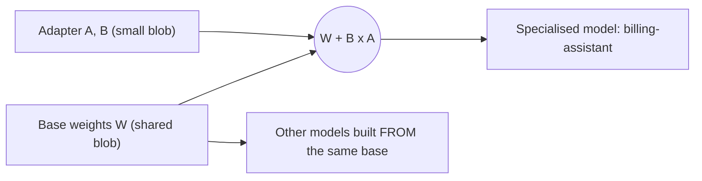

The adapter must come from the **exact** base model: same architecture, same size, ideally the same revision. An adapter trained on Llama 3.1 8B applied to Llama 3.2 3B either fails to load or produces nonsense. If the base you trained on was quantized differently from the `FROM` model (QLoRA on 4-bit, Ollama base at Q4_K_M), quality is usually fine but worth checking. Merging the adapter into the weights before quantizing gives the best quality and the simplest deployment, at the cost of a full-size copy per variant.

### 3.9 Pitfalls

| Pitfall | Symptom | Fix |
| --- | --- | --- |
| Downloaded an HTML page or a Git LFS pointer instead of the file | `ollama create` fails with `invalid file magic`; the file is a few KB | Check the size, re-download with `huggingface-cli download` or `git lfs pull`. `cmd/ggufinfo` reports `not a GGUF file (bad magic)`. |
| Old GGML `.bin` file | `invalid file magic` or `unsupported model format` | Get a GGUF build or convert from safetensors (3.7). |
| Architecture newer than your Ollama or llama.cpp | `unsupported architecture` / `unknown model architecture: 'xyz'` | Upgrade Ollama; for conversion, pull the latest llama.cpp. |
| Wrong or missing chat template | Replies continue the user's text, contain `<|im_start|>`, or never stop | Set `TEMPLATE` and `PARAMETER stop` for the model's real format (3.5). |
| Requesting more context than the model was trained for | Quality collapses beyond a certain length | Keep `num_ctx` ≤ `<arch>.context_length` unless the model documents RoPE scaling. |
| Quantizing an already quantized file | `llama-quantize` refuses, or quality is poor (requantization stacks errors) | Always quantize from F16/BF16/F32. |
| Adapter from a different base | `failed to apply lora adapter` or gibberish | Rebuild `FROM` the exact base the adapter was trained on. |
| Quant chosen by file size alone | Q2_K model breaks JSON and code formatting | Prefer a smaller model at Q4_K_M; measure on your tasks. |

### 3.10 Best Practices

- **Keep the F16 GGUF or safetensors source**: every new quant type or imatrix improvement needs it, and requantizing from a quant loses quality.
- **Default to Q4_K_M, move up when memory allows**: it is the best-tested trade-off and what library tags ship.
- **Use Q8_0 for small models**: a 1-3B model has little redundancy, and Q8_0 of a 3B is still only about 3.4 GB.
- **Leave VRAM for the KV cache**: plan weights + cache + about 1 GiB; a model that "fits" with zero headroom spills to CPU at the first long prompt.
- **Build imatrix quants from your own domain text**: calibration on code helps a code model more than generic web text.
- **Record provenance**: source repo and revision, converter commit, quant type and imatrix in the model's `LICENSE` or a README next to the Modelfile.
- **Verify with `ollama show` after every import**: architecture, parameter count, context length and quantization should match what you expect.

### 3.11 Hands-on Exercise

1. Pull `qwen2.5:7b` (Q4_K_M by default) and `qwen2.5:7b-instruct-q8_0`. Run `go run ./cmd/ggufinfo` on both blobs and record the file type, tensor type counts and size.
2. Ask the starter for estimates of both at `ctx=16384` with your GPU's VRAM (`/api/estimate?model=qwen2.5:7b&quant=Q8_0&ctx=16384&vram=...`). Does each fit?
3. Run the same five prompts (a maths word problem, a JSON extraction, a short Go function, a summary, a translation) on both and compare answers and `eval rate` from `--verbose`.
4. Change one weight in `examples/quantize/main.go` to `0.5` (an outlier) and rerun it. Watch Q4_0's error grow.

Expected: Q8_0 is about 1.75× the size and roughly that much slower to decode, with differences mostly in the maths and code answers; the outlier makes Q4_0's RMSE jump because `d` widens for the whole block. The header reader is `internal/gguf/gguf.go` (tested in `gguf_test.go`), the estimator is `internal/sizing/sizing.go`, and the quantization demo is `examples/quantize/main.go`.

[Back to top ⤴️](#-table-of-contents)

---

## 4. Stage 4: REST API, Streaming, Tool Calling & Structured Outputs

This stage covers the HTTP surface every client is built on: the native `/api` endpoints, NDJSON streaming, embeddings, the OpenAI-compatible `/v1` layer, tool calling, JSON-schema outputs and vision input. It assumes Stages 1-2. Afterwards you can integrate Ollama into any language or framework that can send HTTP.

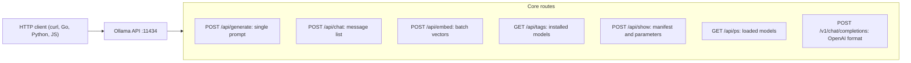

### 4.1 Native REST API Overview

The API listens on port 11434. Requests and responses are JSON; generation endpoints stream newline-delimited JSON (NDJSON) unless the request sets `"stream": false`. Errors come back as `{"error": "..."}` with a 4xx/5xx status, except errors that happen after streaming has started, which arrive in-band as a final line containing `error` (the starter's `ChatStream` handles both).

| Endpoint | Method | Purpose |
| --- | --- | --- |
| `/api/chat` | POST | Multi-turn chat with tools, images, `format`, `think` |
| `/api/generate` | POST | Single prompt, raw mode (`"raw": true` skips the template), suffix for fill-in-the-middle |
| `/api/embed` | POST | Embeddings for one string or a batch |
| `/api/tags` | GET | Models in the local store |
| `/api/ps` | GET | Models currently loaded, with size, VRAM share and expiry |
| `/api/show` | POST | Modelfile, parameters, template, `model_info` metadata |
| `/api/pull`, `/api/push`, `/api/create`, `/api/copy`, `/api/delete` | POST/DELETE | Model management (lock these down in production) |
| `/api/version` | GET | Server version |

### 4.2 Chat Completion and Response Metrics

```bash
curl http://localhost:11434/api/chat -d '{
  "model": "llama3.2:3b",
  "messages": [
    {"role": "system", "content": "You are a concise database architect."},
    {"role": "user", "content": "Explain write amplification in LSM-trees in one sentence."}
  ],
  "stream": false,
  "options": {"temperature": 0, "num_ctx": 4096}
}'
```

```json
{
  "model": "llama3.2:3b",
  "created_at": "2026-09-29T15:20:00.000Z",
  "message": {
    "role": "assistant",
    "content": "Write amplification happens because each write is first logged and flushed, then rewritten several times as compaction merges sorted runs into lower levels."
  },
  "done": true,
  "done_reason": "stop",
  "total_duration": 482910200,
  "load_duration": 1289400,
  "prompt_eval_count": 38,
  "prompt_eval_duration": 129402000,
  "eval_count": 35,
  "eval_duration": 351980000
}
```

| Field | Meaning |
| --- | --- |
| `total_duration` | Whole request, nanoseconds |
| `load_duration` | Time spent loading the model (near zero when resident) |
| `prompt_eval_count` / `prompt_eval_duration` | Prompt tokens processed and prefill time. A cached prefix can make the count smaller than the prompt |
| `eval_count` / `eval_duration` | Generated tokens and decode time; tokens/s = `eval_count / eval_duration × 1e9` |
| `done_reason` | `stop` (stop token), `length` (hit `num_predict`), `load`/`unload` for keep-alive calls |

`keep_alive` can be set per request: `"keep_alive": "1h"` keeps the model loaded, and an empty request with `"keep_alive": 0` unloads it immediately.

### 4.3 Streaming NDJSON in Go

Streaming is the default because users judge latency by the first token, not the last. Each line is a complete JSON object; the client reads line by line and stops early by closing the connection, which tells the server to stop generating.

```go
// internal/ollama/client.go
func (c *Client) ChatStream(ctx context.Context, req ChatRequest, fn func(ChatResponse) error) error {
	req.Stream = Bool(true)
	resp, err := c.do(ctx, http.MethodPost, "/api/chat", req)
	if err != nil {
		return err
	}
	defer resp.Body.Close()

	scanner := bufio.NewScanner(resp.Body)
	scanner.Buffer(make([]byte, 0, 64*1024), 4*1024*1024)
	for scanner.Scan() {
		line := bytes.TrimSpace(scanner.Bytes())
		if len(line) == 0 {
			continue
		}
		var chunk struct {
			ChatResponse
			Error string `json:"error"`
		}
		if err := json.Unmarshal(line, &chunk); err != nil {
			return fmt.Errorf("ollama: decode stream line: %w", err)
		}
		if chunk.Error != "" {
			return &APIError{Status: http.StatusOK, Message: chunk.Error}
		}
		if err := fn(chunk.ChatResponse); err != nil {
			return err
		}
	}
	return scanner.Err()
}
```

| Line / API | Role | What happens at runtime |
| :--- | :--- | :--- |
| `scanner.Buffer(..., 4 MiB)` | Larger line limit | A long tool call or thinking block in one line would otherwise fail with `token too long`. |
| `chunk.Error != ""` | In-band errors | A runner crash mid-stream arrives after a 200 status, as a line with `error`. |
| `return err` from `fn` | Early stop | Returning closes the body; the server sees the disconnect and cancels generation. |

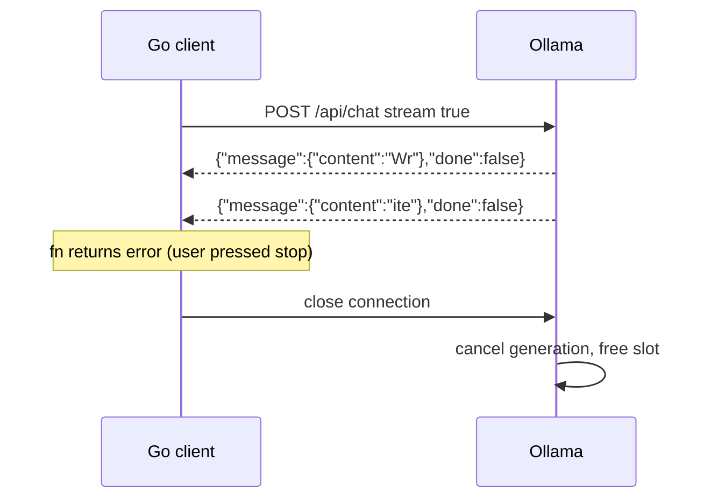

### 4.4 Vector Embeddings (`POST /api/embed`)

```bash
curl http://localhost:11434/api/embed -d '{
  "model": "nomic-embed-text",
  "input": ["search_document: PostgreSQL pgvector indexing strategy",
            "search_document: Kafka consumer group rebalancing"]
}'
# {"model":"nomic-embed-text","embeddings":[[0.0123,-0.045,...],[...]],"total_duration":...}
```

`input` takes a string or an array; arrays are processed in one batch, which is much faster than one request per text. Vectors are L2-normalised, so cosine similarity is a dot product. `truncate` (default `true`) cuts inputs longer than the model's context; set it to `false` to get an error instead. The old `/api/embeddings` endpoint (single `prompt`, key `embedding`) is deprecated.

### 4.5 OpenAI-Compatible Endpoints (`/v1`)

Ollama implements the common parts of the OpenAI API (`/v1/chat/completions`, `/v1/completions`, `/v1/embeddings`, `/v1/models`), so tools built for OpenAI work by changing the base URL. Any API key string is accepted and ignored.

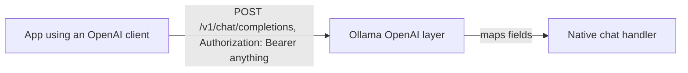

```python
from openai import OpenAI

client = OpenAI(base_url="http://localhost:11434/v1", api_key="ollama")

response = client.chat.completions.create(
    model="llama3.1:8b",
    messages=[
        {"role": "system", "content": "You are a senior SRE."},
        {"role": "user", "content": "Explain Kubernetes readiness vs liveness probes."},
    ],
    temperature=0.2,
    max_tokens=500,
)
print(response.choices[0].message.content)
```

The compatibility layer does not expose every Ollama option: there is no field for `num_ctx` in the OpenAI request, so set it in a Modelfile or with `OLLAMA_CONTEXT_LENGTH`. Use the native API when you need `keep_alive`, `think` levels or exact timing fields.

### 4.6 Tool Calling

Models trained for function calling (Llama 3.1+, Qwen 2.5+/Qwen 3, Mistral and others marked "tools" in the library) accept JSON-schema tool definitions. The model does not run anything: it returns `tool_calls`, your code executes them and sends the results back as `role: "tool"` messages.

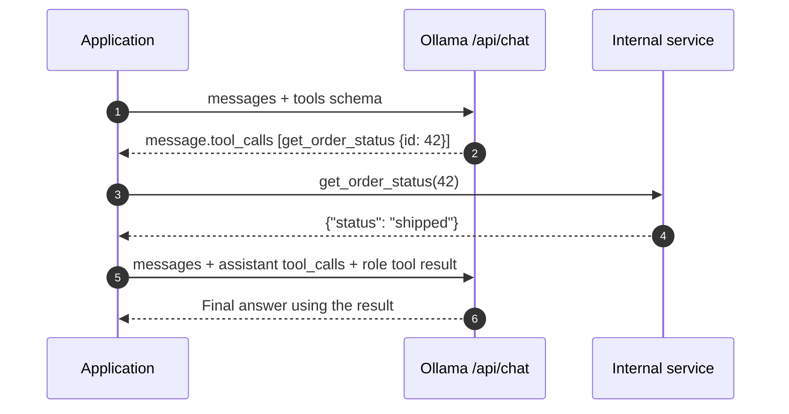

```bash
curl http://localhost:11434/api/chat -d '{
  "model": "llama3.1:8b",
  "stream": false,
  "messages": [{"role": "user", "content": "Where is order 42?"}],
  "tools": [{
    "type": "function",
    "function": {
      "name": "get_order_status",
      "description": "Look up the shipping status of an order by numeric id.",
      "parameters": {
        "type": "object",
        "properties": {"id": {"type": "integer", "description": "Order id"}},
        "required": ["id"]
      }
    }
  }]
}'
```

```json
{
  "message": {
    "role": "assistant",
    "content": "",
    "tool_calls": [{"function": {"name": "get_order_status", "arguments": {"id": 42}}}]
  }
}
```

Note that `arguments` is a JSON object in the native API (in the OpenAI-compatible API it is a JSON string). Tool calls can also be streamed: they arrive as complete calls in a chunk rather than token by token.

### 4.7 Structured Outputs with JSON Schema

`format` accepts `"json"` or a JSON schema. With a schema, decoding is constrained so only tokens that keep the output valid against the schema can be sampled.

```bash
curl -s localhost:11434/api/chat -d '{
  "model": "json-extractor",
  "stream": false,
  "messages": [{"role": "user", "content": "Invoice 2291 from Acme, due 2026-12-01, total 1,240.50 EUR"}],
  "format": {
    "type": "object",
    "properties": {
      "invoice": {"type": "string"},
      "vendor": {"type": "string"},
      "due": {"type": "string"},
      "total": {"type": "number"},
      "currency": {"type": "string", "enum": ["EUR", "USD", "GBP"]}
    },
    "required": ["invoice", "vendor", "due", "total", "currency"]
  }
}' | jq -r .message.content
```

Constrained decoding guarantees the shape, not the truth: validate values in your code, and describe the schema in the prompt too, because the model writes better values when it knows the fields in advance.

### 4.8 Multimodal Vision Input

Vision models (`llama3.2-vision`, `gemma3`, `qwen2.5vl`, `llava` and others) take base64 images in the message's `images` array.

```mermaid
flowchart LR
    F["Image file"] --> B["base64 encode"]
    B --> P["POST /api/chat with images array"]
    P --> V["Vision encoder + projector"]
    V --> L["Language model"]
    L --> A["Description, OCR, analysis"]
```

```bash
IMG=$(base64 -w0 diagram.png)     # macOS: base64 -i diagram.png
curl -s localhost:11434/api/chat -d "{
  \"model\": \"llama3.2-vision:11b\", \"stream\": false,
  \"messages\": [{\"role\": \"user\", \"content\": \"List single points of failure in this architecture diagram.\", \"images\": [\"$IMG\"]}]
}" | jq -r .message.content
```

Images cost context: each image becomes hundreds to thousands of tokens, so raise `num_ctx` for multi-image prompts.

### 4.9 Pitfalls

| Pitfall | Symptom | Fix |
| --- | --- | --- |
| Treating a streamed response as one JSON document | `invalid character '{' after top-level value` | Parse line by line, or set `"stream": false`. |
| Expecting `/v1` to honour `num_ctx` | Long prompts silently truncated through the OpenAI client | Set context in the Modelfile or `OLLAMA_CONTEXT_LENGTH`. |
| Tools sent to a model without tool support | `registry.ollama.ai/library/x does not support tools` (HTTP 400) | Use a model tagged with tools support. |
| Forgetting to send the assistant `tool_calls` message back | Model calls the same tool again in a loop | Append both the assistant message with `tool_calls` and the `tool` result before the next request. |
| `format: "json"` without describing fields | Valid but empty or wrong-shaped JSON (`{}`) | Use a JSON schema and mention the fields in the prompt. |
| Calling the old `/api/embeddings` | Response has `embedding`, code expects `embeddings` | Use `/api/embed`. |

### 4.10 Best Practices

- **Stream user-facing calls, disable streaming for machine-to-machine calls**: first-token latency matters to people, simple parsing matters to pipelines.
- **Propagate cancellation**: close the stream when the user leaves, or the GPU keeps generating for nobody.
- **Batch embeddings**: one request with 64 inputs beats 64 requests.
- **Validate tool arguments before executing**: the model's arguments are untrusted input.
- **Prefer the native API for Ollama-specific features**: `/v1` is for compatibility, not full control.
- **Log `prompt_eval_count`, `eval_count` and durations per request**: they are your cost and capacity metrics.

### 4.11 Hands-on Exercise

Add a `POST /api/extract` route to the starter gateway that accepts `{"text": "..."}`, calls `/api/chat` on the `json-extractor` model with a JSON schema for `{name, email, company}`, and returns the parsed object. Write a test in `internal/server/server_test.go` with the fake Ollama returning a canned JSON string. Expected: a 200 response with three fields, and a 502 when the fake returns invalid JSON. The request plumbing to copy is the `ask` handler in `internal/server/server.go`.

[Back to top ⤴️](#-table-of-contents)

---

## 5. Stage 5: Client Libraries, Embeddings & Local RAG

This stage moves from raw HTTP to the official client libraries and builds a retrieval-augmented generation (RAG) pipeline that never leaves the machine. Python and JavaScript appear here because they are what most application teams use with Ollama; the Go client shows the same calls in the language of the starter. It assumes Stage 4.

```mermaid
flowchart TD
    subgraph Clients["Official clients"]
        PY["ollama (Python): Client, AsyncClient"]
        JS["ollama (JavaScript/TypeScript)"]
        GO["github.com/ollama/ollama/api (Go)"]
    end
    subgraph Ops["Shared operations"]
        CH["chat / generate with streaming"]
        EM["embed"]
        MO["list, pull, create, delete"]
    end
    Clients --> Ops
    Ops --> REST["Ollama :11434"]
```

### 5.1 Choosing a Client

| Client | Install | Streaming style | Notes |
| --- | --- | --- | --- |
| Python `ollama` | `pip install ollama` | Iterator / async iterator | Pydantic schemas via `model_json_schema()` |
| JavaScript `ollama` | `npm i ollama` | `for await` over an async iterable | Works in Node and browsers (`ollama/browser`) |
| Go `github.com/ollama/ollama/api` | `go get github.com/ollama/ollama/api` | Callback per chunk | `api.ClientFromEnvironment()` reads `OLLAMA_HOST` |
| OpenAI SDKs | `openai` in any language | SDK-native | Through `/v1`; fewer Ollama-specific options |
| Plain HTTP (this repo's `internal/ollama`) | Standard library | `bufio.Scanner` over NDJSON | Full visibility, no dependency |

### 5.2 Python: Async Calls with Schema-Validated Output

```python
import asyncio
from pydantic import BaseModel, Field
import ollama


class IncidentReport(BaseModel):
    service_name: str = Field(description="Name of the impacted service")
    severity: str = Field(description="P0, P1, P2 or P3")
    root_cause: str = Field(description="One-sentence technical cause")
    mitigation_steps: list[str] = Field(description="Steps taken, in order")


async def extract_incident(raw_log: str) -> IncidentReport:
    client = ollama.AsyncClient(host="http://localhost:11434")
    response = await client.chat(
        model="llama3.2:3b",
        messages=[
            {"role": "system", "content": "Extract incident metadata from the log."},
            {"role": "user", "content": raw_log},
        ],
        format=IncidentReport.model_json_schema(),
        options={"temperature": 0},
    )
    return IncidentReport.model_validate_json(response.message.content)


if __name__ == "__main__":
    log = """[ERROR] payments-svc: Redis connection timeout on node 10.0.4.12.
Circuit breaker tripped; 503 returned to 4,210 checkout requests.
Traffic failed over to node 10.0.4.13; latency stabilised."""
    report = asyncio.run(extract_incident(log))
    print(report.model_dump_json(indent=2))
```

### 5.3 JavaScript and Go: Streaming

```typescript
import ollama from 'ollama';

const stream = await ollama.chat({
  model: 'llama3.2:3b',
  messages: [{ role: 'user', content: 'Explain Raft in three bullet points.' }],
  stream: true,
});
for await (const part of stream) {
  process.stdout.write(part.message.content);
}
```

```go
package main

import (
	"context"
	"fmt"
	"log"

	"github.com/ollama/ollama/api"
)

func main() {
	client, err := api.ClientFromEnvironment()
	if err != nil {
		log.Fatal(err)
	}
	req := &api.ChatRequest{
		Model:    "llama3.2:3b",
		Messages: []api.Message{{Role: "user", Content: "Explain Raft in three bullet points."}},
	}
	err = client.Chat(context.Background(), req, func(r api.ChatResponse) error {
		fmt.Print(r.Message.Content)
		return nil
	})
	if err != nil {
		log.Fatal(err)
	}
}
```

The three are the same protocol: a POST that returns NDJSON, consumed chunk by chunk.

### 5.4 Embedding Models and Retrieval Quality

Use a dedicated embedding model (`nomic-embed-text`, `mxbai-embed-large`, `bge-m3`, `embeddinggemma` and similar), not a chat model. Some models expect task prefixes: `nomic-embed-text` wants `search_document: ` on stored passages and `search_query: ` on questions. Mixing models between indexing and querying makes vectors incomparable; store the model name with the index.

| Choice | Effect |
| --- | --- |
| Chunk size 300-800 tokens with overlap | Small enough to be specific, large enough to keep context |
| Same embedding model and prefix scheme for index and query | Vectors live in the same space |
| `OLLAMA_MAX_LOADED_MODELS` ≥ 2 | Chat and embedding models stay resident together, no reload per query |

### 5.5 An Air-Gapped Local RAG Pipeline

```mermaid
flowchart TD
    Docs["Internal documents"] --> Chunk["Chunker"]
    Chunk --> Emb["ollama embed (nomic-embed-text)"]
    Emb --> VDB[("Local vector store: Chroma, pgvector, sqlite-vec")]
    Q["User question"] --> QE["ollama embed (search_query prefix)"]
    QE --> TopK["Top-k similarity search"]
    VDB --> TopK
    TopK --> Prompt["System + retrieved context + question"]
    Prompt --> LLM["ollama chat"]
    LLM --> Ans["Grounded answer with sources"]
```

```python
import chromadb
import ollama

EMBED = "nomic-embed-text"
CHAT = "llama3.2:3b"
client = ollama.Client()


def embed(texts: list[str], kind: str) -> list[list[float]]:
    prefixed = [f"search_{kind}: {t}" for t in texts]
    return client.embed(model=EMBED, input=prefixed).embeddings


store = chromadb.PersistentClient(path="./rag_store")
policies = store.get_or_create_collection("policies", metadata={"hnsw:space": "cosine"})

docs = [
    "Security 4.1: passwords must be at least 16 characters and use MFA.",
    "Retention 8.2: database backups are kept on immutable storage for 7 years.",
    "Remote work 2.0: production access requires a company-issued hardware key.",
]
policies.upsert(ids=[f"doc-{i}" for i in range(len(docs))],
                documents=docs, embeddings=embed(docs, "document"))


def ask(question: str) -> str:
    hits = policies.query(query_embeddings=embed([question], "query"), n_results=2)
    context = "\n---\n".join(hits["documents"][0])
    response = client.chat(
        model=CHAT,
        options={"temperature": 0},
        messages=[
            {"role": "system", "content": "Answer only from the context. If it is not there, say "
                                          "'Not in the policy documents.'"},
            {"role": "user", "content": f"Context:\n{context}\n\nQuestion: {question}"},
        ],
    )
    return response.message.content


print(ask("What do I need to access production?"))
```

Passing `embeddings` explicitly (instead of a Chroma embedding function) keeps the query and document prefixes under your control and makes the model choice visible.

### 5.6 Pitfalls

| Pitfall | Symptom | Fix |
| --- | --- | --- |
| Different embedding models for index and query | Retrieval returns unrelated chunks | Store the model name with the collection and check it at query time. |
| Missing task prefixes on prefix-trained models | Noticeably worse recall | Add `search_document:` / `search_query:` (or the model's own scheme). |
| Retrieved context larger than `num_ctx` | Instructions at the start are truncated away; answers ignore the rules | Limit top-k and chunk size; raise `num_ctx`. |
| Embedding and chat model evicting each other | Every query has seconds of `load_duration` | `OLLAMA_MAX_LOADED_MODELS=2` and enough VRAM for both. |
| Sync client inside an async server | Event loop blocked during generation | Use `AsyncClient` (Python) or run calls off the loop. |

### 5.7 Best Practices

- **Reuse one client per process**: it keeps HTTP connections alive.
- **Set timeouts and cancellation**: a generation can take minutes on a CPU.
- **Version the index with the embedding model and chunker settings**: changing either requires re-indexing.
- **Return sources with answers**: grounding is only checkable when users see the chunks.
- **Evaluate retrieval separately from generation**: measure recall@k on a labelled question set before tuning prompts.

### 5.8 Hands-on Exercise

Port the RAG pipeline in 5.5 to Go using the starter's `internal/ollama` client: add an `Embed` method for `POST /api/embed` (request `{model, input}`, response `{embeddings}`), keep vectors in a slice, and rank by dot product. Test it with a fake server that returns fixed vectors. Expected: the question about production access ranks the "hardware key" document first. Model the new method and its test on `Chat` and `TestChatNonStreaming` in `internal/ollama/`.

[Back to top ⤴️](#-table-of-contents)

---

## 6. Stage 6: Production Deployment, Scaling & Observability

This stage runs Ollama as a service other teams depend on: concurrency and memory settings, containers with GPU passthrough, a streaming-safe reverse proxy, Kubernetes, and the signals to alert on. It assumes Stages 1-5.

```mermaid
flowchart TD
    subgraph Env["Server configuration"]
        E1["OLLAMA_NUM_PARALLEL: slots per model"]
        E2["OLLAMA_MAX_LOADED_MODELS: resident models"]
        E3["OLLAMA_KEEP_ALIVE: idle residency"]
        E4["OLLAMA_FLASH_ATTENTION and OLLAMA_KV_CACHE_TYPE"]
        E5["CUDA_VISIBLE_DEVICES: GPU selection"]
    end
    subgraph Sched["Scheduler"]
        S1["Slot 1 active"]
        S2["Slot 2 active"]
        S3["Slot 3 idle"]
        S4["Queue up to OLLAMA_MAX_QUEUE"]
    end
    Env --> Sched
```

### 6.1 Concurrency and Memory Settings

| Variable | Default | Production value | Effect |
| :--- | :--- | :--- | :--- |
| `OLLAMA_HOST` | `127.0.0.1:11434` | `0.0.0.0:11434` in containers | Bind address |
| `OLLAMA_NUM_PARALLEL` | auto | 2-8 | Concurrent requests per loaded model; each slot gets its own `num_ctx` of KV cache |
| `OLLAMA_MAX_LOADED_MODELS` | auto | 2-4 | Distinct models resident at once |
| `OLLAMA_KEEP_ALIVE` | `5m` | `30m`-`24h`, or `-1` | Avoids reload latency |
| `OLLAMA_MAX_QUEUE` | 512 | 32-128 | Requests waiting beyond this get HTTP 503, so overload fails fast |
| `OLLAMA_FLASH_ATTENTION` | model-dependent | `1` | Less attention memory, faster long prompts |
| `OLLAMA_KV_CACHE_TYPE` | `f16` | `q8_0` for long contexts | Halves KV memory (needs flash attention) |
| `OLLAMA_SCHED_SPREAD` | off | `1` to spread one model across all GPUs | Otherwise a model that fits one GPU stays on one |
| `OLLAMA_ORIGINS` | localhost | Exact internal origins | CORS for browser clients |

Budget memory as weights + `NUM_PARALLEL × num_ctx` KV cache + overhead; the starter's `/api/estimate?parallel=4` computes it.

### 6.2 Docker with NVIDIA GPU Passthrough

```mermaid
flowchart LR
    Drv["Host NVIDIA driver"] --> TK["nvidia-container-toolkit"]
    TK --> DR["Docker runtime"]
    DR --> C["ollama/ollama container"]
    C --> GPU["GPU"]
```

```yaml
services:
  ollama:
    image: ollama/ollama:latest          # pin a version tag in production
    restart: unless-stopped
    ports:
      - "127.0.0.1:11434:11434"          # loopback only; put a proxy in front
    environment:
      OLLAMA_NUM_PARALLEL: "4"
      OLLAMA_MAX_LOADED_MODELS: "2"
      OLLAMA_KEEP_ALIVE: "24h"
      OLLAMA_FLASH_ATTENTION: "1"
      OLLAMA_KV_CACHE_TYPE: "q8_0"
    volumes:
      - ollama-models:/root/.ollama
    deploy:
      resources:
        reservations:
          devices:
            - driver: nvidia
              count: all
              capabilities: [gpu]
    healthcheck:
      test: ["CMD", "ollama", "list"]
      interval: 15s
      timeout: 5s
      retries: 3
      start_period: 20s

volumes:
  ollama-models:
```

The top-level `version:` key is obsolete in Compose v2 and is omitted. The repo's `compose.yaml` runs this pattern with the gateway in front.

### 6.3 Load Balancing with NGINX

```mermaid
flowchart TD
    Apps["Internal services"] --> LB["NGINX: least_conn, buffering off"]
    LB --> N1["GPU node 1 :11434"]
    LB --> N2["GPU node 2 :11434"]
    LB --> N3["GPU node 3 :11434"]
```

```nginx
events { worker_connections 2048; }

http {
    upstream ollama_cluster {
        least_conn;
        server 10.0.1.10:11434 max_fails=3 fail_timeout=10s;
        server 10.0.1.11:11434 max_fails=3 fail_timeout=10s;
        server 10.0.1.12:11434 max_fails=3 fail_timeout=10s;
        keepalive 32;
    }

    server {
        listen 443 ssl;
        server_name llm.internal.example;
        ssl_certificate     /etc/nginx/tls/llm.crt;
        ssl_certificate_key /etc/nginx/tls/llm.key;

        proxy_buffering off;          # deliver NDJSON tokens as they arrive
        proxy_read_timeout 300s;      # long generations
        proxy_http_version 1.1;
        proxy_set_header Connection "";

        location /api/chat     { proxy_pass http://ollama_cluster; }
        location /api/generate { proxy_pass http://ollama_cluster; }
        location /api/embed    { proxy_pass http://ollama_cluster; }
        location /v1/          { proxy_pass http://ollama_cluster; }
        location /             { return 403; }   # no pull, create, delete from outside
    }
}
```

`least_conn` suits LLM traffic because request durations vary by orders of magnitude. Every node must have the same models pulled, or requests fail on the nodes missing them.

### 6.4 Health Checks and Observability

```bash
curl -fsS http://localhost:11434/api/version     # liveness: server answers
curl -fsS http://localhost:11434/api/ps | jq '.models[] | {name, size_vram, expires_at}'
ollama ps
```

Ollama does not expose a Prometheus `/metrics` endpoint. Collect metrics in three places:

| Source | Metrics |
| --- | --- |
| Your gateway or proxy | Request rate, latency, status codes, `prompt_eval_count` / `eval_count` per request, tokens/s |
| GPU exporter (NVIDIA DCGM exporter) | `DCGM_FI_DEV_FB_USED` (VRAM), utilisation, temperature, clocks |
| `/api/ps` polled by a small exporter | Loaded models, VRAM share per model |

Alert on: VRAM above 90%, decode tokens/s below your floor (CPU fallback or throttling), `load_duration` spikes (eviction thrash), and 503s (queue full).

### 6.5 Kubernetes Deployment

```yaml
apiVersion: apps/v1
kind: Deployment
metadata:
  name: ollama
  namespace: ai-inference
spec:
  replicas: 3
  selector:
    matchLabels: {app: ollama}
  template:
    metadata:
      labels: {app: ollama}
    spec:
      containers:
        - name: ollama
          image: ollama/ollama:latest    # pin a version
          env:
            - {name: OLLAMA_HOST, value: "0.0.0.0:11434"}
            - {name: OLLAMA_NUM_PARALLEL, value: "4"}
            - {name: OLLAMA_KEEP_ALIVE, value: "24h"}
            - {name: OLLAMA_FLASH_ATTENTION, value: "1"}
          ports:
            - {containerPort: 11434, name: http}
          resources:
            requests: {nvidia.com/gpu: "1", memory: 16Gi, cpu: "4"}
            limits:   {nvidia.com/gpu: "1", memory: 32Gi, cpu: "8"}
          volumeMounts:
            - {name: models, mountPath: /root/.ollama}
          readinessProbe:
            httpGet: {path: /api/version, port: 11434}
            periodSeconds: 10
          livenessProbe:
            httpGet: {path: /api/version, port: 11434}
            initialDelaySeconds: 30
            periodSeconds: 15
      volumes:
        - name: models
          emptyDir: {sizeLimit: 100Gi}   # or a per-pod PVC; pre-pull in an initContainer
---
apiVersion: v1
kind: Service
metadata:
  name: ollama
  namespace: ai-inference
spec:
  selector: {app: ollama}
  ports:
    - {port: 11434, targetPort: 11434, name: http}
```

Prefer local storage per pod (pre-pulled by an init container or baked into a node image) over one shared network volume: load time is disk read time, and concurrent writers to a shared model store can conflict.

### 6.6 Pitfalls

| Pitfall | Symptom | Fix |
| --- | --- | --- |
| Port 11434 exposed to the internet | Unknown clients pulling models, GPU at 100% | Bind to loopback or a private network; authenticate in a proxy. |
| Proxy buffering on | Tokens arrive all at once at the end | `proxy_buffering off`. |
| `NUM_PARALLEL` raised without memory | Model moves partly to CPU; tokens/s collapses | Recompute KV memory for all slots; lower `num_ctx` or use `q8_0` cache. |
| Default `KEEP_ALIVE` on a low-traffic service | First request after 5 minutes takes 5-30 s | Raise `OLLAMA_KEEP_ALIVE` or send periodic warm-up requests. |
| Nodes with different model sets behind one balancer | Random `model not found` 404s | Pre-pull the same pinned tags on every node. |
| Using `latest` image tags | Behaviour changes after a restart | Pin `ollama/ollama:<version>`. |

### 6.7 Best Practices

- **Put authentication, rate limits and audit logs in a gateway**: Ollama has none of its own.
- **Block model-management endpoints at the edge**: only inference routes should be reachable by clients.
- **Pin image and model versions, roll out with a canary**: a template or engine change can alter outputs.
- **Warm models on startup**: send a request with `keep_alive` before marking the pod ready.
- **Size per GPU, scale by adding nodes**: one Ollama per GPU node behind a balancer is simpler than one huge instance.
- **Measure tokens/s per request**: it is the earliest signal of CPU fallback or thermal throttling.

### 6.8 Hands-on Exercise

Run `docker compose up -d --build` from the repo, pull `llama3.2:3b` into the Ollama container, and load-test the gateway with 8 concurrent `/api/ask` requests (`xargs -P 8` over `curl`). Repeat with `OLLAMA_NUM_PARALLEL` set to 1 and to 4 in `compose.yaml`. Expected: with 1, total time grows roughly linearly with the request count; with 4, it drops while per-request tokens/s falls somewhat. Record the numbers next to `/api/estimate?parallel=4` to confirm the memory fits. The gateway is `cmd/server`; the Compose file is `compose.yaml`.

[Back to top ⤴️](#-table-of-contents)

---

## M1. Masterclass: Scheduler, Memory Budgeting & Model Residency

### M1.1 How the Scheduler Decides Where a Model Runs

Every request names a model and options. The scheduler checks whether a runner with a compatible configuration (same model digest, same `num_ctx`, same adapter) is already loaded. If not, it estimates the memory the new model needs, compares it with free memory on each GPU, evicts idle models in least-recently-used order when that frees enough room, and starts a runner with a GPU layer count.

```mermaid
stateDiagram-v2
    [*] --> Pending: request arrives
    Pending --> Reuse: compatible runner loaded
    Pending --> Fit: no runner
    Fit --> Load: fits in free VRAM
    Fit --> Evict: fits after unloading idle models
    Fit --> Partial: does not fit any GPU
    Evict --> Load
    Partial --> Load: some layers on CPU
    Load --> Serving
    Reuse --> Serving
    Serving --> Idle: no active requests
    Idle --> Serving: new request
    Idle --> Unloaded: keep_alive expires or evicted
    Unloaded --> [*]
```

### M1.2 Worked Example: Two Models on a 16 GiB GPU

```bash
# Chat model with 4 slots at 8K and an embedding model, both resident
curl -s 'localhost:8080/api/estimate?model=llama3.1:8b&quant=Q4_K_M&ctx=8192&parallel=4&vram=16'
# weights 4.53 + KV 4.0 + overhead 1.0 = 9.53 GiB: fits with ~6 GiB to spare

OLLAMA_MAX_LOADED_MODELS=2 OLLAMA_NUM_PARALLEL=4 OLLAMA_KEEP_ALIVE=1h ollama serve &
ollama run llama3.1:8b "warm up" > /dev/null
curl -s localhost:11434/api/embed -d '{"model":"nomic-embed-text","input":"warm up"}' > /dev/null
ollama ps     # both listed, 100% GPU
```

Raising `ctx` to 32768 with 4 slots adds 12 GiB of cache, the estimate becomes about 21.5 GiB, and the chat model would be partially offloaded or would evict the embedder.

### M1.3 Trade-offs

| Lever | Gain | Cost |
| --- | --- | --- |
| Higher `NUM_PARALLEL` | Throughput under concurrency | KV memory × slots; per-request speed drops |
| Longer `KEEP_ALIVE` | No reload latency | Memory held when idle |
| `q8_0` KV cache | Half the cache memory | Small quality cost on some models; needs flash attention |
| More loaded models | No swap between workloads | Less memory per model |

### M1.4 Production Checklist

- [ ] Memory budget written down per GPU: weights + slots × context + 1 GiB.
- [ ] `num_ctx` fixed server-side so callers cannot trigger reloads.
- [ ] `ollama ps` shows `100% GPU` for every production model at peak.
- [ ] Alerts on `load_duration` spikes and on 503 queue-full responses.

[Back to top ⤴️](#-table-of-contents)

---

## M2. Masterclass: Constrained Decoding & Structured Output Internals

### M2.1 How a JSON Schema Becomes a Token Mask

With `format` set, the server compiles the schema into a grammar. At every decode step, the sampler asks the grammar which tokens can legally come next and sets every other token's logit to minus infinity before sampling. The model still chooses among legal tokens, so values reflect its knowledge while the structure cannot break.

```mermaid
flowchart LR
    S["JSON schema"] --> G["Grammar (states for objects, strings, numbers, enums)"]
    L["Logits for 128K tokens"] --> M["Mask: keep tokens valid in current grammar state"]
    G --> M
    M --> SAMP["Sample"]
    SAMP --> ADV["Advance grammar state with chosen token"]
    ADV --> M
```

### M2.2 Worked Example

The extractor request in 4.7 uses `enum` for currency: once the model has written `"currency": "`, only tokens that start `EUR`, `USD` or `GBP` survive the mask. Validate afterwards anyway:

```go
var inv struct {
	Invoice  string  `json:"invoice"`
	Total    float64 `json:"total"`
	Currency string  `json:"currency"`
}
if err := json.Unmarshal([]byte(resp.Message.Content), &inv); err != nil || inv.Total <= 0 {
	return fmt.Errorf("extraction failed validation: %v", err)
}
```

### M2.3 Trade-offs

| Approach | Valid structure | Cost |
| --- | --- | --- |
| Prompt only | Usually | Retries and parsing heuristics |
| `format: "json"` | Valid JSON, any shape | Small per-token overhead |
| `format: <schema>` | Valid against the schema | Grammar overhead per token; very large schemas slow down |
| Tool calling | Arguments match tool schemas | Needs a tools-capable model |

### M2.4 Production Checklist

- [ ] Schema in the request and described in the prompt.
- [ ] `num_predict` set so a long string field cannot run forever.
- [ ] Values validated in code; failures logged with the input.
- [ ] Schemas versioned with the code that parses them.

[Back to top ⤴️](#-table-of-contents)

---

## M3. Masterclass: Agentic Tool-Calling Loops & Thinking Models

### M3.1 How a Tool Loop Runs

The model never executes tools. Your loop sends messages and tool definitions, executes any `tool_calls` it gets back, appends the results as `role: "tool"` messages and repeats until the model answers without calling a tool or a step limit is hit.

```mermaid
flowchart TD
    A["messages + tools"] --> B["POST /api/chat"]
    B --> C{"tool_calls present?"}
    C -->|"no"| D["Return content"]
    C -->|"yes"| E["Validate args, run tools with timeouts"]
    E --> F["Append assistant message and tool results"]
    F --> G{"step limit reached?"}
    G -->|"no"| B
    G -->|"yes"| H["Stop with partial answer"]
```

### M3.2 Worked Example: The Loop in Go

```go
for step := 0; step < 5; step++ {
	resp, err := chat(ctx, messages, tools)
	if err != nil {
		return "", err
	}
	messages = append(messages, resp.Message)
	if len(resp.Message.ToolCalls) == 0 {
		return resp.Message.Content, nil
	}
	for _, call := range resp.Message.ToolCalls {
		out, err := runTool(ctx, call.Function.Name, call.Function.Arguments)
		if err != nil {
			out = "error: " + err.Error() // let the model see and recover from failures
		}
		messages = append(messages, Message{Role: "tool", Content: out, ToolName: call.Function.Name})
	}
}
return "", errors.New("tool loop exceeded 5 steps")
```

`chat`, `runTool` and the `ToolCalls` field are the pieces to add to the starter's client; the shapes match the JSON in 4.6. With a thinking model, set `think: true` and keep `message.thinking` out of the messages you send back unless the model's documentation says otherwise.

### M3.3 Trade-offs

| Model size | Single tool call | Multi-step plans |
| --- | --- | --- |
| 1-3B | Works for small, clear schemas | Unreliable |
| 7-14B | Reliable | Usually fine with a step limit |
| 30B+ / thinking models | Reliable | Best, but slower per step |

### M3.4 Production Checklist

- [ ] Step limit and per-tool timeouts.
- [ ] Tool arguments validated; destructive tools require confirmation.
- [ ] Every call logged with arguments and result size.
- [ ] Tool results truncated to fit `num_ctx`.

[Back to top ⤴️](#-table-of-contents)

---

## M4. Masterclass: Securing Ollama: Auth Gateways, Multi-Tenancy & Supply Chain

### M4.1 Where Security Has to Live

Ollama's API has no authentication, authorization or rate limiting, and its management endpoints can pull, create and delete models. Everything security-related therefore sits in front of it.

```mermaid
flowchart LR
    U["Clients"] -->|"TLS + token"| GW["Gateway: authn, quotas, audit, route allow-list"]
    GW -->|"loopback or private network"| O["Ollama"]
    O --> S[("Model store, read-only for clients")]
    CI["Model build pipeline"] -->|"pinned digests"| S
```

### M4.2 Worked Example

The starter gateway already shows two layers: strict input decoding and a route allow-list (only `/api/ask`, `/api/models` and the tools reach Ollama). Add authentication as middleware:

```go
func requireToken(next http.Handler, token string) http.Handler {
	return http.HandlerFunc(func(w http.ResponseWriter, r *http.Request) {
		got := strings.TrimPrefix(r.Header.Get("Authorization"), "Bearer ")
		if subtle.ConstantTimeCompare([]byte(got), []byte(token)) != 1 {
			http.Error(w, `{"error":"unauthorized"}`, http.StatusUnauthorized)
			return
		}
		next.ServeHTTP(w, r)
	})
}
```

### M4.3 Trade-offs

| Control | Protects against | Cost |
| --- | --- | --- |
| Loopback bind + gateway | Direct access, model deletion | One more service |
| Per-tenant quotas | One team exhausting the GPU | Token accounting in the gateway |
| Pinned model digests | Silent model changes | Manual updates |
| Air-gapped store | Supply-chain tampering at pull time | Manual transfer process |

### M4.4 Production Checklist

- [ ] Ollama reachable only from the gateway.
- [ ] Management endpoints blocked for clients.
- [ ] Prompt and response audit log with user identity (and a retention policy).
- [ ] Model provenance recorded: source, digest, licence.

[Back to top ⤴️](#-table-of-contents)

---

## M5. Masterclass: Flagship Blueprint: An Air-Gapped Private Assistant Platform

### M5.1 Architecture

The blueprint combines every stage: a pinned model set built from Modelfiles (Stage 2), quantized to fit the hardware (Stage 3), served through the native API (Stage 4), with RAG (Stage 5), behind a gateway on GPU nodes (Stage 6 and M4).

```mermaid
flowchart TD
    subgraph Build["Connected build zone"]
        P["Pull and pin models"] --> MF["ollama create from versioned Modelfiles"]
        MF --> PK["Package models directory + checksums"]
    end
    PK -->|"approved transfer"| IMP["Import to air-gapped store"]
    subgraph Prod["Air-gapped zone"]
        IMP --> N["GPU nodes running Ollama"]
        GW["Gateway: auth, quotas, audit"] --> LB["Load balancer"]
        LB --> N
        IDX["Indexer: chunk + embed"] --> VDB[("Vector store")]
        GW --> VDB
    end
    Users["Users"] --> GW
```

### M5.2 Build Steps

1. Choose models with the decision tree in 3.4 and record estimates from `/api/estimate`.
2. Write Modelfiles, lint them in CI (2.9), build and test them on a connected machine.
3. Package `~/.ollama/models` with checksums and transfer it (Q36).
4. Run one Ollama per GPU node with fixed `num_ctx`, `NUM_PARALLEL` and `KEEP_ALIVE` (6.1).
5. Put the gateway in front with authentication, quotas and audit logging (M4), and the RAG pipeline behind it (5.5).
6. Monitor tokens/s, VRAM, load duration and queue rejections (6.4).

### M5.3 Trade-offs

| Decision | Option A | Option B |
| --- | --- | --- |
| Model size | 8B at Q8_0: fast, cheaper GPUs | 70B at Q4_K_M: better answers, 48 GiB+ per node |
| RAG store | sqlite-vec per node: simple | pgvector: shared, transactional |
| Updates | Monthly batch: predictable | On demand: faster fixes, more validation work |

### M5.4 Production Checklist

- [ ] Every model, Modelfile and image pinned and recorded.
- [ ] Load test at expected peak passes with `100% GPU` placement.
- [ ] Gateway enforces auth, quotas and audit.
- [ ] Restore drill: rebuild a node from the packaged store in under an hour.

[Back to top ⤴️](#-table-of-contents)

---

## 7. Stage 7: Staff Ollama Platform Engineer Interview Handbook & Cheatsheet

This handbook collects 50 questions for staff-level interviews on running local LLMs with Ollama: internals, quantization, configuration, architecture decisions and production incidents. Answers reference sections earlier in the guide for the full explanation.

### 7.1 Core Concepts (Q1-Q10)

#### Q1. What architectural relationship exists between Ollama, `llama.cpp`, and the Go runtime?

Ollama is a Go program that acts as the control plane: HTTP routing, the content-addressed model store, Modelfile parsing, hardware discovery, scheduling and queueing. It does not run the neural network in its own process. For each loaded model it starts a runner, which is the same `ollama` binary started as `ollama runner` with the model path and a loopback port, and talks to it over HTTP on `127.0.0.1`.

The runner does the tensor maths with GGML, the C library behind llama.cpp. Older model families go through a llama.cpp-based code path; newer ones (multimodal models first, from 2025) run on Ollama's own Go engine that calls GGML directly. Because the runner is a separate process, a GPU fault or out-of-memory abort kills only that runner: the server logs `llama runner process has terminated`, returns an error for the in-flight request and starts a new runner on the next one.

#### Q2. How does Ollama utilize the OS `mmap()` system call when loading models?

When loading a GGUF model, Ollama uses `mmap()` (memory mapping) to map the file directly from the filesystem into the process's virtual memory address space. Instead of performing sequential disk reads into RAM buffers:
1. Virtual address ranges are assigned to model weight offsets.
2. The operating system kernel pages in memory blocks on demand as tensor layers are accessed.
3. If memory pressure occurs, clean read-only pages can be evicted from RAM without disk writes.
This architecture enables instant model cold-starts and allows multiple processes to share the same physical RAM pages for model weights.

#### Q3. What happens when an LLM is partially offloaded between GPU VRAM and CPU RAM?

When a model's size exceeds available VRAM, Ollama splits the transformer layers: the initial $N$ layers execute on the GPU, while the remaining layers execute on the CPU using host RAM.
During inference, tensor activations must cross the **PCIe bus** twice per forward pass: once from GPU to CPU, and once back. Because PCIe bandwidth ($\approx 32–64\text{ GB/s}$ for PCIe 4.0/5.0) is an order of magnitude slower than GPU VRAM bandwidth ($\approx 1,000–2,000\text{ GB/s}$ on high-end GPUs), partial offloading introduces a severe memory bandwidth bottleneck, often dropping throughput from 80 tokens/sec down to 10–20 tokens/sec.

#### Q4. What is the difference between the "Prefill" (Prompt Evaluation) and "Decode" (Token Generation) phases in Ollama?

- **Prefill (`prompt_eval`)**: The model processes the entire user input prompt in parallel. This phase is compute-bound, saturating GPU Tensor Cores to populate the Key-Value (KV) cache. High throughput is achieved (hundreds to thousands of tokens/sec).
- **Decode (`eval`)**: The model generates output tokens autoregressively, one token at a time. Each new token requires reading the entire model weight tensor from memory once. This phase is strictly memory-bandwidth bound. Throughput is limited by how fast VRAM can stream weights to the compute cores (typically 30–120 tokens/sec depending on hardware and model size).

#### Q5. How does Apple Silicon Unified Memory benefit Ollama compared to standard PC architectures?

In standard PCs, system RAM (e.g. 64 GB DDR5) and GPU VRAM (e.g. 24 GB GDDR6X) are physically separate pools connected across a PCIe bus. Running a 70B model requires expensive multi-GPU enterprise hardware.
Apple Silicon uses a **Unified Memory Architecture (UMA)** where the CPU and Metal GPU share a single, massive high-bandwidth memory bus (up to $800\text{ GB/s}$ on M2/M3 Max/Ultra). A Mac Studio with 128 GB or 192 GB of unified RAM can load and execute a 70B parameter model entirely within GPU-accessible memory without requiring a dedicated $10,000 enterprise GPU.

#### Q6. What is GGUF, and why did it replace the older GGML and PyTorch checkpoint formats?

GGUF (GPT-Generated Unified Format) replaced GGML because GGML was brittle: adding new model architectures or hyperparameters broke backward compatibility. 
GGUF is a binary file format featuring:
- **Self-describing metadata headers**: Stores architecture, vocabulary, tokenizer merges, context limits, and chat templates in extensible key-value pairs.
- **Single-file encapsulation**: No separate tokenizer or configuration JSON files needed.
- **Native mmap alignment**: Tensor byte alignments are padded to match OS page boundaries (typically 32-byte alignment) for zero-copy loading.
- **Support for advanced K-quants**: Enables mixed-precision quantization.

#### Q7. Explain the mathematical mechanism of 4-bit integer quantization (e.g. Q4_0)?

Q4_0 splits a tensor into blocks of 32 weights. For each block it finds the weight with the largest magnitude, keeping its sign (`m`), and computes a scale `d = m / -8`, stored as fp16. Each weight is stored as a 4-bit value `q = clamp(trunc(w/d + 8.5), 0, 15)` and decoded as `w ≈ (q - 8) × d`.

Storage is 16 bytes of nibbles plus 2 bytes of scale: 18 bytes per 32 weights, 4.5 bits per weight, against 64 bytes in F16 (3.6× smaller). The extreme weight is reproduced exactly; every other weight is rounded to a grid with spacing `d`, so one outlier coarsens the grid for its whole block. `examples/quantize/main.go` implements this and prints the error next to Q8_0 (Stage 3.2).

#### Q8. What is a "K-Quant" (e.g. Q4_K_M vs Q4_K_S) and why does it outperform legacy quantizations?

Legacy types (Q4_0, Q4_1) use one scale per 32 weights and the same type for every tensor. K-quants improve both sides. Q4_K groups 256 weights into a super-block of eight blocks, each with its own 6-bit scale and 6-bit minimum, plus fp16 super-scales: finer, asymmetric ranges at the same 4.5 bits per weight.

The suffix is a recipe for which tensors get which type. `Q4_K_S` uses Q4_K almost everywhere (about 4.6 effective bits per weight). `Q4_K_M` upgrades the most sensitive tensors (about half of the `attn_v` and `ffn_down` matrices and the output head) to Q6_K, for about 4.85 bits per weight. Those tensors cause most of the quality loss when squeezed, so spending bits there lowers perplexity noticeably for a 5% size increase. Count the tensor types with `go run ./cmd/ggufinfo` to see the mix.

#### Q9. What is Perplexity in LLM evaluation, and what perplexity delta is acceptable during quantization?

Perplexity is the exponentiated average cross-entropy of a model on held-out text: lower means the model predicts the text better. It is useful for comparing quantizations of the same model with the same tokenizer (llama.cpp's `llama-perplexity`), and useless across different models.

As a rough guide, Q8_0 and Q6_K are within measurement noise of F16, Q5_K_M and Q4_K_M show a small increase that rarely matters for chat, and Q3 and Q2 types show a clear increase that appears as broken formatting and more factual errors. Exact deltas vary by model and grow as models get smaller, so measure on your own data and task-level evals, not only perplexity.

#### Q10. Why does FP16 inference require twice the memory bandwidth of Q8_0 inference during the decode phase?

Because during the decode phase, the GPU must stream every single parameter from VRAM into the compute cores for each token generated. In FP16, each parameter is 2 bytes; in Q8_0, each parameter is approximately 1 byte. Since decoding is memory-bandwidth bound, halving the byte size per parameter directly halves the bytes transferred over the memory bus, doubling theoretical tokens-per-second throughput.

### 7.2 Internals & Performance (Q11-Q20)

#### Q11. Explain how Go templates work inside an Ollama Modelfile `TEMPLATE` directive?

Ollama uses Go's standard `text/template` engine to format chat dialogues into the raw string expected by the model's tokenizer. The template receives context variables:
- `.System`: The system instructions.
- `.Prompt`: The user's input prompt.
- `.Response`: The assistant's generated response.
Conditionals like `{{ if .System }}...{{ end }}` ensure headers are only rendered when system prompts exist. Special tokens (like Llama 3's `<|start_header_id|>user<|end_header_id|>`) are embedded directly in the template to match the model's training formatting.

#### Q12. What happens if the `TEMPLATE` directive does not match the model's pre-trained chat format?

The model suffers severe behavioral degradation. Open-weight models (Llama 3, Mistral, Qwen, Gemma) are fine-tuned with specific token delimiters. If the template omits these delimiters or misplaces role headers, the model fails to recognize where user instructions end and assistant responses begin, leading to conversational hallucination, premature termination, or repeating the user's prompt.

#### Q13. How does the Key-Value (KV) cache memory footprint scale with `PARAMETER num_ctx`?

The KV cache stores attention keys and values for all past tokens in the context window. The memory formula is:
$$\text{Memory} = 2 \times \text{layers} \times \text{kv\_heads} \times \text{head\_dim} \times \text{num\_ctx} \times \text{bytes\_per\_element}$$
Because KV cache scales linearly with `num_ctx`, setting `num_ctx 32768` on an 8B model allocates over 4 GB of VRAM strictly to the KV cache. If multiple concurrent requests are processed (`OLLAMA_NUM_PARALLEL > 1`), each parallel slot requires its own KV cache, rapidly exhausting GPU memory.

#### Q14. How does `repeat_penalty` operate mathematically during token sampling?

During token sampling, before applying softmax to the raw logits, the engine inspects the recent token history (typically the last 64 tokens). For any token ID that has already appeared in the history:
- If logit $> 0$, new logit = $\text{logit} / \text{repeat\_penalty}$.
- If logit $< 0$, new logit = $\text{logit} \times \text{repeat\_penalty}$.
A `repeat_penalty > 1.0` (e.g. 1.15) suppresses the probability of repeating recently generated words, breaking repetitive loops.

#### Q15. What is the purpose of the `ADAPTER` directive in a Modelfile?

The `ADAPTER` directive injects a Low-Rank Adaptation (LoRA) weight file (in GGUF format) onto the base foundation weights specified in `FROM`. At load time, Ollama applies the rank decomposition matrices ($\Delta W = A \times B$) to the base weights, allowing deployment of specialized domain models (e.g., medical, legal, or proprietary code) without storing complete duplicate 16 GB base weight tensors.

#### Q16. How does Ollama handle concurrent incoming requests via `OLLAMA_NUM_PARALLEL`?

`OLLAMA_NUM_PARALLEL` defines the number of concurrent execution slots allocated within the model's KV cache. When set to $N$ (e.g. 4), Ollama pre-allocates $N$ independent KV-cache contexts in VRAM. Incoming requests are assigned to idle slots and executed using continuous batching: the prefill and decode passes of multiple concurrent users are interleaved across GPU compute cycles.

#### Q17. What is the VRAM trade-off when increasing `OLLAMA_NUM_PARALLEL`?

Increasing `OLLAMA_NUM_PARALLEL` multiplies the KV-cache VRAM requirement by $N$. If a model's base weights consume 5 GB and its KV cache at 8K context consumes 1 GB per slot:
- $N=1$: Total VRAM = $5 + 1 = 6\text{ GB}$.
- $N=4$: Total VRAM = $5 + (4 \times 1) = 9\text{ GB}$.
- $N=8$: Total VRAM = $5 + (8 \times 1) = 13\text{ GB}$.
If total VRAM exceeds physical GPU memory, Ollama is forced to offload transformer layers back to CPU RAM, crashing inference throughput.

#### Q18. What is `OLLAMA_KEEP_ALIVE` and how should it be configured in production?

`OLLAMA_KEEP_ALIVE` governs how long a model remains loaded in GPU VRAM after completing a request (default: 5 minutes). In production environments, cold-starting a 70B model can take 10–30 seconds. Production deployments should configure `OLLAMA_KEEP_ALIVE=24h` or `-1` (infinite) to ensure models remain permanently pinned in VRAM. To forcefully unload a model to free VRAM for another workload, send an empty request with `"keep_alive": 0`.

#### Q19. What does `OLLAMA_FLASH_ATTENTION=1` do, and what are its hardware prerequisites?

It enables flash attention kernels in the runner. Flash attention computes attention in tiles kept in fast on-chip memory instead of materialising the full attention matrix, so memory for attention grows linearly with context instead of quadratically, and long prompts are processed faster.

It is required for a quantized KV cache (`OLLAMA_KV_CACHE_TYPE=q8_0` or `q4_0`). It is supported on most modern NVIDIA GPUs and on Apple Metal; recent Ollama versions turn it on automatically for some models. If a model or backend does not support it, Ollama falls back to the normal path and logs that it did.

#### Q20. How does `OLLAMA_MAX_LOADED_MODELS` manage multi-model memory allocation?

It defines the maximum number of distinct models that can reside concurrently in memory. If `OLLAMA_MAX_LOADED_MODELS=2`, an application can keep both a chat model (`llama3.2:3b`) and an embedding model (`nomic-embed-text`) active in VRAM simultaneously without triggering model unload/reload thrashing between RAG steps.

### 7.3 Architecture & Design (Q21-Q30)

#### Q21. How does Ollama execute native tool calling without external agent libraries?

When tools are provided in the `tools` parameter of `POST /api/chat`, Ollama:
1. Injects the tool definitions and JSON schema specifications into the model's system prompt using the model's native function calling format (e.g. Llama 3.1 tool call headers).
2. Sets custom stop sequences and grammar constraints.
3. If the model determines a tool should be executed, it outputs a structured payload (e.g. `<|python_tag|>call:func_name{...}`).
4. Ollama intercepts this token stream, parses the call and arguments into a standardized JSON `tool_calls` array, and returns it to the client with `role: "assistant"`.

#### Q22. How does Ollama guarantee that a model's output is 100% valid JSON?

When `"format": "json"` or a Pydantic schema is passed in an API request, Ollama uses **Context-Free Grammar (CFG) constrained decoding** powered by `llama.cpp` GBNF (GGML BNF) grammars. During each token generation step, the grammar parser masks out any token in the vocabulary whose addition would violate valid JSON syntax. As a result, the model is mathematically incapable of emitting invalid JSON characters.

#### Q23. What is the performance penalty of using grammar-constrained JSON decoding?

Constrained decoding requires evaluating the grammar parser and filtering logits across the entire vocabulary (e.g. 128,000 tokens) at every decode step. This introduces a slight CPU latency overhead per token (typically 5–15%), but eliminates downstream JSON parsing failures and retry loops.

#### Q24. How does Ollama handle tool execution results returned by the client?

The client executes the tool function and sends a follow-up `POST /api/chat` request containing the full message history: the original prompt, the assistant's `tool_calls` message, and a new message with `role: "tool"` containing the stringified result. The model uses this tool observation to generate the final natural language answer.

#### Q25. Can smaller quantized models (e.g. 1B to 3B parameters) reliably perform multi-turn tool calling?

Smaller models (e.g. Llama 3.2 1B/3B) can execute simple single-tool calls if schemas are concise. However, they frequently suffer from schema hallucination, argument type coercion errors, and inability to handle multi-step tool sequencing when compared to 8B+ or 70B models. Best practice: use 8B+ models for reliable production tool calling.

#### Q26. Why must `OLLAMA_HOST=0.0.0.0:11434` be set when running inside Docker containers?

By default, Ollama binds to `127.0.0.1` (the loopback interface). Inside a Docker container, `127.0.0.1` binds strictly to the container's isolated network namespace, making the port inaccessible from the host machine or other containers on the Docker bridge network. Setting `0.0.0.0` binds to all network interfaces within the container, allowing traffic from mapped ports (`-p 11434:11434`).

#### Q27. How do you configure multi-GPU tensor parallelism across two NVIDIA GPUs in Ollama?

With `CUDA_VISIBLE_DEVICES=0,1` (or `ROCR_VISIBLE_DEVICES` for AMD) Ollama sees both GPUs. A model that fits on one GPU is placed on one GPU, which avoids cross-GPU traffic; set `OLLAMA_SCHED_SPREAD=1` to spread it across all GPUs anyway. A model too large for one GPU is split by layers across both (pipeline-style layer split, not tensor parallelism), proportionally to free memory.

Layer splitting adds capacity, not speed: each token still passes through the layers one GPU at a time. For real tensor parallelism across many GPUs, use a serving engine built for it (vLLM, SGLang) or run one Ollama instance per GPU behind a load balancer, which often gives better aggregate throughput for models that fit on one card.

#### Q28. How do you handle zero-downtime model updates in high-availability Ollama clusters?

Use blue-green deployments fronted by an NGINX or Traefik load balancer:
1. Spin up a new worker pool (Green) running the updated model version.
2. Send warm-up requests to Green with `keep_alive=-1` to pre-load weights into VRAM.
3. Update load balancer routing rules to shift traffic from Blue to Green.
4. Gracefully drain existing connections on Blue and terminate old instances.

#### Q29. What are the security risks of exposing Ollama port 11434 directly to the public internet?

Ollama has **no native authentication, authorization, or rate limiting**. Exposing port 11434 allows unauthenticated external actors to:
- Issue unlimited inference requests, causing GPU denial-of-service.
- Call `POST /api/pull` or `DELETE /api/delete` to fill host NVMe drives or wipe models.
- Read system prompts and custom enterprise Modelfiles via `POST /api/show`.
Production deployments MUST place Ollama behind a secure reverse proxy (NGINX, Envoy, Traefik) enforcing TLS, API keys (Bearer tokens), and IP whitelisting.

#### Q30. How do you configure Prometheus alerting for an Ollama cluster?

Ollama has no built-in Prometheus endpoint, so metrics come from around it. Export request metrics from your gateway or proxy (rate, latency, status, tokens in and out, tokens/s from each final response), GPU metrics from NVIDIA's DCGM exporter (`DCGM_FI_DEV_FB_USED`, utilisation, temperature, clock throttle reasons), and model residency by polling `/api/ps`.

Useful alerts: VRAM above 90% for 10 minutes; p50 decode tokens/s below the floor you measured at deployment (CPU fallback or throttling); `load_duration` above a few seconds more than occasionally (eviction thrash); any HTTP 503 (queue full); and the runner-terminated log line, scraped from the server logs.

### 7.4 Scenario & Debugging Questions (Q31-Q50)

#### Q31. Ollama's inference speed abruptly dropped from 90 tokens/sec to 4 tokens/sec. What happened?

This indicates **CPU fallback**. Possible causes:
1. Another process (or a second model) consumed GPU VRAM, forcing Ollama to evict layers to system RAM.
2. The user requested an exceptionally large context window (`num_ctx`), causing the KV cache to exceed remaining VRAM.
3. NVIDIA driver crash or CUDA error triggering fallback to the CPU AVX2 runner.
Inspect `ollama ps` to verify whether the model is listed as `100% GPU` or `15% GPU / 85% CPU`.

#### Q32. What causes `CUDA error: out of memory` during the prefill phase on long inputs?

While model weights remain constant, input prompt activations and the KV cache allocate dynamic memory. If an input prompt of 32,000 tokens is submitted without sufficient VRAM headroom, the prefill matrix multiplication buffers overflow available memory. Mitigation: enable `OLLAMA_FLASH_ATTENTION=1` or lower `num_ctx`.

#### Q33. How do you diagnose GPU thermal throttling in an Ollama server?

Run `nvidia-smi -q -d PERFORMANCE,TEMPERATURE`. If the GPU core temperature exceeds $83^\circ\text{C}$ (or hotspot exceeds $95^\circ\text{C}$), the GPU hardware controller throttles clock speeds from 2,500 MHz down to 500 MHz to prevent silicon damage, resulting in an 80% drop in generation throughput.

#### Q34. What causes duplicate token generation loops (e.g. "the the the the...")?

Sampling degeneracy. Often occurs when:
1. `temperature` is set to `0.0` on small, low-parameter models.
2. `repeat_penalty` is set to `1.0` (disabled).
3. The prompt ends abruptly without proper role tokens.
Mitigation: increase `repeat_penalty` to `1.15` and ensure chat templates terminate with appropriate stop tokens.

#### Q35. How does Ollama handle context overflow when conversation history exceeds `num_ctx`?

When the prompt exceeds `num_ctx`, the oldest content is dropped so the newest turns fit; the start of the context (`num_keep` tokens, which normally covers the system prompt where possible) is kept. No error is returned. The model simply no longer sees early turns, which shows up as "forgetting" instructions or facts.

Detect it by comparing `prompt_eval_count` (or a token count you compute) with `num_ctx`. Prevent it by summarising or trimming history in the client, retrieving only relevant chunks, or raising `num_ctx` while keeping the KV-cache cost in mind.

#### Q36. How can you run Ollama in an air-gapped environment with zero internet access?

1. On an internet-connected staging machine, pull required models: `ollama pull llama3.2:3b`.
2. Archive the model storage directory: `tar -czvf ollama_models.tar.gz /usr/share/ollama/.ollama/models`.
3. Transfer the tarball via secure physical media to the air-gapped machine.
4. Extract the archive into the air-gapped machine's `.ollama/models` directory.
5. Launch Ollama; all models appear immediately in `ollama list` without internet calls.

#### Q37. How do you calculate the maximum theoretical decode tokens/sec for a model on a given GPU?

$$\text{Max Tokens/Sec} = \frac{\text{VRAM Bandwidth (GB/s)}}{\text{Model Size in VRAM (GB)}}$$
For example: An NVIDIA RTX 4090 has $\approx 1,008\text{ GB/s}$ memory bandwidth. 
A Llama-3-8B model quantized to Q4_K_M consumes $\approx 4.7\text{ GB}$.
$$\text{Theoretical Max Throughput} = \frac{1008}{4.7} \approx 214\text{ tokens/second}$$
Real-world throughput is typically $60–70\%$ of theoretical max due to memory controller efficiency and compute latencies ($\approx 120–140\text{ tokens/sec}$).

#### Q38. What is the difference between `stop` tokens and the `is_termination_msg` in multi-agent frameworks?

- `stop` token (Ollama level): Low-level engine primitive. When the LLM outputs this exact string (e.g. `<|eot_id|>`), inference halts immediately at the tensor generation level.
- `is_termination_msg` (Framework level): High-level software predicate. It evaluates the entire generated message *after* generation completes to decide whether to continue the conversation loop.

#### Q39. Why does setting `temperature=0.0` not always produce 100% bit-identical results on GPUs?

Floating-point non-associativity in parallel CUDA operations. When summing floating-point values across thousands of parallel GPU threads, the order of additions varies non-deterministically across thread warps depending on race conditions and memory scheduling. While `temperature=0.0` uses greedy `argmax` sampling, floating-point jitter in logits near equality can occasionally select alternate tokens.

#### Q40. How does Ollama manage KV-cache memory during model switching?

When a request needs a model that is not loaded and memory or `OLLAMA_MAX_LOADED_MODELS` is exhausted, the scheduler picks idle models (no active requests) in least-recently-used order, stops their runners and waits until the memory is reported free. Stopping a runner frees both the weights and its KV cache. Then it loads the requested model. If no model is idle, the request waits in the queue.

The swap costs the load time of the new model, typically one to several seconds from NVMe, plus a cold start for the evicted one when it is needed again. Two workloads alternating on a GPU that can hold only one model therefore thrash; fix it by sizing memory for both, lowering context or parallel slots, or giving each its own node.

#### Q41. Why should dedicated embedding models (e.g. `nomic-embed-text`) be used instead of generative models for vector search?

Generative models (decoder-only transformers like Llama 3) are optimized for autoregressive next-token prediction and their hidden states are non-isotropic. Dedicated embedding models (encoder or bi-directional transformers) are trained using contrastive loss specifically to maximize cosine similarity between semantically related passages while producing compact vector representations (e.g. 768 or 1024 dimensions vs 4096 dimensions).

#### Q42. What is the difference between asymmetric and symmetric embeddings in Ollama RAG?

In asymmetric search (standard RAG), queries are short questions, while documents are lengthy passages. High-quality embedding models like `nomic-embed-text` require task prefixes:
- Prefix for documents: `search_document: <passage>`
- Prefix for queries: `search_query: <question>`
Failing to include these prefixes degrades retrieval precision significantly.

#### Q43. How do you serve multiple embedding requests concurrently in high-throughput RAG systems?

Batch queries together using the `input` array in `POST /api/embed`. Ollama processes the entire batch in parallel within a single forward pass through the embedding model, achieving orders of magnitude higher throughput than issuing individual sequential HTTP requests.

#### Q44. Can Ollama run on low-power edge hardware like Raspberry Pi 5?

Yes. Raspberry Pi 5 (Quad-core ARM Cortex-A76 with 8GB RAM) can run Ollama using CPU inference with ARM NEON SIMD instructions. Small models (Llama 3.2 1B or Qwen 2.5 0.5B at Q4_K_M) run at 4–8 tokens/sec, suitable for local IoT voice assistants and edge telemetry classification.

#### Q45. How do you implement semantic caching in front of an Ollama inference cluster?

1. Incoming user prompts are vectorized using `POST /api/embed` with a fast local model.
2. The query vector is looked up in Redis / Milvus with a high cosine similarity threshold (e.g. $>0.96$).
3. If a match is found, return the cached answer with $<5\text{ms}$ latency.
4. If no match exists, forward the request to Ollama and cache the resulting completion.

#### Q46. When should an enterprise choose Ollama over vLLM or TGI (Text Generation Inference)?

- **Choose Ollama**: For local developer workstations, Mac development environments, edge devices, internal microservices requiring lightweight deployment, single-GPU setups, and rapid prototyping without complex distributed orchestration.
- **Choose vLLM / TGI**: For massive cloud-scale clusters (hundreds of concurrent requests/sec), multi-node tensor-parallel setups across 8x H100 clusters, continuous PagedAttention batching at scale, and advanced speculative decoding.

#### Q47. How does Ollama compare to LM Studio and LocalAI?

- **Ollama**: Optimized for headless server daemons, Docker infrastructure, and CLI automation. Uses Go + `llama.cpp` subprocesses with an OCI-compliant registry.
- **LM Studio**: Focused primarily on desktop graphical user interfaces (GUI) for consumers and individual researchers.
- **LocalAI**: Broader multi-modal ecosystem (supporting audio, Whisper, image generation, TTS) but heavier resource footprint and slower release cadence for bleeding-edge LLM architectures.

#### Q48. What are the trade-offs of using Speculative Decoding in local inference?

Speculative decoding uses a small "draft" model (e.g. Llama 3.2 1B) to generate candidate tokens rapidly, and a large "target" model (e.g. Llama 3.1 70B) to verify them in a single batch pass.
- Advantage: Can accelerate decoding speeds by 1.5x to 2.5x.
- Trade-off: Requires keeping both draft and target models loaded in VRAM simultaneously, consuming additional memory.

#### Q49. How do you enforce compliance and audit logging for local Ollama usage?

Route all traffic through an enterprise API gateway (Kong, NGINX, or custom FastAPI middleware) that:
1. Authenticates users via OAuth/OIDC tokens.
2. Scans prompts and completions for sensitive PII or data exfiltration attempts.
3. Emits immutable audit logs to an enterprise SIEM (Splunk, Elastic) recording user identity, prompt hashes, and token consumption.

#### Q50. What is the single most important architectural metric for sizing an on-premise local LLM cluster?

**Total VRAM Capacity and Memory Bandwidth**.
Compute FLOPs dictate prompt prefill speed, but memory bandwidth dictates sustained generation speed (tokens/sec). For on-premise clusters, ensure that:
1. Total GPU VRAM across nodes comfortably fits the model weights *plus* peak KV-cache memory for all concurrent parallel slots.
2. Memory bandwidth per GPU exceeds $800\text{ GB/s}$ to ensure interactive response times ($>40\text{ tokens/sec}$) for concurrent users.

### 7.5 Staff Cheatsheet

| Need | Ollama answer | Gotcha |
| --- | --- | --- |
| Is the model on the GPU? | `ollama ps` PROCESSOR column | `SIZE` there includes KV cache, not just weights |
| Decode speed | `eval_count / eval_duration × 1e9` | Only the final streamed object has timings |
| Decode ceiling | memory bandwidth / model size | Partial offload drops to system-RAM bandwidth |
| KV cache size | `2 × layers × kv_heads × head_dim × num_ctx × slots × bytes` | `OLLAMA_NUM_PARALLEL` multiplies it |
| Bigger context everywhere | `OLLAMA_CONTEXT_LENGTH` | Per-request `num_ctx` changes reload the model |
| Less cache memory | `OLLAMA_FLASH_ATTENTION=1 OLLAMA_KV_CACHE_TYPE=q8_0` | Needs flash attention support |
| Keep a model warm | `OLLAMA_KEEP_ALIVE=24h` or `"keep_alive": -1` | Holds memory while idle |
| Unload now | `ollama stop m` or `"keep_alive": 0` | Next request pays the load time |
| Guaranteed JSON shape | `format: <JSON schema>` | Guarantees structure, not correct values |
| Tool calls | `tools` in `/api/chat`, reply with `role: "tool"` | Native `arguments` is an object; `/v1` sends a string |
| Separate reasoning | `think: true`, read `message.thinking` | gpt-oss takes `low`/`medium`/`high` |
| Default quantization | Q4_K_M | Use Q8_0 for models of 3B and below |
| Import GGUF | `FROM ./x.gguf` + `ollama create` | Check the template; add stop tokens |
| Quantize your own | `ollama create -q q4_K_M` from F16 | Few targets; llama.cpp for IQ and imatrix |
| Remote CLI | `OLLAMA_HOST=host:11434 ollama ps` | API has no auth: never expose it directly |
| Rename a tag | `ollama cp a b` | There is no `ollama tag` |
| Streaming through a proxy | `proxy_buffering off` | Otherwise tokens arrive in one burst |
| Health probe | `GET /api/version` or `GET /` | Does not prove a model can load |
| Air-gapped install | Copy the `models` directory (manifests + blobs) | Keep directory ownership for the `ollama` user |

[Back to top ⤴️](#-table-of-contents)

---

## 🧪 Example Projects

| Project | Builds on | What you practise | Stretch goal |
| --- | --- | --- | --- |
| [Starter gateway](./cmd/server) (in this repo) | [Stage 1](#18-line-by-line-breakdown-of-the-starter-gateway), [2.9](#29-linting-modelfiles-with-the-starter), [3.4](#34-choosing-a-quantization-size-quality-and-speed) | Typed Ollama client, validation, health checks, Modelfile linting, memory estimates | Add streaming to `/api/ask` with server-sent events |
| [GGUF inspector](./cmd/ggufinfo) (in this repo) | [3.1](#31-gguf-file-anatomy) | Binary parsing, metadata keys, sizing | Print the chat template and per-layer tensor types |
| Release-notes model | [2.12](#212-hands-on-exercise) | Modelfiles, sampling, few-shot turns | Publish it to your ollama.com namespace |
| Structured extractor service | [4.7](#47-structured-outputs-with-json-schema), [M2](#m2-masterclass-constrained-decoding--structured-output-internals) | JSON schema output, validation | Batch extraction with a worker pool |
| Offline policy assistant | [5.5](#55-an-air-gapped-local-rag-pipeline) | Embeddings, retrieval, grounded prompts | Cite chunk ids and score retrieval recall |
| Tool-using ops bot | [4.6](#46-tool-calling), [M3](#m3-masterclass-agentic-tool-calling-loops--thinking-models) | Tool loops, step limits | Require confirmation for write actions |
| Quantization bake-off | [3.7](#37-converting-with-the-llamacpp-toolchain) | llama.cpp conversion, perplexity, evals | Build imatrix quants from your own text |
| Multi-node inference tier | [Stage 6](#6-stage-6-production-deployment-scaling--observability), [M5](#m5-masterclass-flagship-blueprint-an-air-gapped-private-assistant-platform) | NGINX, Kubernetes, monitoring | Canary rollout of a new model tag |

## 📝 Cheat Sheets

### CLI / Commands

```bash
ollama serve                        # start the server in the foreground
ollama run <model>                  # chat (pulls if missing)
ollama run <model> --verbose        # chat with timing statistics
ollama run <model> "prompt"         # one-shot
ollama pull <model>                 # download or update
ollama push <namespace/model:tag>   # publish to ollama.com
ollama list                         # installed models
ollama ps                           # loaded models: size, CPU/GPU split, context, expiry
ollama stop <model>                 # unload now
ollama rm <model>                   # delete
ollama cp <src> <dst>               # copy or rename a tag
ollama show <model>                 # summary: architecture, parameters, context, quantization
ollama show --modelfile <model>     # effective Modelfile
ollama show --template <model>      # chat template
ollama create <name> -f Modelfile   # build a model
ollama create <name> -q q4_K_M -f Modelfile   # build and quantize from F16 source
OLLAMA_HOST=host:11434 ollama ps    # talk to a remote server
```

### Modelfile Quick Reference

```dockerfile
FROM llama3.2:3b                    # or ./model.gguf, or ./safetensors-dir
PARAMETER temperature 0.2
PARAMETER top_p 0.9
PARAMETER top_k 40
PARAMETER num_ctx 8192
PARAMETER num_predict 512
PARAMETER repeat_penalty 1.1
PARAMETER seed 42
PARAMETER stop "<|eot_id|>"
SYSTEM """You are a principal software architect. Answer with code first."""
MESSAGE user "Ping"
MESSAGE assistant "Pong"
ADAPTER ./lora-adapter
LICENSE """Apache-2.0"""
```

### REST API Quick Reference

| Task | Code |
| --- | --- |
| Chat, no streaming | `curl localhost:11434/api/chat -d '{"model":"m","stream":false,"messages":[...]}'` |
| Generate | `curl localhost:11434/api/generate -d '{"model":"m","prompt":"..."}'` |
| Embeddings | `curl localhost:11434/api/embed -d '{"model":"nomic-embed-text","input":["a","b"]}'` |
| JSON schema output | add `"format": {"type":"object",...}` |
| Tools | add `"tools": [{"type":"function","function":{...}}]` |
| Thinking | add `"think": true`, read `message.thinking` |
| Unload | `curl localhost:11434/api/generate -d '{"model":"m","keep_alive":0}'` |
| List / loaded | `curl localhost:11434/api/tags`, `curl localhost:11434/api/ps` |
| OpenAI client | `base_url="http://localhost:11434/v1"`, any API key |

## 📚 Resources

- [Ollama website and model library](https://ollama.com)
- [Ollama documentation](https://github.com/ollama/ollama/tree/main/docs)
- [Ollama API reference](https://github.com/ollama/ollama/blob/main/docs/api.md)
- [Modelfile reference](https://github.com/ollama/ollama/blob/main/docs/modelfile.md)
- [Ollama release notes](https://github.com/ollama/ollama/releases)
- [Ollama blog](https://ollama.com/blog)
- [Ollama source repository](https://github.com/ollama/ollama)
- [ollama-python](https://github.com/ollama/ollama-python) and [ollama-js](https://github.com/ollama/ollama-js)
- [llama.cpp](https://github.com/ggml-org/llama.cpp) and the [GGUF specification](https://github.com/ggml-org/ggml/blob/master/docs/gguf.md)

## 🤝 Contributing

Contributions are welcome. Read the [contributing guide](https://github.com/TheLearningHubOrg/.github/blob/main/CONTRIBUTING.md) and the [code of conduct](https://github.com/TheLearningHubOrg/.github/blob/main/CODE_OF_CONDUCT.md) before you open a pull request. Commit messages follow [Conventional Commits](https://www.conventionalcommits.org/), which drive the automated changelog.

## 📄 License

This project is licensed under the MIT License. See the [LICENSE](LICENSE) file for details.

## 🙏 Acknowledgments

- [Ollama](https://ollama.com) and its maintainers
- [llama.cpp and GGML](https://github.com/ggml-org/llama.cpp), the tensor library and file format underneath
- [Go](https://go.dev), the language of the starter project
- [Distroless images](https://github.com/GoogleContainerTools/distroless) used for the runtime container

## 🌐 Connect with me

- [Twitter](https://twitter.com/manthan_ank)
- [LinkedIn](https://www.linkedin.com/in/manthanank)
- [Facebook](https://www.facebook.com/manthanank/)
- [Instagram](https://www.instagram.com/manthan_ank/)
- [YouTube](https://www.youtube.com/@manthanank)
- [GitHub](https://github.com/manthanank)

## ☕ Support

If you like this learning repository and find it useful, consider buying me a coffee or sponsoring me through GitHub Sponsors. Your support helps me keep these guides up to date. Thank you!

[](https://www.buymeacoffee.com/manthanank)

[](https://github.com/sponsors/manthanank)

---

Show your support by 🌟 the repository.
