# Ollama: The Staff-Level Local LLM Serving, Quantization & Edge Inference Masterclass

Welcome to the definitive, production-grade guide to **Ollama**—the premier framework for serving, quantizing, customizing, and deploying open-weight Large Language Models locally, in enterprise VPCs, and at the edge.

---

## Master Architecture & Curriculum Overview

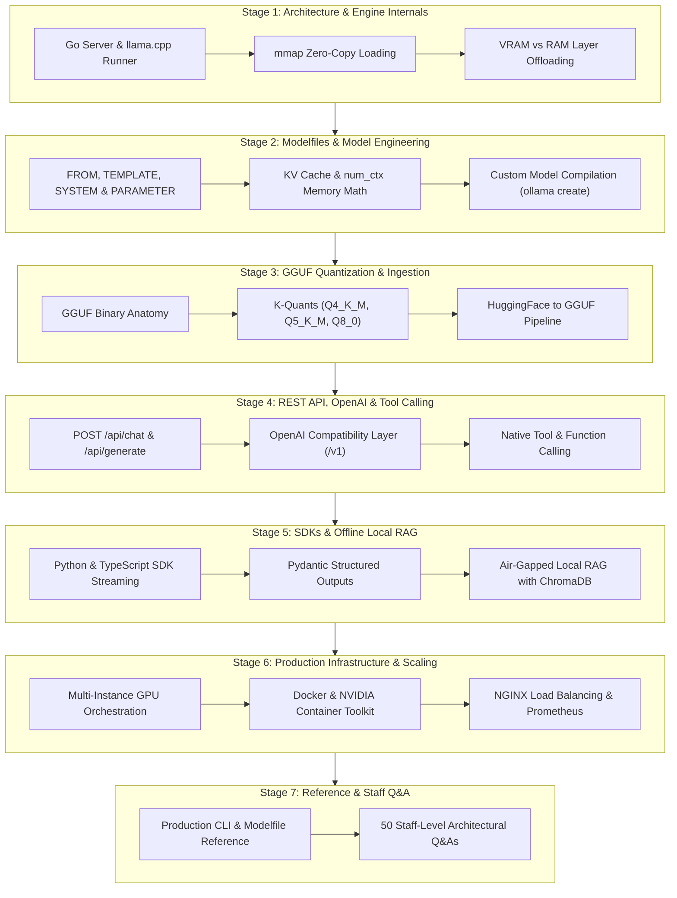

---

## Table of Contents
1. [Stage 1: Ollama Architecture & Core Engine Internals](#stage-1-ollama-architecture--core-engine-internals)
2. [Stage 2: Modelfiles & Custom Model Engineering](#stage-2-modelfiles--custom-model-engineering)
3. [Stage 3: GGUF Quantization & Model Ingestion](#stage-3-gguf-quantization--model-ingestion)
4. [Stage 4: REST API, OpenAI Compatibility & Tool/Function Calling](#stage-4-rest-api-openai-compatibility--toolfunction-calling)
5. [Stage 5: Python & TypeScript SDKs with Local RAG Integration](#stage-5-python--typescript-sdks-with-local-rag-integration)
6. [Stage 6: Production Infrastructure, Multi-GPU Scaling & Orchestration](#stage-6-production-infrastructure-multi-gpu-scaling--orchestration)
7. [Stage 7: Production API Reference & 50 Staff-Level Interview Questions](#stage-7-production-api-reference--50-staff-level-interview-questions)

---

## Stage 1: Ollama Architecture & Core Engine Internals

### 1.1 The Local LLM Revolution: Why Ollama Dominates Edge & On-Premise Inference

Deploying Large Language Models within internal enterprise networks is essential for data privacy, compliance (HIPAA, GDPR, SOC2), zero-latency local workflows, and eliminating recurring per-token cloud API bills. **Ollama** has become the industry standard runtime for running, serving, and customizing open-weight LLMs locally.

Ollama bridges high-level developer ergonomics (a Docker-like CLI and REST API) with ultra-performant, low-level C++ tensor computation powered by **`llama.cpp`**:

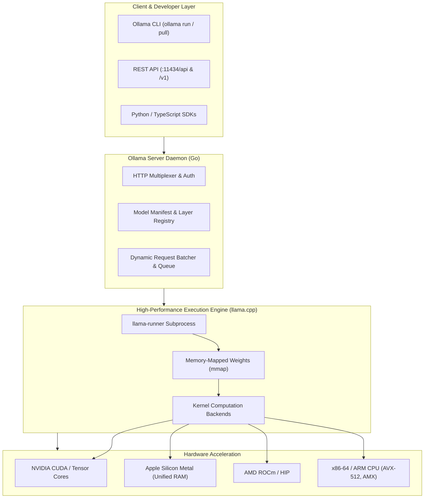

---

### 1.2 The Go Server & Subprocess Runner Isolation Architecture

Ollama does not embed the C++ LLM inference engine directly into the Go web server process. Instead, it utilizes a robust **Subprocess Runner Architecture**:

1. **Crash Isolation**: If a low-level C++ CUDA kernel throws an illegal memory access or segmentation fault, only the isolated `llama-runner` subprocess terminates. The parent Go daemon remains healthy, immediately logs the failure, and returns an HTTP 500 error rather than crashing the entire host service.
2. **Dynamic Backend Selection**: Upon startup, the Go daemon inspects the host hardware (`lspci`, `nvidia-smi`, Metal availability). It dynamically selects and executes the optimal compiled runner binary (`runners/cuda_v12`, `runners/cuda_v11`, `runners/rocm`, `runners/cpu_avx2`).
3. **IPC via Unix Domain Sockets / Local Named Pipes**: Communication between the Go HTTP server and the `llama-runner` engine occurs over high-speed local IPC, minimizing serialization overhead.

---

### 1.3 Memory Architecture: VRAM vs RAM, mmap & Zero-Copy Loading

Understanding how Ollama loads neural network weights into memory is crucial for optimizing throughput and avoiding Out-Of-Memory (OOM) crashes.

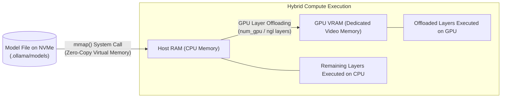

#### Key Memory Mechanisms:
- **`mmap` (Memory Mapping)**: Ollama reads model files using the OS `mmap()` system call. Instead of reading tens of gigabytes from disk into RAM buffers sequentially, the OS maps the GGUF file directly into the process's virtual address space. Pages are paged in on demand, enabling sub-second cold starts when re-invoking models.
- **Layer Offloading (`ngl` / `num_gpu`)**: Neural networks consist of stacked transformer blocks (e.g. 32 layers for Llama-3-8B, 80 layers for Llama-3-70B). Ollama calculates available GPU VRAM and transfers as many layers as possible to the GPU. 
  - **Full Offload**: All layers fit in VRAM $\rightarrow$ Maximum throughput (e.g. 80–120 tokens/sec).
  - **Partial Offload**: Layers are split between GPU and CPU $\rightarrow$ Memory bandwidth bottleneck over PCIe bus (e.g. 15–30 tokens/sec).
  - **CPU Only**: All layers execute in system RAM via AVX2/AVX-512 instructions (e.g. 4–10 tokens/sec).

---

### 1.4 The Ollama Blob Storage & Manifest Layer System

Ollama stores models in an OCI-compliant (Docker-like) content-addressable layer system, typically located at:
- **Linux**: `/usr/share/ollama/.ollama/models`
- **macOS**: `~/.ollama/models`
- **Windows**: `C:\Users\<User>\.ollama\models`

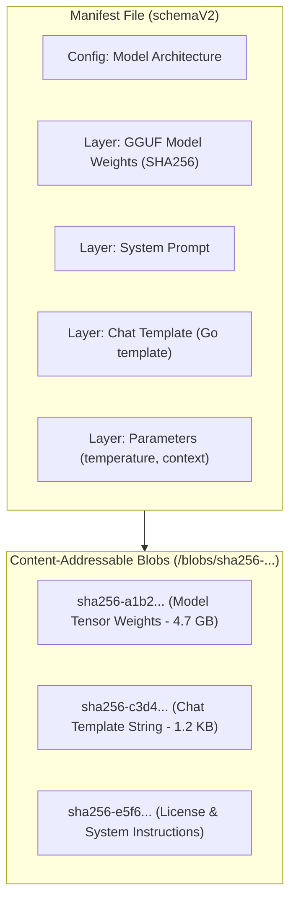

When you pull two variations of a model (e.g. `llama3:8b` and a customized company variant created with a `Modelfile`), Ollama deduplicates the underlying 4.7 GB weight blob, storing only the new metadata delta.

---

### 1.5 Installing and Verifying Ollama in Production

#### Linux Enterprise Installation (Systemd Service)
```bash
# Automated installation script
curl -fsSL https://ollama.com/install.sh | sh

# Verify systemd service status
sudo systemctl status ollama

# Configure environment variables (override systemd service)
sudo systemctl edit ollama.service
```

Add production environment overrides in the systemd override file:
```ini
[Service]
Environment="OLLAMA_HOST=0.0.0.0:11434"
Environment="OLLAMA_ORIGINS=*"
Environment="OLLAMA_NUM_PARALLEL=4"
Environment="OLLAMA_MAX_LOADED_MODELS=2"
Environment="OLLAMA_KEEP_ALIVE=24h"
```

Reload and restart:
```bash
sudo systemctl daemon-reload
sudo systemctl restart ollama
```

Verify service connectivity:
```bash
curl http://localhost:11434/api/version
# Output: {"version":"0.5.x"}
```


---

## Stage 2: Modelfiles & Custom Model Engineering

### 2.1 The Modelfile: The Dockerfile of Local AI

Just as a `Dockerfile` packages an OS image, dependencies, and entrypoint binaries into a portable container, an **Ollama Modelfile** packages foundation weights, prompt templates, runtime hyperparameters, system guardrails, and LoRA adapters into a single redistributable model image.

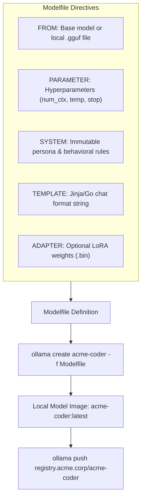

---

### 2.2 Deep-Dive into Modelfile Directives

| Directive | Description | Example / Syntax |
| :--- | :--- | :--- |
| **`FROM`** | Specifies the base model (pulled from registry) or an absolute path to a local GGUF file. | `FROM llama3.2:3b` or `FROM ./models/mistral.gguf` |
| **`PARAMETER`** | Configures runtime inference parameters passed to the low-level engine. | `PARAMETER temperature 0.2` |
| **`SYSTEM`** | Establishes the authoritative system prompt defining behavior and boundaries. | `SYSTEM "You are a senior Linux kernel security auditor."` |
| **`TEMPLATE`** | Formats multi-turn chat dialogues using Go template syntax. | `TEMPLATE '''{{ if .System }}...{{ end }}'''` |
| **`ADAPTER`** | Injects pre-trained Low-Rank Adaptation (LoRA) tensor weights. | `ADAPTER ./adapters/finance_lora.bin` |
| **`MESSAGE`** | Pre-populates few-shot conversational demonstration turns. | `MESSAGE user "Ping" \n MESSAGE assistant "Pong"` |
| **`LICENSE`** | Embeds legal and compliance terms into the image manifest. | `LICENSE "Apache 2.0"` |

---

### 2.3 Runtime Hyperparameter Reference (`PARAMETER`)

Fine-tuning inference parameters in the Modelfile directly impacts token quality, determinism, and memory consumption:

| Parameter | Type | Default | Description & Production Tuning Guidance |
| :--- | :--- | :--- | :--- |
| **`temperature`** | float | `0.8` | Controls randomness. Use `0.0` for code/SQL generation and classification; use `0.7–0.9` for creative writing. |
| **`num_ctx`** | int | `2048` | Context window size in tokens. Defaults to 2,048. Scale to `8192` or `32768` for RAG and large file analysis. Increases VRAM consumption. |
| **`top_k`** | int | `40` | Limits token sampling to the $K$ most probable tokens. Reduces gibberish generation. |
| **`top_p`** | float | `0.9` | Nucleus sampling: accumulates probability mass until reaching $P$. Balances diversity with coherence. |
| **`repeat_penalty`**| float | `1.1` | Penalizes repetitive phrasing and loops. Higher values (e.g. `1.2`) force vocabulary diversity. |
| **`num_gpu`** | int | auto | Number of transformer layers to offload to GPU. Set `999` to force all layers to VRAM. |
| **`stop`** | string| none | Stop token string. When generated, inference halts immediately (e.g. `"<|eot_id|>"`). |
| **`seed`** | int | `0` | Random number generator seed. Pin to a fixed integer for deterministic testing. |

---

### 2.4 Context Window (`num_ctx`) & VRAM Mathematics

Many developers assume context window expansion is free. In reality, the **Key-Value (KV) Cache** scales with context length and model dimensions:

$$\text{KV Cache Size (Bytes)} = 2 \times \text{num\_layers} \times \text{num\_kv\_heads} \times \text{head\_dim} \times \text{num\_ctx} \times \text{bytes\_per\_element}$$

For an 8B model (e.g., Llama 3 8B with 32 layers, 8 KV heads, head dimension 128, FP16 precision):
- At `num_ctx 2048`: KV Cache $\approx$ **256 MB** of VRAM.
- At `num_ctx 8192`: KV Cache $\approx$ **1.0 GB** of VRAM.
- At `num_ctx 32768`: KV Cache $\approx$ **4.1 GB** of VRAM.
- At `num_ctx 131072`: KV Cache $\approx$ **16.4 GB** of VRAM *just for the context cache*, before accounting for the model's base 5 GB weight tensor!

Always balance `num_ctx` against available GPU memory.

---

### 2.5 Complete Production Modelfile Implementations

#### 1. Enterprise Secure Coding Assistant (`Modelfile.coder`)

```dockerfile
# Base foundation model
FROM codellama:13b-instruct

# Hardware & Context tuning
PARAMETER num_ctx 8192
PARAMETER temperature 0.1
PARAMETER top_p 0.95
PARAMETER repeat_penalty 1.15
PARAMETER num_gpu 999

# Custom Stop Tokens to prevent runaway generation
PARAMETER stop "<|endoftext|>"
PARAMETER stop "### User:"

# Authoritative Persona
SYSTEM '''You are HexaCoder, a Principal Application Security and Python Architect at Acme Corp.
Strict Engineering Rules:
1. Always produce PEP 8 compliant, type-annotated, modern Python 3.12+ code.
2. Every function must include robust error handling, defensive input sanitization, and docstrings.
3. Never use insecure libraries or functions (avoid eval, raw SQL strings, pickle, or hardcoded secrets).
4. Provide unit tests using pytest for every proposed implementation.
5. If a security vulnerability is identified in user code, explain the Common Weakness Enumeration (CWE) and remediate it.
'''

# Few-shot demonstration
MESSAGE user "How do I format an SQL query safely in Python?"
MESSAGE assistant '''Use parameterized queries with SQLAlchemy or your database driver:
```python
# SAFE: Parameterized execution prevents SQL injection
stmt = text("SELECT id, username FROM users WHERE email = :email")
result = session.execute(stmt, {"email": user_email}).fetchone()
```
Never concatenate user input directly into query strings.'''
```

#### 2. Deterministic JSON Structured Output Model (`Modelfile.json`)

```dockerfile
FROM llama3.2:3b

PARAMETER temperature 0.0
PARAMETER num_ctx 4096
PARAMETER stop "```"

SYSTEM '''You are a deterministic JSON extraction engine.
You MUST output valid, parseable JSON conforming strictly to the requested schema.
Do NOT include any conversational commentary, introductory text, or markdown fences outside the JSON object.
''''
```

---

### 2.6 Building, Inspecting & Distributing Custom Models

```bash
# 1. Build the model image from the Modelfile
ollama create acme-coder:v1 -f ./Modelfile.coder

# 2. Inspect model architecture, layers, and hyperparameters
ollama show --modelfile acme-coder:v1
ollama show --parameters acme-coder:v1

# 3. Test interactively via CLI
ollama run acme-coder:v1 "Write a thread-safe singleton cache in Python."

# 4. Tag for private enterprise registry
ollama tag acme-coder:v1 registry.internal.corp/models/acme-coder:v1

# 5. Push to remote registry
ollama push registry.internal.corp/models/acme-coder:v1
```


---

## Stage 3: GGUF Quantization & Model Ingestion

### 3.1 The GGUF Format: Anatomy of Modern Quantized Weights

Open-weight LLMs are typically released by research labs in **FP16** (16-bit floating point) or **BF16** (Bfloat16) precision using HuggingFace `safetensors`. An unquantized 70-billion parameter model requires over **140 Gigabytes of VRAM**—requiring multi-GPU enterprise servers (e.g. 2x NVIDIA A100 80GB).

**GGUF** (GPT-Generated Unified Format) is the modern binary standard developed by Georgi Gerganov and the `llama.cpp` community. It provides:
1. **Single-File Portability**: Weights, hyperparameters, tokenizer vocabs, and chat templates packaged in a single binary.
2. **Metadata Extensibility**: Self-describing key-value metadata headers stored at the start of the file.
3. **mmap Friendliness**: Memory alignment designed specifically for zero-copy OS paging.
4. **Quantization Precision Variety**: State-of-the-art $k$-quants (Q4_K_M, Q5_K_M) minimizing perplexity loss.

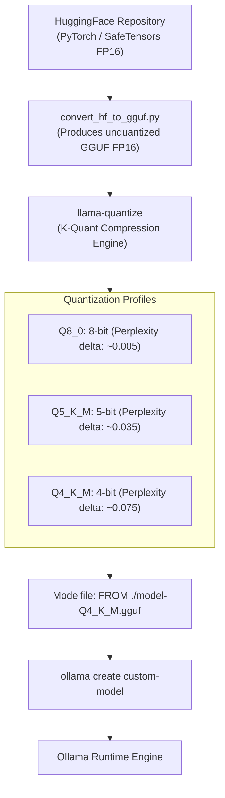

---

### 3.2 Quantization Profiles & Perplexity Trade-Offs

Quantization compresses 16-bit floating point numbers ($16\text{ bits} = 2\text{ bytes}$) into smaller bit representations ($4, 5,\text{ or } 8\text{ bits}$), reducing memory footprints and memory bandwidth requirements by $50\%\text{ to }75\%$:

| Quantization Type | Bits per Weight | 8B VRAM Size | 70B VRAM Size | Perplexity Impact | Recommended Use Case |
| :--- | :--- | :--- | :--- | :--- | :--- |
| **FP16 / BF16** | 16.0 | ~16.0 GB | ~140.0 GB | None (Ground Truth) | Baseline reference / Fine-tuning |
| **Q8_0** | 8.5 | ~8.5 GB | ~72.0 GB | Extremely Minimal ($<0.01$) | Max quality when sufficient VRAM exists |
| **Q6_K** | 6.56 | ~6.6 GB | ~56.0 GB | Negligible ($<0.02$) | High-fidelity reasoning and complex math |
| **Q5_K_M** | 5.5 | ~5.5 GB | ~47.0 GB | Very Low ($<0.04$) | **Optimal Quality/VRAM Sweet Spot** |
| **Q4_K_M** | 4.5 | ~4.7 GB | ~41.0 GB | Low ($<0.08$) | **Default Standard for Consumer Hardware** |
| **Q3_K_M** | 3.5 | ~3.8 GB | ~33.0 GB | Moderate ($>0.20$) | Constrained hardware edge devices |
| **Q2_K** | 2.5 | ~3.0 GB | ~26.0 GB | High ($>0.60$) | Severe degradation; avoid for production |

> [!TIP]
> **What is a "K-Quant"?**  
> Traditional quantization applies a uniform bit width across all layers. **K-Quants** use mixed precision: critical attention layers (`attn_v`, `attn_k`) and feed-forward gate weights are kept at higher precision (e.g. 5-bit or 6-bit), while less sensitive down-projection weights are compressed to 4-bit. This achieves 4-bit size with near 5-bit accuracy.

---

### 3.3 End-to-End Pipeline: Converting HuggingFace Models to GGUF

To import custom fine-tuned weights (e.g., from Unsloth, HuggingFace TRL, or internal PyTorch training) into Ollama, follow this conversion pipeline:

#### Step 1: Clone `llama.cpp` and Install Python Tooling
```bash
git clone https://github.com/ggerganov/llama.cpp
cd llama.cpp
pip install -r requirements.txt
make -j  # Compiles llama-quantize and runtime binaries
```

#### Step 2: Convert HuggingFace Directory to Unquantized GGUF
```bash
python convert_hf_to_gguf.py /path/to/hf_model/ \
    --outfile ./my_model_fp16.gguf \
    --outtype f16
```

#### Step 3: Quantize to Production-Grade `Q4_K_M`
```bash
./llama-quantize ./my_model_fp16.gguf ./my_model_q4_k_m.gguf Q4_K_M
```

#### Step 4: Inspect GGUF Metadata with `gguf-dump`
```bash
python -m gguf.dump ./my_model_q4_k_m.gguf
# Outputs tensor list, vocab size, context length, and architecture type
```

---

### 3.4 Ingesting GGUF Binaries into Ollama

Once you have your `.gguf` file, importing it into Ollama requires a two-line Modelfile:

```dockerfile
# Modelfile
FROM ./my_model_q4_k_m.gguf

# Set default context length and parameters
PARAMETER num_ctx 8192
PARAMETER temperature 0.2

TEMPLATE '''{{ if .System }}<|start_header_id|>system<|end_header_id|>

{{ .System }}<|eot_id|>{{ end }}{{ if .Prompt }}<|start_header_id|>user<|end_header_id|>

{{ .Prompt }}<|eot_id|>{{ end }}<|start_header_id|>assistant<|end_header_id|>

{{ .Response }}<|eot_id|>'''
```

Register the model into Ollama's local registry:
```bash
ollama create my-quantized-model -f ./Modelfile
```

Verify that the model was successfully created and inspect its quantization:
```bash
ollama list
# Output:
# NAME                         ID              SIZE      MODIFIED
# my-quantized-model:latest    a1b2c3d4e5f6    4.7 GB    10 seconds ago

ollama show --parameters my-quantized-model
```


---

## Stage 4: REST API, OpenAI Compatibility & Tool/Function Calling

### 4.1 Native REST API Architecture

Ollama exposes a high-throughput HTTP REST API on port `11434`. By default, responses are streamed as newline-delimited JSON (`ndjson`), but can be toggled to synchronous single payloads via `"stream": false`.

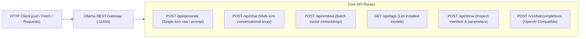

---

### 4.2 Comprehensive REST Endpoint Reference

#### 1. Multi-Turn Chat Completion (`POST /api/chat`)
The primary endpoint for conversational workflows:

```bash
curl http://localhost:11434/api/chat -d '{
  "model": "llama3.2:3b",
  "messages": [
    {"role": "system", "content": "You are a concise enterprise database architect."},
    {"role": "user", "content": "Explain write amplification in LSM-trees in one sentence."}
  ],
  "stream": false,
  "options": {
    "temperature": 0.0,
    "num_ctx": 4096
  }
}'
```

**JSON Response Payload:**
```json
{
  "model": "llama3.2:3b",
  "created_at": "2026-09-29T15:20:00.000Z",
  "message": {
    "role": "assistant",
    "content": "Write amplification in LSM-trees occurs because incoming mutations are written to sequential append-only logs and subsequently re-written multiple times during background compaction phases."
  },
  "done": true,
  "total_duration": 482910200,
  "load_duration": 1289400,
  "prompt_eval_count": 38,
  "prompt_eval_duration": 129402000,
  "eval_count": 35,
  "eval_duration": 351980000
}
```

#### Key Telemetry Metrics in API Responses
- `total_duration`: Total time spent handling the request (in nanoseconds).
- `prompt_eval_count`: Number of tokens in the input prompt.
- `prompt_eval_duration`: Time taken to process the prompt and fill the KV cache (prefill phase).
- `eval_count`: Number of tokens generated in the output.
- `eval_duration`: Time taken to generate the output tokens (decode phase).
- **Inference Speed**: Calculated as $(\text{eval\_count} / \text{eval\_duration}) \times 10^9 = \text{Tokens per Second}$.

#### 2. Vector Embeddings (`POST /api/embed`)
Batch vector generation endpoint for semantic search and RAG:

```bash
curl http://localhost:11434/api/embed -d '{
  "model": "nomic-embed-text",
  "input": [
    "Enterprise search query",
    "PostgreSQL pgvector indexing strategy"
  ]
}'
```

---

### 4.3 OpenAI Drop-In Compatibility (`/v1/chat/completions`)

Ollama provides a built-in OpenAI API emulation layer. This enables instant integration with existing enterprise codebases, libraries, and frameworks (LangChain, AutoGen, CrewAI, Vercel AI SDK) simply by changing the `base_url`:

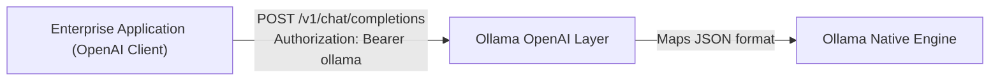

#### Drop-In Python Example using official `openai` SDK

```python
from openai import OpenAI

# Point client to local Ollama instance
client = OpenAI(
    base_url="http://localhost:11434/v1",
    api_key="ollama"  # Required by SDK, but ignored by Ollama
)

response = client.chat.completions.create(
    model="llama3.1:8b",
    messages=[
        {"role": "system", "content": "You are a senior DevOps SRE."},
        {"role": "user", "content": "Explain Kubernetes readiness vs liveness probes."}
    ],
    temperature=0.2,
    max_tokens=500
)

print(response.choices[0].message.content)
```

---

### 4.4 Native Tool & Function Calling with Local Models

Models such as **Llama 3.1**, **Llama 3.2**, **Qwen 2.5**, and **Mistral** support native structured tool calling inside Ollama. The client passes JSON schemas in the `tools` array:

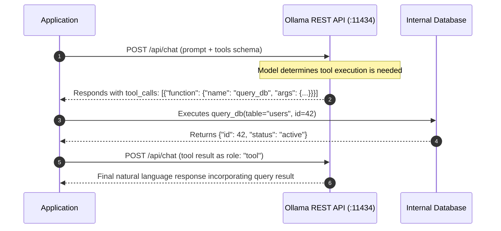

#### Raw cURL Implementation of Tool Calling

```bash
curl http://localhost:11434/api/chat -d '{
  "model": "llama3.1:8b",
  "messages": [
    {"role": "user", "content": "What is the stock price of Apple (AAPL)?"}
  ],
  "stream": false,
  "tools": [
    {
      "type": "function",
      "function": {
        "name": "get_stock_quote",
        "description": "Fetch current stock price and trading volume for a ticker symbol.",
        "parameters": {
          "type": "object",
          "properties": {
            "symbol": {
              "type": "string",
              "description": "The stock ticker symbol (e.g. AAPL, TSLA)"
            }
          },
          "required": ["symbol"]
        }
      }
    }
  ]
}'
```

**Model Output with Tool Call:**
```json
{
  "message": {
    "role": "assistant",
    "content": "",
    "tool_calls": [
      {
        "function": {
          "name": "get_stock_quote",
          "arguments": {
            "symbol": "AAPL"
          }
        }
      }
    ]
  }
}
```

---

### 4.5 Multimodal Vision Inference with Local Models

Ollama natively supports multimodal vision models such as **`llama3.2-vision`**, **`llava`**, and **`bakllava`**. Image data is transmitted directly as base64-encoded strings within the `images` array of the message object:

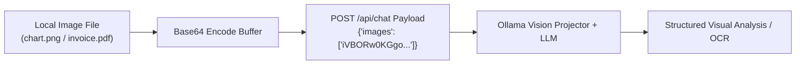

#### Python Vision API Implementation
```python
import base64
import ollama

def analyze_infrastructure_diagram(image_path: str) -> str:
    '''Encodes an architecture diagram and queries llama3.2-vision.'''
    with open(image_path, "rb") as f:
        image_bytes = f.read()
        base64_encoded = base64.b64encode(image_bytes).decode("utf-8")

    client = ollama.Client()
    response = client.chat(
        model="llama3.2-vision:11b",
        messages=[
            {
                "role": "user",
                "content": "Analyze this cloud infrastructure diagram. Identify single points of failure and security misconfigurations.",
                "images": [base64_encoded]
            }
        ],
        options={"temperature": 0.1}
    )
    return response.message.content
```


---

## Stage 5: Python & TypeScript SDKs with Local RAG Integration

### 5.1 Official SDK Architecture: Python & TypeScript

Ollama provides first-party SDKs for Python (`ollama-python`) and TypeScript (`ollama-js`) that wrap streaming connections, asynchronous operations, and schema validation:

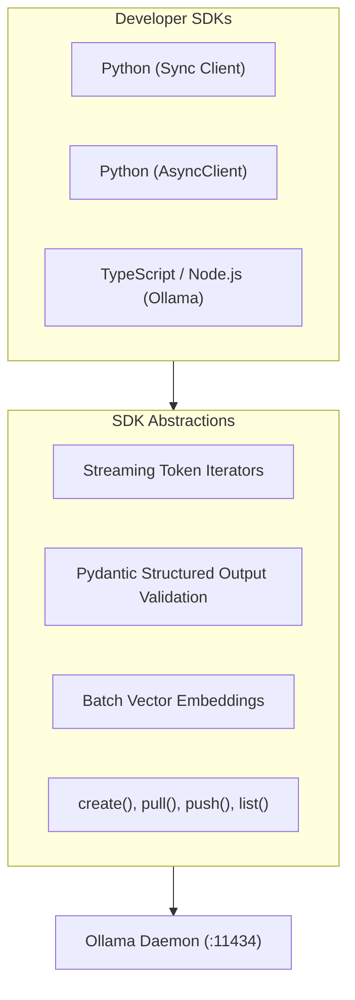

---

### 5.2 Python SDK: Streaming & Structured Pydantic Outputs

The Python SDK provides native integration with **Pydantic** to enforce structured JSON outputs directly from local models:

```python
import asyncio
from typing import List, Optional
from pydantic import BaseModel, Field
import ollama

# 1. Define Strict Pydantic Data Contract
class IncidentReport(BaseModel):
    service_name: str = Field(description="Name of the impacted microservice")
    severity: str = Field(description="Incident severity: P0, P1, P2, or P3")
    root_cause: str = Field(description="One-sentence technical summary of the failure")
    mitigation_steps: List[str] = Field(description="Chronological steps to restore service")

# 2. Async Client Streaming with Structured Validation
async def extract_incident_telemetry(raw_log: str) -> IncidentReport:
    client = ollama.AsyncClient(host="http://localhost:11434")
    
    response = await client.chat(
        model="llama3.2:3b",
        messages=[
            {
                "role": "system",
                "content": "You are a site reliability engineering log analyzer. Extract incident metadata."
            },
            {"role": "user", "content": raw_log}
        ],
        format=IncidentReport.model_json_schema(), # Enforces JSON schema constraint
        options={"temperature": 0.0}
    )
    
    # Parse and validate the JSON string directly into Pydantic model
    validated_report = IncidentReport.model_validate_json(response.message.content)
    return validated_report

# Example invocation
if __name__ == "__main__":
    sample_log = '''
    [ERROR] 2026-09-29 14:02:11 payments-svc: Redis connection timeout on cluster node 10.0.4.12.
    Circuit breaker tripped. 503 Service Unavailable returned to 4,210 checkout requests.
    Traffic failed over to secondary node 10.0.4.13. Latency stabilized.
    '''
    report = asyncio.run(extract_incident_telemetry(sample_log))
    print(f"Service: {report.service_name} | Severity: {report.severity}")
    print(f"Root Cause: {report.root_cause}")
    for idx, step in enumerate(report.mitigation_steps, 1):
        print(f"  {idx}. {step}")
```

---

### 5.3 TypeScript SDK: Native Streaming & Node.js Edge

```typescript
import { Ollama } from 'ollama';

const ollama = new Ollama({ host: 'http://localhost:11434' });

async function streamModelResponse(prompt: string): Promise<void> {
  const response = await ollama.chat({
    model: 'llama3.2:3b',
    messages: [{ role: 'user', content: prompt }],
    stream: true,
  });

  // Consume asynchronous streaming iterator
  for await (const part of response) {
    process.stdout.write(part.message.content);
  }
  console.log('\n[+] Stream Complete.');
}

streamModelResponse('Explain Raft consensus protocol in 3 concise bullet points.');
```

---

### 5.4 Building an Air-Gapped Local RAG Pipeline

A key use case for Ollama in security-conscious organizations is building **100% offline, air-gapped Retrieval-Augmented Generation (RAG)** pipelines. Zero bytes ever leave the local machine:

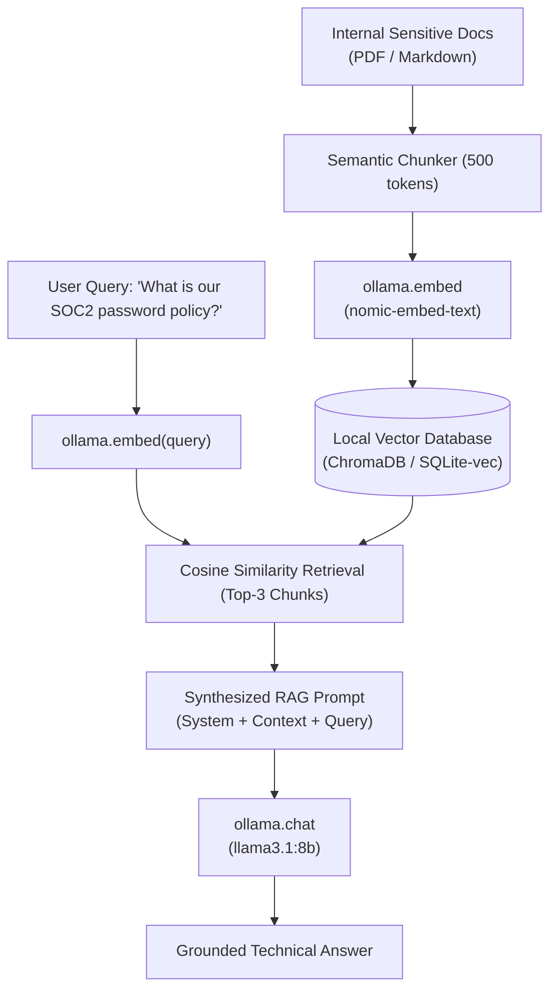

#### Complete Implementation: Local Offline RAG with ChromaDB

```python
import ollama
import chromadb
from chromadb.api.types import Documents, EmbeddingFunction, Embeddings

# 1. Custom Ollama Embedding Function for ChromaDB
class OllamaEmbeddingFunction(EmbeddingFunction):
    def __init__(self, model_name: str = "nomic-embed-text", host: str = "http://localhost:11434"):
        self.client = ollama.Client(host=host)
        self.model_name = model_name

    def __call__(self, input: Documents) -> Embeddings:
        response = self.client.embed(model=self.model_name, input=input)
        return response.embeddings

# 2. Initialize ChromaDB Vector Collection
chroma_client = chromadb.PersistentClient(path="./local_rag_storage")
embed_fn = OllamaEmbeddingFunction(model_name="nomic-embed-text")

collection = chroma_client.get_or_create_collection(
    name="enterprise_policies",
    embedding_function=embed_fn,
    metadata={"hnsw:space": "cosine"}
)

# 3. Ingest Sensitive Documents
sample_docs = [
    "ACME Corp Security Policy 4.1: Passwords must be at least 16 characters with multi-factor authentication.",
    "ACME Corp Data Retention 8.2: Database backups must be archived to immutable WORM storage for 7 years.",
    "ACME Corp Remote Work 2.0: Access to production VPCs requires a company-managed YubiKey hardware token."
]

collection.add(
    documents=sample_docs,
    ids=[f"doc_{i}" for i in range(len(sample_docs))]
)

# 4. Query Pipeline with Contextual Synthesis
def query_local_rag(user_question: str) -> str:
    # Retrieve top 2 most relevant passages
    results = collection.query(query_texts=[user_question], n_results=2)
    retrieved_context = "\n---\n".join(results["documents"][0])

    rag_prompt = f'''You are an enterprise compliance auditor.
Answer the user question strictly using the provided context. If the answer cannot be found in the context, reply 'Information not available in policy documents.'

Context:
{retrieved_context}

Question:
{user_question}'''

    client = ollama.Client()
    response = client.chat(
        model="llama3.2:3b",
        messages=[{"role": "user", "content": rag_prompt}],
        options={"temperature": 0.0}
    )
    return response.message.content

if __name__ == "__main__":
    answer = query_local_rag("What are the hardware requirements for connecting to production VPCs?")
    print("[+] Grounded Answer:\n", answer)
```


---

## Stage 6: Production Infrastructure, Multi-GPU Scaling & Orchestration

### 6.1 Enterprise Daemon Configuration & Concurrency Tuning

In default standalone installations, Ollama processes requests serially and unloads models after 5 minutes of inactivity. For high-throughput enterprise deployments, these parameters must be configured via environment variables:

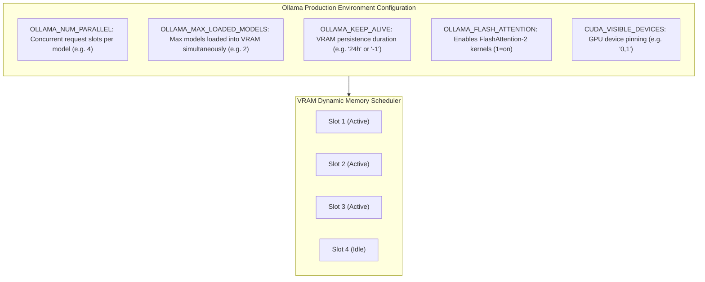

| Environment Variable | Default | Recommended Production Value | Description |
| :--- | :--- | :--- | :--- |
| **`OLLAMA_HOST`** | `127.0.0.1:11434`| `0.0.0.0:11434` | Network interface binding. Must be `0.0.0.0` for Docker/Kubernetes container networks. |
| **`OLLAMA_NUM_PARALLEL`**| `1` (or auto) | `4` to `8` | Number of parallel requests a single model instance can process simultaneously using continuous batching. Increases KV cache memory proportionally. |
| **`OLLAMA_MAX_LOADED_MODELS`** | `1` (or auto) | `2` to `4` | Maximum number of distinct models held in VRAM at the same time (e.g., an LLM + an embedding model). |
| **`OLLAMA_KEEP_ALIVE`**| `5m` | `24h` or `-1` | Duration a model remains pinned in VRAM after its last request. Set to `-1` or `24h` in production to prevent 5-second reload latency penalties. |
| **`OLLAMA_FLASH_ATTENTION`** | `0` (off) | `1` (on) | Enables FlashAttention kernels in `llama.cpp`, drastically reducing KV-cache VRAM and accelerating generation on Ampere/Ada/Hopper GPUs. |
| **`OLLAMA_ORIGINS`** | Local only | `https://*.internal.corp` | Permitted Cross-Origin Resource Sharing (CORS) domains. Set to `*` only behind internal VPN gateways. |

---

### 6.2 Containerized Docker Deployment with NVIDIA GPU Passthrough

Deploying Ollama in Kubernetes or Docker Swarm requires the **NVIDIA Container Toolkit** for CUDA driver passthrough:

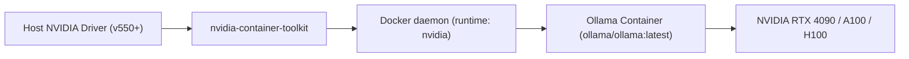

#### Production `docker-compose.yml` Manifest

```yaml
version: '3.8'

services:
  ollama-gpu:
    image: ollama/ollama:latest
    container_name: enterprise-ollama-node
    restart: always
    ports:
      - "11434:11434"
    environment:
      - OLLAMA_HOST=0.0.0.0:11434
      - OLLAMA_NUM_PARALLEL=4
      - OLLAMA_MAX_LOADED_MODELS=2
      - OLLAMA_KEEP_ALIVE=24h
      - OLLAMA_FLASH_ATTENTION=1
    volumes:
      - ollama_storage:/root/.ollama
    deploy:
      resources:
        reservations:
          devices:
            - driver: nvidia
              count: all
              capabilities: [gpu]
    healthcheck:
      test: ["CMD-SHELL", "ollama list || exit 1"]
      interval: 15s
      timeout: 5s
      retries: 3
      start_period: 20s

volumes:
  ollama_storage:
    name: ollama_persistent_models
```

---

### 6.3 High-Availability Load Balancing with NGINX

When deploying Ollama in production clusters handling hundreds of concurrent users, horizontal scaling across a pool of GPU worker nodes fronted by a reverse proxy prevents saturation:

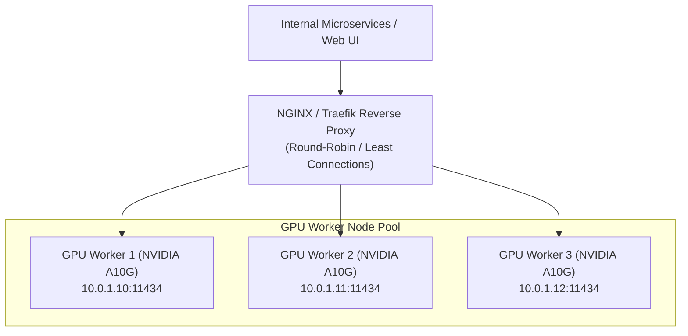

#### Production NGINX Load Balancer Configuration (`nginx.conf`)

```nginx
events { worker_connections 2048; }

http {
    upstream ollama_cluster {
        least_conn; # Route traffic to worker with fewest active connections
        server 10.0.1.10:11434 max_fails=3 fail_timeout=10s;
        server 10.0.1.11:11434 max_fails=3 fail_timeout=10s;
        server 10.0.1.12:11434 max_fails=3 fail_timeout=10s;
    }

    server {
        listen 80;
        server_name llm.internal.corp;

        # Disable buffering to preserve token streaming latency
        proxy_buffering off;
        proxy_read_timeout 300s;
        proxy_connect_timeout 5s;
        proxy_send_timeout 300s;

        location / {
            proxy_pass http://ollama_cluster;
            proxy_set_header Host $host;
            proxy_set_header X-Real-IP $remote_addr;
            proxy_set_header X-Forwarded-For $proxy_add_x_forwarded_for;
            proxy_set_header X-Forwarded-Proto $scheme;
            
            # SSE streaming support
            proxy_http_version 1.1;
            proxy_set_header Connection "";
        }
    }
}
```

---

### 6.4 Metrics, Health Checks & Observability

Monitoring inference latency and GPU utilization is vital for capacity planning. While Ollama provides HTTP health endpoints (`/api/tags`), use the Prometheus `ollama_exporter` or NVIDIA `dcgm-exporter` to aggregate cluster telemetry:

```bash
# Health check probe
curl -f http://localhost:11434/api/tags || exit 1

# Inspect active running models in VRAM
ollama ps
# Output:
# NAME             ID              SIZE      PROCESSOR    UNTIL
# llama3.2:3b      a1b2c3d4e5f6    2.0 GB    100% GPU     23h59m
# nomic-embed-text e8f9a0b1c2d3    274 MB    100% GPU     23h59m
```

#### Key Prometheus Metrics to Alert On:
1. **GPU VRAM Utilization (`DCGM_FI_DEV_FB_USED`)**: Alert if $>92\%$ to prevent OOM errors during peak context lengths.
2. **Inference Decode Rate**: Alert if tokens/sec drops below threshold (e.g. $<20\text{ tps}$ indicates CPU fallback).
3. **Queue Wait Duration**: Alert if HTTP requests wait in queue $>2.0\text{ seconds}$, signaling the need to scale additional Ollama GPU nodes.

---

### 6.5 Kubernetes Enterprise Deployment Manifest

In production cloud environments (AWS EKS, GKE, on-prem OpenShift), run Ollama as a stateful or persistent deployment requesting NVIDIA GPU resources:

```yaml
apiVersion: apps/v1
kind: Deployment
metadata:
  name: ollama-cluster
  namespace: ai-inference
  labels:
    app: ollama
spec:
  replicas: 3
  selector:
    matchLabels:
      app: ollama
  template:
    metadata:
      labels:
        app: ollama
    spec:
      containers:
      - name: ollama
        image: ollama/ollama:latest
        imagePullPolicy: IfNotPresent
        env:
        - name: OLLAMA_HOST
          value: "0.0.0.0:11434"
        - name: OLLAMA_NUM_PARALLEL
          value: "4"
        - name: OLLAMA_MAX_LOADED_MODELS
          value: "2"
        - name: OLLAMA_KEEP_ALIVE
          value: "24h"
        - name: OLLAMA_FLASH_ATTENTION
          value: "1"
        ports:
        - containerPort: 11434
          name: http
        resources:
          limits:
            nvidia.com/gpu: "1" # Request dedicated GPU
            memory: "32Gi"
            cpu: "8"
          requests:
            nvidia.com/gpu: "1"
            memory: "16Gi"
            cpu: "4"
        volumeMounts:
        - name: model-cache
          mountPath: /root/.ollama
        readinessProbe:
          httpGet:
            path: /api/tags
            port: 11434
          initialDelaySeconds: 15
          periodSeconds: 10
        livenessProbe:
          httpGet:
            path: /api/tags
            port: 11434
          initialDelaySeconds: 30
          periodSeconds: 15
      volumes:
      - name: model-cache
        persistentVolumeClaim:
          claimName: nfs-ollama-model-store-pvc
---
apiVersion: v1
kind: Service
metadata:
  name: ollama-service
  namespace: ai-inference
spec:
  type: ClusterIP
  selector:
    app: ollama
  ports:
  - port: 11434
    targetPort: 11434
    name: http
```


---

## Stage 7: Production API Reference & 50 Staff-Level Interview Questions

### 7.1 Production CLI & Modelfile Reference Cheatsheet

#### Ollama CLI Command Reference

```bash
# Model Lifecycle & Execution
ollama run <model>                  # Runs model interactively (pulls automatically if absent)
ollama run <model> --verbose        # Runs model emitting generation tokens/sec telemetry
ollama pull <model>                 # Downloads model weights and layers from registry
ollama push <repo/model:tag>        # Pushes custom model to remote Ollama registry
ollama list                         # Lists all locally installed model images
ollama ps                           # Displays models currently loaded in RAM/VRAM
ollama rm <model>                   # Deletes model image from local disk
ollama cp <source> <target>         # Duplicates/aliases an existing model tag
ollama show <model>                 # Displays architecture, template, and parameters
ollama show --modelfile <model>     # Dumps the exact Modelfile used to build the image
ollama create <name> -f <file>      # Compiles a new model image from a Modelfile
```

#### Modelfile Syntax Cheatsheet

```dockerfile
# 1. Base Model Specification
FROM llama3.2:3b                    # Base registry image
# FROM ./models/custom-Q4_K_M.gguf  # Or local GGUF binary file

# 2. Runtime Hyperparameters
PARAMETER temperature 0.2           # Sampling temperature (0.0 to 1.0)
PARAMETER top_p 0.9                 # Nucleus sampling threshold
PARAMETER top_k 40                  # Top-K candidate filtering
PARAMETER num_ctx 8192              # Context window token capacity
PARAMETER num_gpu 999               # Number of layers offloaded to VRAM (999=all)
PARAMETER repeat_penalty 1.15       # Penalty factor for repetitive n-grams
PARAMETER seed 42                   # Deterministic RNG seed
PARAMETER stop "<|eot_id|>"         # Explicit stop token sequence

# 3. System Instructions & Persona
SYSTEM '''You are a Principal Software Architect. Output strictly valid TypeScript.'''

# 4. Chat Template Definition (Go Template Syntax)
TEMPLATE '''{{ if .System }}<|start_header_id|>system<|end_header_id|>

{{ .System }}<|eot_id|>{{ end }}{{ if .Prompt }}<|start_header_id|>user<|end_header_id|>

{{ .Prompt }}<|eot_id|>{{ end }}<|start_header_id|>assistant<|end_header_id|>

{{ .Response }}<|eot_id|>'''
```

---

### 7.2 50 Staff-Level Technical Interview Questions & In-Depth Architectural Answers

#### Category 1: Local Inference Architecture & Engine Internals

##### Q1: What architectural relationship exists between Ollama, `llama.cpp`, and the Go runtime?
**Answer:**
Ollama is a high-level server daemon and model management platform written in **Go**. It acts as the control plane: handling HTTP routing, OCI-like blob storage, Modelfile parsing, hardware detection, and request queueing. 
For low-level tensor computation, Ollama forks an isolated C++ subprocess (`llama-runner`) dynamically linked to **`llama.cpp`**. The Go daemon communicates with the `llama-runner` over high-speed IPC (Unix domain sockets or pipes), ensuring that hardware-level memory faults (e.g. CUDA segmentation faults) isolate to the runner without crashing the primary Go server.

##### Q2: How does Ollama utilize the OS `mmap()` system call when loading models?
**Answer:**
When loading a GGUF model, Ollama uses `mmap()` (memory mapping) to map the file directly from the filesystem into the process's virtual memory address space. Instead of performing sequential disk reads into RAM buffers:
1. Virtual address ranges are assigned to model weight offsets.
2. The operating system kernel pages in memory blocks on demand as tensor layers are accessed.
3. If memory pressure occurs, clean read-only pages can be evicted from RAM without disk writes.
This architecture enables instant model cold-starts and allows multiple processes to share the same physical RAM pages for model weights.

##### Q3: What happens when an LLM is partially offloaded between GPU VRAM and CPU RAM?
**Answer:**
When a model's size exceeds available VRAM, Ollama splits the transformer layers: the initial $N$ layers execute on the GPU, while the remaining layers execute on the CPU using host RAM.
During inference, tensor activations must cross the **PCIe bus** twice per forward pass: once from GPU to CPU, and once back. Because PCIe bandwidth ($\approx 32–64\text{ GB/s}$ for PCIe 4.0/5.0) is an order of magnitude slower than GPU VRAM bandwidth ($\approx 1,000–2,000\text{ GB/s}$ on high-end GPUs), partial offloading introduces a severe memory bandwidth bottleneck, often dropping throughput from 80 tokens/sec down to 10–20 tokens/sec.

##### Q4: What is the difference between the "Prefill" (Prompt Evaluation) and "Decode" (Token Generation) phases in Ollama?
**Answer:**
- **Prefill (`prompt_eval`)**: The model processes the entire user input prompt in parallel. This phase is compute-bound, saturating GPU Tensor Cores to populate the Key-Value (KV) cache. High throughput is achieved (hundreds to thousands of tokens/sec).
- **Decode (`eval`)**: The model generates output tokens autoregressively, one token at a time. Each new token requires reading the entire model weight tensor from memory once. This phase is strictly memory-bandwidth bound. Throughput is limited by how fast VRAM can stream weights to the compute cores (typically 30–120 tokens/sec depending on hardware and model size).

##### Q5: How does Apple Silicon Unified Memory benefit Ollama compared to standard PC architectures?
**Answer:**
In standard PCs, system RAM (e.g. 64 GB DDR5) and GPU VRAM (e.g. 24 GB GDDR6X) are physically separate pools connected across a PCIe bus. Running a 70B model requires expensive multi-GPU enterprise hardware.
Apple Silicon uses a **Unified Memory Architecture (UMA)** where the CPU and Metal GPU share a single, massive high-bandwidth memory bus (up to $800\text{ GB/s}$ on M2/M3 Max/Ultra). A Mac Studio with 128 GB or 192 GB of unified RAM can load and execute a 70B parameter model entirely within GPU-accessible memory without requiring a dedicated $10,000 enterprise GPU.

---

#### Category 2: GGUF Quantization Mathematics & Weight Compression

##### Q6: What is GGUF, and why did it replace the older GGML and PyTorch checkpoint formats?
**Answer:**
GGUF (GPT-Generated Unified Format) replaced GGML because GGML was brittle: adding new model architectures or hyperparameters broke backward compatibility. 
GGUF is a binary file format featuring:
- **Self-describing metadata headers**: Stores architecture, vocabulary, tokenizer merges, context limits, and chat templates in extensible key-value pairs.
- **Single-file encapsulation**: No separate tokenizer or configuration JSON files needed.
- **Native mmap alignment**: Tensor byte alignments are padded to match OS page boundaries (typically 32-byte alignment) for zero-copy loading.
- **Support for advanced K-quants**: Enables mixed-precision quantization.

##### Q7: Explain the mathematical mechanism of 4-bit integer quantization (e.g. Q4_0).
**Answer:**
In Q4_0 quantization, weights originally represented as 32-bit floats are grouped into blocks (typically 32 consecutive weights). 
For each block:
1. The maximum absolute value is identified: $M = \max(|w_1|, \dots, |w_{32}|)$.
2. A scale factor $d = M / (-8)$ is computed and stored as an FP16 float (2 bytes).
3. Each individual weight $w_i$ is mapped to a 4-bit signed integer $q_i \in [-8, 7]$ via $q_i = \text{round}(w_i / d)$.
During matrix multiplication, the original float is approximated via $w_i \approx d \cdot q_i$. This compresses 32 16-bit floats ($32 \times 2 = 64\text{ bytes}$) into 32 4-bit nibbles ($16\text{ bytes}$) plus a 2-byte scale factor, achieving a $3.5\times$ memory reduction.

##### Q8: What is a "K-Quant" (e.g. Q4_K_M vs Q4_K_S) and why does it outperform legacy quantizations?
**Answer:**
Legacy quantizations (Q4_0, Q4_1) apply uniform bit widths across all tensors. However, transformer layers exhibit non-uniform sensitivity to precision loss:
- The attention Key and Value projections (`attn_k`, `attn_v`) and feed-forward gate projections are critical for coherence.
- The down-projection tensors can tolerate higher compression.
**K-Quants** use block-level scale-of-scales and mixed precision:
- `Q4_K_S`: Small 4-bit k-quant; all tensors use 4-bit quantization with super-blocks.
- `Q4_K_M`: Medium 4-bit k-quant; critical attention and gate tensors use 5-bit or 6-bit quantization, while other tensors use 4-bit. This yields superior perplexity (lower error) with negligible size increases.

##### Q9: What is Perplexity in LLM evaluation, and what perplexity delta is acceptable during quantization?
**Answer:**
Perplexity measures how well a probability model predicts a sample of text (the exponentiated cross-entropy loss). Lower perplexity indicates superior predictive accuracy.
When quantizing:
- $\Delta\text{ Perplexity} < 0.05$ (e.g. Q5_K_M, Q8_0): Indistinguishable from FP16 in real-world reasoning and coding.
- $\Delta\text{ Perplexity} \in [0.05, 0.15]$ (e.g. Q4_K_M): Minor degradation on complex multi-step reasoning, but excellent for standard tasks.
- $\Delta\text{ Perplexity} > 0.50$ (e.g. Q2_K): Substantial degradation; high hallucination and syntax errors.

##### Q10: Why does FP16 inference require twice the memory bandwidth of Q8_0 inference during the decode phase?
**Answer:**
Because during the decode phase, the GPU must stream every single parameter from VRAM into the compute cores for each token generated. In FP16, each parameter is 2 bytes; in Q8_0, each parameter is approximately 1 byte. Since decoding is memory-bandwidth bound, halving the byte size per parameter directly halves the bytes transferred over the memory bus, doubling theoretical tokens-per-second throughput.

---

#### Category 3: Modelfiles, Templates & Hyperparameter Tuning

##### Q11: Explain how Go templates work inside an Ollama Modelfile `TEMPLATE` directive.
**Answer:**
Ollama uses Go's standard `text/template` engine to format chat dialogues into the raw string expected by the model's tokenizer. The template receives context variables:
- `.System`: The system instructions.
- `.Prompt`: The user's input prompt.
- `.Response`: The assistant's generated response.
Conditionals like `{{ if .System }}...{{ end }}` ensure headers are only rendered when system prompts exist. Special tokens (like Llama 3's `<|start_header_id|>user<|end_header_id|>`) are embedded directly in the template to match the model's training formatting.

##### Q12: What happens if the `TEMPLATE` directive does not match the model's pre-trained chat format?
**Answer:**
The model suffers severe behavioral degradation. Open-weight models (Llama 3, Mistral, Qwen, Gemma) are fine-tuned with specific token delimiters. If the template omits these delimiters or misplaces role headers, the model fails to recognize where user instructions end and assistant responses begin, leading to conversational hallucination, premature termination, or repeating the user's prompt.

##### Q13: How does the Key-Value (KV) cache memory footprint scale with `PARAMETER num_ctx`?
**Answer:**
The KV cache stores attention keys and values for all past tokens in the context window. The memory formula is:
$$\text{Memory} = 2 \times \text{layers} \times \text{kv\_heads} \times \text{head\_dim} \times \text{num\_ctx} \times \text{bytes\_per\_element}$$
Because KV cache scales linearly with `num_ctx`, setting `num_ctx 32768` on an 8B model allocates over 4 GB of VRAM strictly to the KV cache. If multiple concurrent requests are processed (`OLLAMA_NUM_PARALLEL > 1`), each parallel slot requires its own KV cache, rapidly exhausting GPU memory.

##### Q14: How does `repeat_penalty` operate mathematically during token sampling?
**Answer:**
During token sampling, before applying softmax to the raw logits, the engine inspects the recent token history (typically the last 64 tokens). For any token ID that has already appeared in the history:
- If logit $> 0$, new logit = $\text{logit} / \text{repeat\_penalty}$.
- If logit $< 0$, new logit = $\text{logit} \times \text{repeat\_penalty}$.
A `repeat_penalty > 1.0` (e.g. 1.15) suppresses the probability of repeating recently generated words, breaking repetitive loops.

##### Q15: What is the purpose of the `ADAPTER` directive in a Modelfile?
**Answer:**
The `ADAPTER` directive injects a Low-Rank Adaptation (LoRA) weight file (in GGUF format) onto the base foundation weights specified in `FROM`. At load time, Ollama applies the rank decomposition matrices ($\Delta W = A \times B$) to the base weights, allowing deployment of specialized domain models (e.g., medical, legal, or proprietary code) without storing complete duplicate 16 GB base weight tensors.

---

#### Category 4: Concurrency, Batching & Memory Budgeting

##### Q16: How does Ollama handle concurrent incoming requests via `OLLAMA_NUM_PARALLEL`?
**Answer:**
`OLLAMA_NUM_PARALLEL` defines the number of concurrent execution slots allocated within the model's KV cache. When set to $N$ (e.g. 4), Ollama pre-allocates $N$ independent KV-cache contexts in VRAM. Incoming requests are assigned to idle slots and executed using continuous batching: the prefill and decode passes of multiple concurrent users are interleaved across GPU compute cycles.

##### Q17: What is the VRAM trade-off when increasing `OLLAMA_NUM_PARALLEL`?
**Answer:**
Increasing `OLLAMA_NUM_PARALLEL` multiplies the KV-cache VRAM requirement by $N$. If a model's base weights consume 5 GB and its KV cache at 8K context consumes 1 GB per slot:
- $N=1$: Total VRAM = $5 + 1 = 6\text{ GB}$.
- $N=4$: Total VRAM = $5 + (4 \times 1) = 9\text{ GB}$.
- $N=8$: Total VRAM = $5 + (8 \times 1) = 13\text{ GB}$.
If total VRAM exceeds physical GPU memory, Ollama is forced to offload transformer layers back to CPU RAM, crashing inference throughput.

##### Q18: What is `OLLAMA_KEEP_ALIVE` and how should it be configured in production?
**Answer:**
`OLLAMA_KEEP_ALIVE` governs how long a model remains loaded in GPU VRAM after completing a request (default: 5 minutes). In production environments, cold-starting a 70B model can take 10–30 seconds. Production deployments should configure `OLLAMA_KEEP_ALIVE=24h` or `-1` (infinite) to ensure models remain permanently pinned in VRAM. To forcefully unload a model to free VRAM for another workload, send an empty request with `"keep_alive": 0`.

##### Q19: What does `OLLAMA_FLASH_ATTENTION=1` do, and what are its hardware prerequisites?
**Answer:**
It enables FlashAttention-2 kernels within the underlying `llama.cpp` inference engine. FlashAttention tiles the attention computation to fit into GPU SRAM, reducing memory I/O from $O(N^2)$ to $O(N)$. This achieves:
1. Up to a 50% reduction in KV-cache VRAM consumption.
2. 2x to 4x faster prompt prefill evaluation on long contexts ($>4096\text{ tokens}$).
Prerequisite: NVIDIA GPU with Compute Capability 8.0+ (Ampere RTX 30xx/A100, Ada Lovelace RTX 40xx, Hopper H100).

##### Q20: How does `OLLAMA_MAX_LOADED_MODELS` manage multi-model memory allocation?
**Answer:**
It defines the maximum number of distinct models that can reside concurrently in memory. If `OLLAMA_MAX_LOADED_MODELS=2`, an application can keep both a chat model (`llama3.2:3b`) and an embedding model (`nomic-embed-text`) active in VRAM simultaneously without triggering model unload/reload thrashing between RAG steps.

---

#### Category 5: Tool Calling & Structured Outputs

##### Q21: How does Ollama execute native tool calling without external agent libraries?
**Answer:**
When tools are provided in the `tools` parameter of `POST /api/chat`, Ollama:
1. Injects the tool definitions and JSON schema specifications into the model's system prompt using the model's native function calling format (e.g. Llama 3.1 tool call headers).
2. Sets custom stop sequences and grammar constraints.
3. If the model determines a tool should be executed, it outputs a structured payload (e.g. `<|python_tag|>call:func_name{...}`).
4. Ollama intercepts this token stream, parses the call and arguments into a standardized JSON `tool_calls` array, and returns it to the client with `role: "assistant"`.

##### Q22: How does Ollama guarantee that a model's output is 100% valid JSON?
**Answer:**
When `"format": "json"` or a Pydantic schema is passed in an API request, Ollama uses **Context-Free Grammar (CFG) constrained decoding** powered by `llama.cpp` GBNF (GGML BNF) grammars. During each token generation step, the grammar parser masks out any token in the vocabulary whose addition would violate valid JSON syntax. As a result, the model is mathematically incapable of emitting invalid JSON characters.

##### Q23: What is the performance penalty of using grammar-constrained JSON decoding?
**Answer:**
Constrained decoding requires evaluating the grammar parser and filtering logits across the entire vocabulary (e.g. 128,000 tokens) at every decode step. This introduces a slight CPU latency overhead per token (typically 5–15%), but eliminates downstream JSON parsing failures and retry loops.

##### Q24: How does Ollama handle tool execution results returned by the client?
**Answer:**
The client executes the tool function and sends a follow-up `POST /api/chat` request containing the full message history: the original prompt, the assistant's `tool_calls` message, and a new message with `role: "tool"` containing the stringified result. The model uses this tool observation to generate the final natural language answer.

##### Q25: Can smaller quantized models (e.g. 1B to 3B parameters) reliably perform multi-turn tool calling?
**Answer:**
Smaller models (e.g. Llama 3.2 1B/3B) can execute simple single-tool calls if schemas are concise. However, they frequently suffer from schema hallucination, argument type coercion errors, and inability to handle multi-step tool sequencing when compared to 8B+ or 70B models. Best practice: use 8B+ models for reliable production tool calling.

---

#### Category 6: Enterprise Production Deployment & Infrastructure

##### Q26: Why must `OLLAMA_HOST=0.0.0.0:11434` be set when running inside Docker containers?
**Answer:**
By default, Ollama binds to `127.0.0.1` (the loopback interface). Inside a Docker container, `127.0.0.1` binds strictly to the container's isolated network namespace, making the port inaccessible from the host machine or other containers on the Docker bridge network. Setting `0.0.0.0` binds to all network interfaces within the container, allowing traffic from mapped ports (`-p 11434:11434`).

##### Q27: How do you configure multi-GPU tensor parallelism across two NVIDIA GPUs in Ollama?
**Answer:**
Set `CUDA_VISIBLE_DEVICES=0,1`. By default, `llama.cpp` detects both GPUs and automatically splits transformer layers across them (pipeline/layer parallelism). You can control the VRAM split ratio using the `--tensor-split` configuration flag in low-level settings or allow Ollama to balance layers proportionally based on free memory.

##### Q28: How do you handle zero-downtime model updates in high-availability Ollama clusters?
**Answer:**
Use blue-green deployments fronted by an NGINX or Traefik load balancer:
1. Spin up a new worker pool (Green) running the updated model version.
2. Send warm-up requests to Green with `keep_alive=-1` to pre-load weights into VRAM.
3. Update load balancer routing rules to shift traffic from Blue to Green.
4. Gracefully drain existing connections on Blue and terminate old instances.

##### Q29: What are the security risks of exposing Ollama port 11434 directly to the public internet?
**Answer:**
Ollama has **no native authentication, authorization, or rate limiting**. Exposing port 11434 allows unauthenticated external actors to:
- Issue unlimited inference requests, causing GPU denial-of-service.
- Call `POST /api/pull` or `POST /api/delete` to fill host NVMe drives or wipe models.
- Read system prompts and custom enterprise Modelfiles via `POST /api/show`.
Production deployments MUST place Ollama behind a secure reverse proxy (NGINX, Envoy, Traefik) enforcing TLS, API keys (Bearer tokens), and IP whitelisting.

##### Q30: How do you configure Prometheus alerting for an Ollama cluster?
**Answer:**
Deploy `ollama_exporter` alongside `nvidia-dcgm-exporter`. Configure alerts for:
- `ollama_model_load_duration_seconds > 10`: Warns of cold-start latency spikes.
- `ollama_eval_tokens_per_second < 15`: Warns of CPU fallback or GPU thermal throttling.
- `container_memory_usage_bytes > 90%`: Prevents host OS Out-Of-Memory (OOM) killer terminations.

---

#### Category 7: Advanced Troubleshooting & Edge Cases

##### Q31: Ollama's inference speed abruptly dropped from 90 tokens/sec to 4 tokens/sec. What happened?
**Answer:**
This indicates **CPU fallback**. Possible causes:
1. Another process (or a second model) consumed GPU VRAM, forcing Ollama to evict layers to system RAM.
2. The user requested an exceptionally large context window (`num_ctx`), causing the KV cache to exceed remaining VRAM.
3. NVIDIA driver crash or CUDA error triggering fallback to the CPU AVX2 runner.
Inspect `ollama ps` to verify whether the model is listed as `100% GPU` or `15% GPU / 85% CPU`.

##### Q32: What causes `CUDA error: out of memory` during the prefill phase on long inputs?
**Answer:**
While model weights remain constant, input prompt activations and the KV cache allocate dynamic memory. If an input prompt of 32,000 tokens is submitted without sufficient VRAM headroom, the prefill matrix multiplication buffers overflow available memory. Mitigation: enable `OLLAMA_FLASH_ATTENTION=1` or lower `num_ctx`.

##### Q33: How do you diagnose GPU thermal throttling in an Ollama server?
**Answer:**
Run `nvidia-smi -q -d PERFORMANCE,TEMPERATURE`. If the GPU core temperature exceeds $83^\circ\text{C}$ (or hotspot exceeds $95^\circ\text{C}$), the GPU hardware controller throttles clock speeds from 2,500 MHz down to 500 MHz to prevent silicon damage, resulting in an 80% drop in generation throughput.

##### Q34: What causes duplicate token generation loops (e.g. "the the the the...")?
**Answer:**
Sampling degeneracy. Often occurs when:
1. `temperature` is set to `0.0` on small, low-parameter models.
2. `repeat_penalty` is set to `1.0` (disabled).
3. The prompt ends abruptly without proper role tokens.
Mitigation: increase `repeat_penalty` to `1.15` and ensure chat templates terminate with appropriate stop tokens.

##### Q35: How does Ollama handle context overflow when conversation history exceeds `num_ctx`?
**Answer:**
In native `POST /api/chat`, if the conversation token length exceeds `num_ctx`, Ollama truncates earlier messages from the prompt evaluation buffer (while preserving the system prompt), discarding the oldest conversational turns to fit within the allotted KV cache.

##### Q36: How can you run Ollama in an air-gapped environment with zero internet access?
**Answer:**
1. On an internet-connected staging machine, pull required models: `ollama pull llama3.2:3b`.
2. Archive the model storage directory: `tar -czvf ollama_models.tar.gz /usr/share/ollama/.ollama/models`.
3. Transfer the tarball via secure physical media to the air-gapped machine.
4. Extract the archive into the air-gapped machine's `.ollama/models` directory.
5. Launch Ollama; all models appear immediately in `ollama list` without internet calls.

##### Q37: How do you calculate the maximum theoretical decode tokens/sec for a model on a given GPU?
**Answer:**
$$\text{Max Tokens/Sec} = \frac{\text{VRAM Bandwidth (GB/s)}}{\text{Model Size in VRAM (GB)}}$$
For example: An NVIDIA RTX 4090 has $\approx 1,008\text{ GB/s}$ memory bandwidth. 
A Llama-3-8B model quantized to Q4_K_M consumes $\approx 4.7\text{ GB}$.
$$\text{Theoretical Max Throughput} = \frac{1008}{4.7} \approx 214\text{ tokens/second}$$
Real-world throughput is typically $60–70\%$ of theoretical max due to memory controller efficiency and compute latencies ($\approx 120–140\text{ tokens/sec}$).

##### Q38: What is the difference between `stop` tokens and the `is_termination_msg` in multi-agent frameworks?
**Answer:**
- `stop` token (Ollama level): Low-level engine primitive. When the LLM outputs this exact string (e.g. `<|eot_id|>`), inference halts immediately at the tensor generation level.
- `is_termination_msg` (Framework level): High-level software predicate. It evaluates the entire generated message *after* generation completes to decide whether to continue the conversation loop.

##### Q39: Why does setting `temperature=0.0` not always produce 100% bit-identical results on GPUs?
**Answer:**
Floating-point non-associativity in parallel CUDA operations. When summing floating-point values across thousands of parallel GPU threads, the order of additions varies non-deterministically across thread warps depending on race conditions and memory scheduling. While `temperature=0.0` uses greedy `argmax` sampling, floating-point jitter in logits near equality can occasionally select alternate tokens.

##### Q40: How does Ollama manage KV-cache memory during model switching?
**Answer:**
When a new model is requested and `OLLAMA_MAX_LOADED_MODELS` is reached:
1. Ollama flushes and deallocates the KV cache of the least recently used (LRU) model.
2. It unmaps or unloads the model's weight layers from VRAM.
3. It maps the new model weights and allocates the new KV cache.
This entire swap cycle can take 1–5 seconds depending on storage NVMe read speeds.

---

#### Category 8: Advanced RAG, Embeddings & Edge Optimization

##### Q41: Why should dedicated embedding models (e.g. `nomic-embed-text`) be used instead of generative models for vector search?
**Answer:**
Generative models (decoder-only transformers like Llama 3) are optimized for autoregressive next-token prediction and their hidden states are non-isotropic. Dedicated embedding models (encoder or bi-directional transformers) are trained using contrastive loss specifically to maximize cosine similarity between semantically related passages while producing compact vector representations (e.g. 768 or 1024 dimensions vs 4096 dimensions).

##### Q42: What is the difference between asymmetric and symmetric embeddings in Ollama RAG?
**Answer:**
In asymmetric search (standard RAG), queries are short questions, while documents are lengthy passages. High-quality embedding models like `nomic-embed-text` require task prefixes:
- Prefix for documents: `search_document: <passage>`
- Prefix for queries: `search_query: <question>`
Failing to include these prefixes degrades retrieval precision significantly.

##### Q43: How do you serve multiple embedding requests concurrently in high-throughput RAG systems?
**Answer:**
Batch queries together using the `input` array in `POST /api/embed`. Ollama processes the entire batch in parallel within a single forward pass through the embedding model, achieving orders of magnitude higher throughput than issuing individual sequential HTTP requests.

##### Q44: Can Ollama run on low-power edge hardware like Raspberry Pi 5?
**Answer:**
Yes. Raspberry Pi 5 (Quad-core ARM Cortex-A76 with 8GB RAM) can run Ollama using CPU inference with ARM NEON SIMD instructions. Small models (Llama 3.2 1B or Qwen 2.5 0.5B at Q4_K_M) run at 4–8 tokens/sec, suitable for local IoT voice assistants and edge telemetry classification.

##### Q45: How do you implement semantic caching in front of an Ollama inference cluster?
**Answer:**
1. Incoming user prompts are vectorized using `POST /api/embed` with a fast local model.
2. The query vector is looked up in Redis / Milvus with a high cosine similarity threshold (e.g. $>0.96$).
3. If a match is found, return the cached answer with $<5\text{ms}$ latency.
4. If no match exists, forward the request to Ollama and cache the resulting completion.

---

#### Category 9: Strategic Comparison & Industry Decision Matrices

##### Q46: When should an enterprise choose Ollama over vLLM or TGI (Text Generation Inference)?
**Answer:**
- **Choose Ollama**: For local developer workstations, Mac development environments, edge devices, internal microservices requiring lightweight deployment, single-GPU setups, and rapid prototyping without complex distributed orchestration.
- **Choose vLLM / TGI**: For massive cloud-scale clusters (hundreds of concurrent requests/sec), multi-node tensor-parallel setups across 8x H100 clusters, continuous PagedAttention batching at scale, and advanced speculative decoding.

##### Q47: How does Ollama compare to LM Studio and LocalAI?
**Answer:**
- **Ollama**: Optimized for headless server daemons, Docker infrastructure, and CLI automation. Uses Go + `llama.cpp` subprocesses with an OCI-compliant registry.
- **LM Studio**: Focused primarily on desktop graphical user interfaces (GUI) for consumers and individual researchers.
- **LocalAI**: Broader multi-modal ecosystem (supporting audio, Whisper, image generation, TTS) but heavier resource footprint and slower release cadence for bleeding-edge LLM architectures.

##### Q48: What are the trade-offs of using Speculative Decoding in local inference?
**Answer:**
Speculative decoding uses a small "draft" model (e.g. Llama 3.2 1B) to generate candidate tokens rapidly, and a large "target" model (e.g. Llama 3.1 70B) to verify them in a single batch pass.
- Advantage: Can accelerate decoding speeds by 1.5x to 2.5x.
- Trade-off: Requires keeping both draft and target models loaded in VRAM simultaneously, consuming additional memory.

##### Q49: How do you enforce compliance and audit logging for local Ollama usage?
**Answer:**
Route all traffic through an enterprise API gateway (Kong, NGINX, or custom FastAPI middleware) that:
1. Authenticates users via OAuth/OIDC tokens.
2. Scans prompts and completions for sensitive PII or data exfiltration attempts.
3. Emits immutable audit logs to an enterprise SIEM (Splunk, Elastic) recording user identity, prompt hashes, and token consumption.

##### Q50: What is the single most important architectural metric for sizing an on-premise local LLM cluster?
**Answer:**
**Total VRAM Capacity and Memory Bandwidth**.
Compute FLOPs dictate prompt prefill speed, but memory bandwidth dictates sustained generation speed (tokens/sec). For on-premise clusters, ensure that:
1. Total GPU VRAM across nodes comfortably fits the model weights *plus* peak KV-cache memory for all concurrent parallel slots.
2. Memory bandwidth per GPU exceeds $800\text{ GB/s}$ to ensure interactive response times ($>40\text{ tokens/sec}$) for concurrent users.


---

## Summary & Next Steps

Congratulations on completing the **Ollama Staff-Level Masterclass**! You have mastered:
- The internal architecture of the Go daemon, `llama.cpp` subprocess runners, and `mmap` zero-copy memory management.
- Modelfile authoring, template syntax, context window memory scaling mathematics, and LoRA adapter integration.
- GGUF binary anatomy, mixed-precision K-quantization trade-offs, and converting HuggingFace SafeTensors to production-ready GGUF models.
- The high-throughput REST API surface, drop-in OpenAI emulation layer, and native structured tool calling.
- Building completely offline, air-gapped local RAG systems using `ollama-python`, `nomic-embed-text`, and ChromaDB.
- High-availability enterprise infrastructure, multi-slot concurrency (`OLLAMA_NUM_PARALLEL`), Docker GPU passthrough, and NGINX load balancing.
- 50 staff-level technical interview challenges covering the full spectrum of local AI systems engineering.

Continue expanding your capabilities in the `the-learninghub` ecosystem to master vLLM, LangGraph, CrewAI, AutoGen, and Vector Databases!
